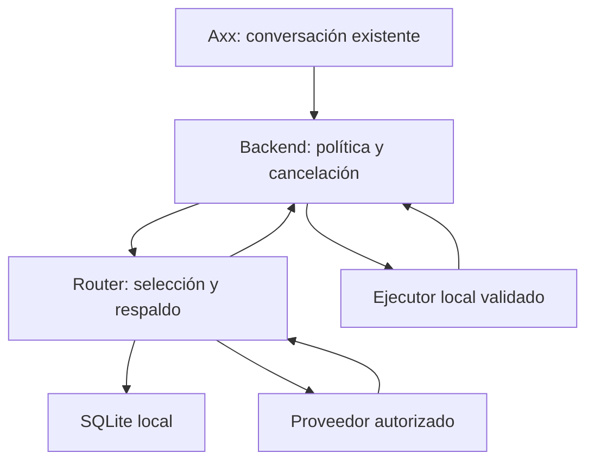

# 02 — Especificación de integración

## Objetivo y restricciones

Integrar la inferencia remota en el Axx ya existente para continuar una solicitud en otro proveedor cuando el principal sea inelegible o falle de forma recuperable. Objetivo de equipo: Windows 11, Acer Spin 3, i7 11.ª generación, 16 GB, GPU integrada. Es una arquitectura viable en principio, no un benchmark del equipo. No cargar modelos grandes localmente para este incremento.

Python 3.11+ para el router actual; conservar el stack y gestor de paquetes de Axx. No introducir un servicio en red para una llamada local. No depender de Node ni del MCP del catálogo si no se usa descubrimiento.

## Arquitectura elegida

Axx UI → servicio de inferencia del backend actual → adaptador de ciclo de vida → router privado → APIs autorizadas. El backend posee credenciales y estado; la UI recibe solo contenido permitido, metadatos sanitizados y eventos de estado.

La flecha al ejecutor solo se utiliza cuando Axx ya disponga de herramientas registradas. El router devuelve propuestas; no ejecuta órdenes. Las capacidades reales de ese ejecutor deben inventariarse, no suponerse.

## Rutas de integración

- Backend Python existente: importar Router dentro del worker de inferencia. Crear/cerrar la conexión SQLite en ese mismo hilo. No llamar chat() en el hilo de UI o event loop.
- Host Rust/Tauri o Node sin backend Python reutilizable: sidecar por solicitud mediante API nativa de procesos, `shell=false`. Enviar JSON por stdin, leer stdout JSON y stderr con límites. Resolver rutas absolutas del recurso empaquetado. No lanzar comandos desde el frontend ni añadir permisos amplios de shell.
- Si Axx ya tiene un servicio de inferencia separado: implementar el adaptador allí y reutilizar su IPC/autenticación. No duplicar procesos o API por conveniencia.

La elección se registra en PROJECT_MAP con ruta y símbolo reales. Las rutas nuevas propuestas en el plan se ajustan al estilo del proyecto; no deben presentarse como rutas descubiertas.

## Política de selección y reintentos

Prioridad estática por orden; filtros por tarea, capacidad, credenciales, autorización de datos, cuota local y pausa. Un intento máximo por entrada y hasta 3 intentos totales por solicitud. Un mínimo de dos proveedores de cuentas distintas para demostrar respaldo. Respetar Retry-After normalizado; nunca esperar en bucle dentro de la solicitud interactiva.

400/422: error de solicitud, detener. 401/402: inhabilitar temporalmente esa conexión y considerar siguiente autorizado; no comprar créditos. 403 desconocido: detener con clasificación explícita hasta comprobar el significado oficial para ese proveedor; no usar fallback para eludir una negativa de contenido. 404/408/5xx, respuesta inválida o red: considerar respaldo, salvo que se hayan producido efectos remotos no idempotentes. Cancelación: detener todo. Cambios de política respecto al baseline requieren nuevas pruebas.

Deadline de integración: 70 segundos de pared por solicitud, incluyendo arranque de sidecar y todos los intentos; contador monotónico. Timeout por operación del baseline: 20 segundos. Estos valores son decisiones de diseño, no latencias medidas. Al llegar al deadline, cancelar worker/proceso y descartar respuestas tardías; no sumar reintentos ocultos en otra capa.

## Privacidad y coste

Ningún proveedor se activa solo por aparecer en el catálogo. Runtime permite únicamente destinos y modelos aprobados en configuración local. Cuentas configuradas para evitar pagos; sin recarga automática. `free_confirmed` es evidencia humana/local, no garantía de precio. Revocar la conexión si cambian condiciones.

El backend clasifica la solicitud. Datos que no puedan salir del equipo: bloquear en incremento 1, porque no hay inferencia local autorizada. Datos sensibles autorizados a ciertos destinos: enviar axx_sensitive=true y restringir allow_sensitive. La UI no controla una política menos estricta que el backend.

## Preservación visual y funcional

Conservar Obsidian 3D sin rostro, herramientas radiales, paneles anclados al cuerpo, barra única, tamaño/posición/forma persistentes y acciones existentes. Proveedor/modelo en menú discreto. Esc cancela la solicitud y cualquier acción en curso por su mecanismo existente; no reinicia la app. Alt+Mayús+A y doble invocación conservan su significado.

Estado mostrado: 'Pensando', 'Cambiando de proveedor', 'Sin proveedor disponible', 'Cancelado' y 'Error de solicitud'. 'Cambiando' solo tras un evento real del backend; si el baseline aún no expone progreso, mostrar estado final con attempts>1, no animar un failover inventado. No emitir sonidos o rediseñar el cuerpo como parte de esta tarea.

## Persistencia, concurrencia y éxito

Config y SQLite en directorio de datos local de usuario fuera de Program Files, resuelto mediante mecanismo del framework. Respaldar antes de migrar. Una conexión SQLite por hilo/worker; transacciones cortas. Máximo 1 inferencia en vuelo por conversación y 2 globales al inicio; la siguiente entrada interactiva se rechaza con BUSY, no se agrega silenciosamente a una cola.

Éxito del incremento 1: criterios G0–G6 del documento 07 cumplidos. La integración debe poder desactivarse sin perder el historial ni los contadores; ninguna regresión de módulos existentes. Memoria, cola y cuotas remotas son incrementos 2 con feature flags separadas.
