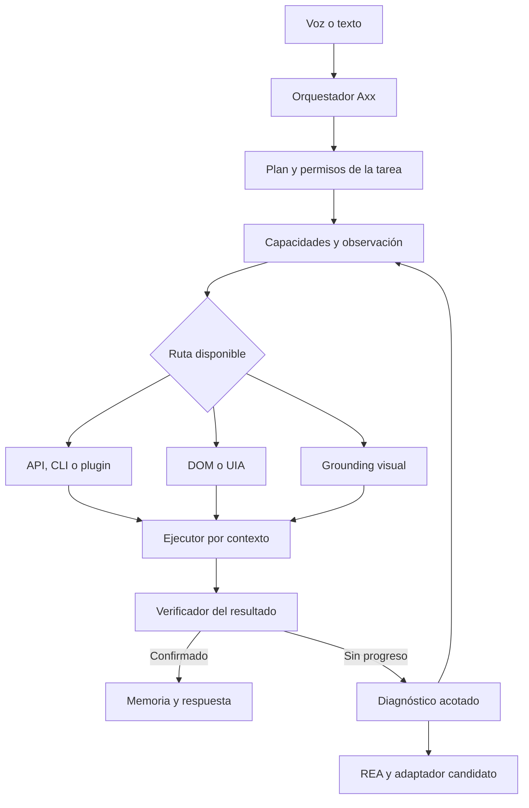

# Axx — Arquitectura unificada de control de escritorio

## Especificación técnica revisada

**Fecha de revisión:** 25 de octubre de 2026, America/Santo_Domingo.
**Versión del documento:** 2.0.
**Estado:** diseño propuesto, sustentado en documentación y código públicos. No acredita instalación, integración, compilación ni pruebas en el equipo del usuario.

## 0. Dictamen y alcance

**Seguimiento de implementación local:** [docs/UNIFIED-EXECUTION.md](docs/UNIFIED-EXECUTION.md)
describe el circuito integrado, los comandos ejecutables, las pruebas y las fases
pendientes. Este documento sigue siendo el diseño completo: su implementación
parcial no convierte los gates ni componentes externos en resultados aprobados.

La integración es técnicamente razonable si Axx conserva la coordinación de tareas y conecta los proyectos como componentes con responsabilidades delimitadas. El resultado buscado es un asistente que identifica objetivos, ejecuta operaciones compatibles con el entorno y verifica sus efectos.

El texto original necesita sustituir cuatro garantías por condiciones verificables: precisión absoluta, interacción universal en segundo plano, conversión automática de software cerrado en una API y navegación indetectable. También necesita distinguir un skill escrito de una capacidad ejecutable.

**Decisión de diseño propuesta:** mantener Axx como interfaz y orquestador; utilizar Cua Driver como adaptador de escritorio; incorporar grounding visual cuando las interfaces semánticas no basten; reservar REA para diagnóstico y desarrollo de adaptadores; añadir un entorno aislado para tareas que requieran escritorio propio o análisis de archivos.

Esta revisión no inspeccionó el repositorio privado/local de Axx ni su PC. La afirmación del texto original de que existen cinco archivos en `.agents/skills/` permanece sin verificar. Los nombres, rutas, contratos y metas de este documento son propuestas salvo indicación expresa de HECHO.

**Suposición de dimensionamiento:** si el equipo objetivo sigue siendo el Acer Spin 3 con Windows 11, i7 de 11.ª generación y 16 GB de RAM indicado anteriormente, usarlo como referencia inicial. No se ha medido su memoria disponible, virtualización, rendimiento ni compatibilidad con estos proyectos.

### Objetivos

1. Ejecutar comandos expresados en lenguaje natural conservando una representación estructurada de intención, argumentos y alcance.
2. Seleccionar la interfaz adecuada por aplicación y operación: API, CLI, plugin, DOM, accesibilidad o visión.
3. Mantener el trabajo del usuario sin interferencias cuando se solicita ejecución en segundo plano.
4. Recuperarse de cambios de pantalla, respuestas lentas, procesos reiniciados y proveedores de modelos no disponibles.
5. Verificar el resultado solicitado con evidencia de la aplicación, archivo o servicio afectado.
6. Conservar procedimientos reutilizables y experiencias verificadas al cambiar de modelo.

## 1. Correcciones fundamentales del texto original

| Afirmación original | Corrección necesaria |
|---|---|
| SoM elimina los errores de clic | SoM identifica regiones previamente detectadas. Persisten errores de selección, detección, geometría, estado y ejecución. [R03] |
| Agent S equivale a UIA + YOLO/PaddleOCR + tags | Esa combinación sería una integración de Axx. El código S3 consultado genera coordenadas a partir de captura y descripción; usa otro circuito para OCR. [R01–R02] |
| Un cursor overlay permite controlar cualquier aplicación en segundo plano | El overlay representa la acción. La entrega depende de APIs semánticas y mecanismos de entrada compatibles con el destino. [R04–R06] |
| Tres clics fallidos implican ingeniería inversa | Primero hay que comprobar si hubo efecto y clasificar la causa. Repetir un clic puede duplicar una operación. |
| Un HWND puede entregarse a Ghidra como binario | El HWND identifica una ventana. Hay que resolver el proceso, su instalación y los artefactos que interesa analizar. |
| Extraer ASAR permite invocar IPC | Revelar un canal no proporciona automáticamente acceso al contexto, sesión ni contrato de la aplicación. [R11–R12] |
| La VM y Firefox modificado son inmunes a Cloudflare | Son componentes reales; la inmunidad no está demostrada. El aislamiento de la VM y la aceptación por un sitio son propiedades diferentes. [R13–R16] |
| Gemini 2.5 Flash y Claude 3.7 son la combinación fija recomendada | La selección debe depender del endpoint, disponibilidad y pruebas. Claude 3.7 figura retirado en la API de Anthropic; Gemini 2.5 conserva condiciones específicas de acceso. [R17–R18] |
| Tener SKILL.md demuestra una integración | El skill documenta uso. Hace falta además una herramienta funcional, contrato, versión fijada y evidencia de prueba. |

El repositorio de Agent S consultado distingue S3 y S4: S3 sigue siendo el agente de `gui-agents`; S4 es una línea separada de evolución de interfaces. Seleccionar una versión y documentar el adaptador evita mezclar arquitecturas. [R01]

## 2. Arquitectura recomendada

### Alternativas consideradas

| Enfoque | Ventaja | Coste o limitación |
|---|---|---|
| Integrar cuatro agentes completos que puedan actuar sobre el mismo escritorio | Aprovecha sus interfaces existentes | Duplica coordinación, memoria, reintentos y propiedad de la entrada |
| Mantener Axx y conectar adaptadores especializados | Conserva una sola política de ejecución y permite sustituir componentes | Requiere contratos internos y pruebas de integración |
| Ejecutar todas las tareas en una VM | Separa el escritorio automatizado del escritorio humano | Añade consumo, sincronización de archivos y dificultades con aplicaciones instaladas en el host |

Se recomienda el segundo enfoque, con VM disponible bajo demanda.



**Regla de coordinación:** un propietario de las acciones por contexto de ejecución. Se pueden paralelizar lecturas, investigación y análisis independientes. Dos agentes no deben modificar concurrentemente la misma ventana, documento o sesión sin un mecanismo explícito de exclusión.

El permiso de escritura incluye una generación monotónica que el broker comprueba antes de cada despacho. Un trabajador que perdió su lease no puede enviar nuevas acciones aunque conserve respuestas del modelo. La exclusión también cubre archivos y recursos remotos compartidos entre contextos, desde la observación necesaria hasta la verificación de la mutación. Las operaciones ya enviadas al perder el lease se reconcilian antes de transferir el control. El broker coordina las lecturas que renuevan tokens para que una observación concurrente no invalide silenciosamente un objetivo pendiente.

La VM es un contexto adicional donde instalar el ejecutor y las aplicaciones necesarias. REA es un trabajador de diagnóstico. Ninguno necesita sustituir la identidad, interfaz radial, herramientas ni memoria de Axx.

### Componentes internos propuestos

| Componente | Responsabilidad y salida |
|---|---|
| Orchestrator | Mantener tarea, pasos, presupuesto, progreso y cancelación |
| Capability Registry | Registrar operaciones disponibles por aplicación, versión, sesión y backend |
| Observation Broker | Obtener observaciones con identidad, geometría y tiempos coherentes |
| Grounding Adapter | Resolver una intención a un elemento o región de una observación concreta |
| Execution Broker | Validar contrato, autorización y contexto antes de despachar una operación |
| Result Verifier | Evaluar postcondiciones y conservar la evidencia |
| Model Router | Elegir un modelo compatible, disponible y adecuado al trabajo |
| Diagnostic Worker | Clasificar fallos y realizar análisis delimitado, incluido REA |
| Procedure Store | Guardar procedimientos versionados, requisitos y resultados de evaluación |
| Event Journal | Persistir transiciones y efectos para recuperar tareas tras fallos |

Estos nombres describen interfaces internas de Axx; no son nombres de APIs existentes de Cua, Agent S o REA.

## 3. Registro de capacidades y selección del método

La pregunta de Axx debe ser «¿cómo se puede realizar esta operación en esta aplicación?». Una clasificación global del equipo como compatible/incompatible resulta insuficiente.

Cada registro debe contener:

- Identidad de la aplicación y rango de versiones validado.
- Backend, versión o commit, esquema disponible y prueba de salud.
- Operaciones concretas: consultar, abrir, seleccionar, escribir, exportar, guardar o cerrar.
- Modos de entrega admitidos para cada operación.
- Necesidad de foco, visibilidad, sesión interactiva o autenticación.
- Evidencia utilizada para validar el efecto.
- Fallos conocidos, recuperación y fecha de la última evaluación.
- Estado `unknown`, `available`, `degraded` o `unavailable`, con motivo.

### Orden de preferencia propuesto

1. API, SDK, plugin o comando propio de la aplicación.
2. Adaptador de dominio ya verificado.
3. DOM para una aplicación web con conexión disponible.
4. Patrones de accesibilidad para controles nativos.
5. Grounding visual y entrada por coordenadas.
6. Diagnóstico especializado cuando las rutas anteriores no resuelvan el objetivo.

Este orden es una política inicial, no una obligación de intentar todos los pasos. El registro permite saltar rutas que ya se sabe que no aplican.

Ejemplo: una operación de exportación puede tener una CLI fiable aunque el programa muestre un canvas sin UIA. La ausencia de accesibilidad no obliga a descompilar el programa. Para CAD/BIM, conviene investigar primero las interfaces del producto y formato concretos.

## 4. Percepción, grounding y coordenadas

### 4.1 Observación coherente

HECHO: Cua documenta una operación que reúne árbol y captura de una ventana, así como selección por elementos y por píxeles. Esto permite empezar con su observación, evitando duplicar inmediatamente toda la infraestructura de captura. [R05]

PROPUESTA: cada observación de Axx debe guardar `observation_id`, contexto, sesión, proceso, ventana, fecha monotónica, generación de geometría, dimensiones y sistema de coordenadas. Una captura y una consulta UIA siguen pudiendo representar instantes distintos: registrar sus tiempos y volver a observar si existe una discrepancia relevante.

Para Desktop Duplication u otro capturador propio, añadir control de cambios de pantalla, rotación, recortes, pérdida de acceso y recuperación del capturador. No asumir que una imagen negra demuestra que la aplicación está vacía.

### 4.2 Construcción de candidatos

Usar primero nombres, roles, estados y patrones de UIA o DOM. Cuando falten, añadir regiones detectadas visualmente y texto reconocido. Conservar su procedencia y relación jerárquica.

HECHO: PaddleOCR es un sistema de reconocimiento de texto; sus resultados no equivalen a una lista validada de botones. Microsoft publica componentes de detección de regiones interactivas dentro de OmniParser. El nombre «YOLOv8-UI» por sí solo no fija un modelo reproducible. [R19–R20]

Para cualquier modelo de percepción, fijar repositorio, revisión, archivo de pesos, hash, licencia del artefacto, preprocesamiento y configuración. Evaluar su rendimiento en las capturas reales de Axx antes de activarlo.

No eliminar automáticamente un control hijo porque su caja se solape con la del padre. Tampoco convertir todas las cajas de OCR en destinos clicables.

### 4.3 Etiquetas y salida del modelo

Una etiqueta debe identificar un candidato dentro de una observación concreta. Su representación conceptual es:

`context_id + observation_id + candidate_id`

El modelo devuelve una selección estructurada o una abstención:

- `selected`: existe un candidato que satisface la intención.
- `not_found`: no aparece el objetivo.
- `ambiguous`: varios candidatos siguen siendo plausibles.

Forzar siempre un número oculta incertidumbre. Las marcas deben ser legibles y no cubrir el texto o icono necesario para seleccionar.

HECHO: SoM propone marcar regiones de imagen; no aporta por sí solo la detección perfecta ni la ejecución del gesto. El S3 inspeccionado genera puntos y los adapta a su resolución de acción; la capa de tags aquí propuesta requiere integración propia. [R02–R03]

### 4.4 Geometría

PROPUESTA: usar píxeles físicos del escritorio virtual como referencia canónica para el host y una transformación explícita para cada imagen. Mantener la conversión a coordenadas locales cuando el driver espera píxeles de una captura de ventana.

HECHO: UIA utiliza coordenadas físicas para su geometría. Aplicar un factor global de 1,5 cuando la captura y el rectángulo ya son físicos introduce doble escalado. [R08]

La transformación debe representar, según corresponda:

- Origen del monitor, incluidos valores negativos.
- Origen y borde de la ventana o área cliente.
- Recorte utilizado para inferencia.
- Escala de redimensionado y padding.
- Rotación y resolución de la imagen.
- Convención de salida del modelo: píxeles o coordenadas normalizadas.

Si un backend no soporta el monitor o una combinación de geometría, declararlo. Un overlay que se dibuja en varios monitores no demuestra que todas las operaciones del backend puedan dirigirse a cualquiera de ellos.

### 4.5 Validación antes y después de actuar

Antes de despachar: comprobar identidad del proceso, ventana, candidato, estado habilitado, vigencia de observación y condiciones específicas de entrega. Para un clic físico, comprobar además el punto y el destino actual.

Un TTL es una defensa adicional, no una garantía de vigencia. Invalidar o revalidar después de scroll, redimensionado, movimiento de ventana, modal, navegación, cambio de DPI o reinicio del proceso.

Después de despachar: obtener evidencia nueva y evaluar el resultado esperado. Evitar el criterio genérico «cambió la captura»: una animación, un tooltip o un reloj pueden producir cambios irrelevantes.

La comprobación previa y el despacho no son atómicos frente al usuario o la aplicación salvo que el backend lo garantice. Comprobar generación, identidad y cancelación en el último punto disponible de despacho. Si una operación de consecuencias relevantes no puede identificar el destino con estabilidad suficiente, abstenerse o utilizar otra ruta. Las pruebas de invalidación evalúan cambios inyectados y detectables; no demuestran la inexistencia de todas las carreras posibles.

## 5. Control de Windows sin interferir con el usuario

HECHO: Cua Driver documenta Windows y rutas de segundo plano, con límites por aplicación y gesto. El cursor sintético es una representación visual; la acción real puede usar accesibilidad, mensajes de ventana o entrada del sistema. [R04, R06]

Al fijar dependencias, utilizar los paquetes vigentes. El README actual marca `cuabot` como obsoleto y advierte de problemas conocidos; las demostraciones o instrucciones de ese paquete no deben trasladarse automáticamente al Cua Driver actual. [R07]

### Modos de ejecución propuestos

| Modo interno | Contrato |
|---|---|
| `background` | La operación no debe activar otra ventana, mover el puntero físico ni insertar entrada en la aplicación del usuario |
| `isolated` | La operación ocurre dentro de un escritorio independiente, con sus propios archivos y aplicaciones |
| `foreground` | Uso explícito del escritorio activo dentro del alcance ya autorizado, con arbitraje y cancelación |

En modo `background`, una falta de soporte devuelve una incapacidad estructurada. El planificador puede elegir una API o un contexto aislado. No cambiar silenciosamente a primer plano para aparentar éxito.

Cada contexto `isolated` declara su mecanismo, identidad, recursos compartidos, accesos a archivos/red y límites efectivamente impuestos. Separar escritorio, archivos y autoridad son propiedades diferentes. Una restricción requerida que no esté disponible o verificada se declara como no garantizada; no ejecutar en ese contexto una tarea que dependa de ella.

La documentación actual de Cua distingue entrega y efecto, y ofrece rechazos como `background_unavailable`. Al adaptar su respuesta, conservar la diferencia entre evento entregado, efecto observado y tarea completada. [R05]

HECHO: `SendInput` inserta eventos en el flujo de teclado/ratón y está sujeto a UIPI. El retorno exitoso no demuestra que el usuario haya obtenido el resultado solicitado. [R09]

### Arbitraje

- Serializar cambios de estado por contexto.
- Mantener un lease de ejecución con propietario y vencimiento.
- Revalidar el destino justo antes de actuar.
- Detener pasos futuros cuando se cancela la tarea.
- En operaciones de primer plano, detectar actividad humana y ceder el control de forma acotada.
- Evitar usar el portapapeles global como mecanismo silencioso de transporte. Cuando sea necesario, tratarlo como un recurso compartido explícito.
- No asumir que restaurar el foco después de un gesto elimina una interferencia que ya ocurrió.

### Servicio y sesión

HECHO: Microsoft no recomienda que un servicio interactúe directamente con la GUI del usuario; documenta un proceso separado en la sesión interactiva y comunicación IPC. [R10]

PROPUESTA: mantener el supervisor opcional como servicio y el controlador de escritorio en la sesión del usuario. El canal local debe autenticar identidad y sesión, aplicar ACL y no aceptar llamadas de otras cuentas por el mero conocimiento de un nombre de pipe.

Empezar con el proceso de usuario de Axx si basta. Convertirlo en servicio es una fase operativa posterior, no un requisito para demostrar el primer flujo útil.

## 6. Ejecución de shell y conciencia ambiental

La telemetría debe responder preguntas concretas: qué aplicación está abierta, qué ventana se seleccionó, cuánto recurso queda y dónde están los proyectos autorizados para la tarea.

PROPUESTA:

1. Obtener procesos, ventanas, volúmenes y memoria mediante interfaces estructuradas.
2. Acotar el descubrimiento de proyectos a ubicaciones conocidas o configuradas.
3. Refrescar datos según necesidad y eventos; no recorrer discos completos continuamente.
4. Separar hechos observados de rutas o capacidades inferidas.
5. Mantener tiempos de observación para no tratar una telemetría vieja como estado actual.

### Contrato del ejecutor

- Ejecutable resuelto, argumentos tipados y directorio de trabajo explícito.
- Variables de entorno estrictamente necesarias.
- Plazo máximo, cancelación y límite de salida.
- `stdout`, `stderr`, código de salida, señal de truncamiento y tiempos.
- Control de descendientes, mediante un Job Object u otro mecanismo compatible con el backend.
- Archivos producidos e identificación de la comprobación aplicada.

Preferir operaciones registradas o scripts con parámetros frente a concatenar texto del modelo en una orden de shell. Usar PowerShell 7 solo cuando esté instalado y sea una dependencia declarada; no asumir su presencia.

Al consultar un PID, distinguir proceso inexistente, acceso denegado y ruta disponible. Revalidar identidad para evitar que un PID reutilizado corresponda a otra aplicación.

Un código de salida cero es un resultado de proceso. La tarea «exporta el archivo» requiere además comprobar archivo, formato, ubicación y contenido relevante.

## 7. REA como diagnóstico y desarrollo de adaptadores

HECHO: el proyecto identificado es `morluto/rea`, paquete `rea-agents`. Su documentación describe análisis de JavaScript/Electron, .NET y binarios con proveedores como Ghidra, Hopper o IDA, con evidencia y limitaciones. [R11]

### Activación correcta

El tercer fallo puede abrir un diagnóstico, pero no constituye una instrucción suficiente para ejecutar un análisis completo de binarios. Antes hay que determinar:

- Si la operación ya ocurrió y solo faltó confirmación.
- Si cambió el objetivo, apareció un modal o se invalidó la observación.
- Si la ruta no soporta el gesto o el nivel de integridad.
- Si hay error de aplicación, autenticación o red.
- Si existe una interfaz más directa para el objetivo.

No repetir automáticamente una operación con efectos no idempotentes.

### Flujo propuesto

1. Resolver ventana, proceso e instalación.
2. Clasificar runtime y componentes pertinentes.
3. Copiar los artefactos necesarios y registrar versión y hash.
4. Formular una pregunta limitada: por ejemplo, «¿qué integración de exportación utiliza esta aplicación?».
5. Analizar estáticamente dentro de un presupuesto de tiempo, memoria y resultados.
6. Emitir hechos, inferencias, desconocidos y evidencias.
7. Elaborar un adaptador candidato, cuando exista una vía de integración.
8. Probarlo con una aplicación y datos de ensayo.
9. Incorporarlo al registro solo para las versiones y operaciones verificadas.

### Electron y ASAR

La inspección puede identificar módulos, preloads, referencias y canales. No debe ejecutar el código de la aplicación por el simple hecho de extraerlo.

INFERENCIA: un canal encontrado no es automáticamente una API externa. La comunicación normal de Electron depende de sus procesos, contexto y contratos; hace falta comprobar una vía válida de integración. [R12]

### Binarios nativos y .NET

La representación decompilada debe tratarse como evidencia de análisis, no como recuperación exacta del código fuente. `HWND` no es una dirección de función ni un archivo de entrada.

HECHO: Ghidra Headless importa archivos y trabaja con proyectos y scripts de análisis. La documentación de REA consultada describe su soporte de Ghidra en Windows como experimental y acotado, con diferencias entre la rama principal y paquetes publicados. Validar la combinación exacta de paquete, Ghidra, JDK, formato y arquitectura antes de asignarle tareas. [R23–R24]

Seleccionar proveedor y formatos compatibles antes del trabajo. Las capacidades de un servidor MCP no deben inferirse de su nombre: descubrir sus herramientas y esquemas en la versión fijada.

El informe de REA no habilita automáticamente nuevas herramientas con escritura. La creación de un adaptador constituye un cambio de software que necesita pruebas y un mecanismo de reversión.

## 8. Entornos aislados e Invisible Dots

HECHO: `feder-cr/invisible_dots` documenta un equipo virtual Linux persistente mediante QEMU y aceleración KVM o Windows Hypervisor Platform. Su stack enlaza `invisible_playwright_mcp` y Firefox modificado. [R13–R14]

Eso no implica que una aplicación Windows instalada en el host exista en el invitado Linux. Las aplicaciones Win32 que deban operar aisladas requieren un entorno compatible, sus dependencias y el acceso a los archivos necesarios.

### Separar dos perfiles

| Perfil | Uso | Persistencia y acceso |
|---|---|---|
| Navegación y trabajo | Tareas con sesiones y archivos de trabajo | Identidad persistente, conectividad limitada al trabajo y exportación explícita |
| Análisis de archivos | Inspección de paquetes y ejecutables | Copia desechable, sin credenciales de producción y red desactivada salvo necesidad concreta |

PROPUESTA: conservar una base conocida e inmutable, un disco de trabajo por contexto y un canal de intercambio de artefactos. No montar todo el perfil del usuario como carpeta compartida.

Aplicar límites efectivos desde el host a CPU, memoria, disco y tiempo. La RAM configurada del invitado no constituye por sí sola un límite de consumo total del proceso QEMU.

HECHO: QEMU distingue virtualización de emulación TCG y no permite tratar TCG como una garantía equivalente de aislamiento. Verificar acelerador, máquina y configuración; no cambiar silenciosamente de backend al fallar el preflight. [R15]

### Navegador y challenges

Mantener el navegador como componente sustituible. La existencia de parches en C++ no demuestra que todo sistema antibot acepte las peticiones. Cloudflare documenta comprobaciones de navegador, reputación y reglas del sitio, entre otras causas de challenge. [R16]

PROPUESTA: reconocer `challenge_required`, conservar el paso y permitir intervención del usuario o una integración disponible. Después, observar de nuevo antes de continuar. El objetivo de aceptación es recuperación correcta de la tarea, no invisibilidad universal.

### Rollback

Revertir el disco restaura estado local. No deshace cambios en un servicio externo, mensajes ya enviados ni archivos modificados fuera del entorno. Registrar esos efectos en el diario y ofrecer compensación solo cuando la operación lo permita.

## 9. Router de modelos

### Hallazgos de actualización

HECHO: Anthropic registra `claude-3-7-sonnet-20250219` como retirado el 19 de febrero de 2026 en su API. La documentación consultada distingue calendarios de plataformas gestionadas por terceros. [R17]

HECHO: la documentación de Gemini Developer API consultada mantiene Gemini 2.5 Flash sin fecha anunciada de cierre, pero limita la familia 2.5 a usuarios/proyectos con uso previo e indica modelos más recientes para proyectos nuevos. No confundir esa situación con el calendario de Vertex/otros endpoints. [R18]

### Matriz propuesta

| Trabajo | Ruta inicial |
|---|---|
| Leer telemetría, validar JSON o código de salida | Lógica determinista |
| Ejecutar una receta ya validada con parámetros claros | Ejecutor y verificador; modelo solo si hay ambigüedad |
| Entender una orden nueva | Modelo de texto con esquema estructurado |
| Resolver un objetivo visual | Modelo o especialista visual evaluado para esa función |
| Planificar una tarea compleja | Modelo con capacidad de planificación, herramientas y contexto |
| Analizar resultados de REA y crear adaptadores | Modelo orientado a código y razonamiento |
| Confirmar un resultado consultable por API/archivo | Comprobación determinista |
| Confirmar un estado solamente visual | Verificación visual con evidencia nueva |

### Registro de modelos

Guardar proveedor, endpoint, identificador exacto, modalidad, herramientas, esquema, límites de contexto, credencial disponible, estado de salud y compatibilidad. Añadir latencias p50/p95 medidas en Axx, coste observado por tarea verificada y fecha de la última prueba.

Primero filtrar incompatibles. Después puntuar los candidatos por éxito observado, latencia y coste dentro del presupuesto. No convertir una autovaloración del LLM en una probabilidad calibrada.

### Failover

- Errores transitorios y límites de tasa: respetar los tiempos comunicados, aplicar espera acotada y cambiar de proveedor compatible cuando corresponda.
- Credenciales inválidas: marcar el proveedor como no utilizable y evitar reintentos infinitos.
- Modelo retirado o identificador inválido: actualizar su estado y utilizar una alternativa previamente validada.
- Resultado mal formado: validar el contrato; un modelo de respaldo no autoriza a ejecutar una respuesta inválida.
- Caída después de una acción: consultar el diario y verificar el efecto antes de repetir.

La memoria de la tarea pertenece a Axx. Un cambio de proveedor recibe objetivo, estado confirmado, pasos pendientes y evidencias necesarias, sin depender de la conversación privada del modelo anterior.

## 10. Contratos internos propuestos

Los siguientes nombres son contratos de diseño de Axx, no llamadas listas para copiar a un SDK externo.

### Observation

Campos obligatorios: versión de esquema, identificador, contexto, sesión, identidad de ventana/proceso, tiempos, captura o motivo de ausencia, geometría, candidatos y capacidades del destino.

Cada candidato incluye origen, función, estado, identidad de elemento cuando exista, región, punto de interacción cuando se haya validado y generación de observación.

### ActionRequest

Ejemplo sintético válido en JSON:

```json
{
  "schema_version": "1.0",
  "task_id": "task-demo-001",
  "action_id": "action-demo-004",
  "context_id": "host-session-demo",
  "observation_id": "observation-demo-021",
  "target": {
    "application_id": "fixture-editor",
    "window_ref": "window-demo-03",
    "candidate_id": "candidate-17"
  },
  "operation": "invoke",
  "delivery_mode": "background",
  "preconditions": [
    "same_process_instance",
    "observation_current",
    "target_enabled",
    "background_supported"
  ],
  "postcondition": {
    "kind": "application_state",
    "key": "export_dialog_visible",
    "expected": true
  },
  "deadline_ms": 5000,
  "retry_class": "reconcile_before_retry",
  "authorization_ref": "task-scope-demo"
}
```

La implementación debe definir cada enum y resolver cada referencia. Una cadena como `target_enabled` no es una comprobación ejecutable hasta que exista un verificador implementado.

### ActionResult

Separar:

- **Despacho:** no intentado, entregado, rechazado, parcial o desconocido.
- **Efecto:** confirmado, no observado o desconocido.
- **Tarea:** en progreso, completada, fallida, cancelada o esperando intervención.

Añadir método utilizado, observaciones antes/después, evidencia de postcondición, tiempos, error tipado, efectos conocidos y recomendación de recuperación.

### Evidence

Cada evidencia debe identificar tarea, acción, origen, tiempo y objeto observado. Para un archivo, registrar ruta, hash y comprobación de contenido cuando aplique. Para una interfaz, registrar el valor o estado observado y la captura recortada si se necesita.

Registrar solo lo necesario para verificar la acción. No incluir secretos o el escritorio completo por defecto.

## 11. Persistencia, recuperación y aprendizaje

PROPUESTA: mantener un diario durable que distinga `planned`, `dispatch_started`, `delivered`, `verified`, `failed`, `cancelled` y `unknown`. Si hay caída entre despacho y registro de resultado, recuperar como efecto desconocido.

Antes de despachar una mutación, persistir su intención, identidad, parámetros y estado `dispatch_started`; si esa escritura falla, no despachar. Separar la acción lógica de sus intentos y reutilizar una clave de idempotencia cuando el destino la admita. Si no puede determinarse si una operación no idempotente ocurrió, mantener el efecto como desconocido y detener su repetición automática. Cancelar impide nuevos despachos; no revierte ni elimina los efectos ya enviados.

No prometer exactamente una ejecución de toda acción GUI. Cuando no exista idempotencia nativa, la recuperación debe reconciliar el estado antes de decidir si reintenta.

### Biblioteca de procedimientos

Un procedimiento reutilizable debe incluir:

- Intenciones y variaciones lingüísticas.
- Parámetros tipados y valores que no se deben inferir.
- Aplicaciones, versiones y capacidades requeridas.
- Selectores semánticos o estrategias de grounding.
- Precondiciones y postcondiciones por paso.
- Clases de reintento y compensaciones posibles.
- Casos exitosos, fallos y límites conocidos.
- Fecha y conjunto de pruebas con el que fue validado.

Guardar coordenadas absolutas de una sesión no convierte un flujo en una habilidad robusta.

### Mejora continua propuesta

Una ejecución verificada puede producir una receta candidata. La candidata se evalúa en una aplicación de prueba o en un flujo repetible; solo después se promueve a receta utilizable. Cambios de versión, fallos repetidos o regresiones la degradan.

Esto permite mejorar procedimientos y selección de herramientas sin afirmar que se han entrenado o modificado los pesos del modelo. La evolución de interfaces inspirada en Agent S4 puede estudiarse después de tener evaluaciones fiables.

## 12. Skills: responsabilidades y estado

**Estado de esta entrega:** especificaciones propuestas. No se crearon estos archivos en el repositorio de Axx.

| Skill propuesto | Responsabilidad exclusiva |
|---|---|
| `axx-orchestrator` | Dividir tareas y mantener estado, presupuesto y cancelación |
| `capability-registry` | Descubrir y consultar capacidades reales por operación |
| `agent-s-vision-grounding` | Adaptar percepción y grounding; resolver candidatos sin ejecutar |
| `cua-os-driver` | Ejecutar operaciones compatibles y devolver resultados sin declarar éxito de tarea |
| `action-verifier` | Comprobar postcondiciones con evidencia nueva |
| `rea-reverse-engine` | Diagnóstico acotado e informes; producir adaptadores candidatos |
| `vm-sandbox` | Crear, limitar, verificar y recuperar contextos aislados |
| `model-router-matrix` | Seleccionar y supervisar proveedores/modelos compatibles |
| `procedure-memory` | Versionar recetas y gestionar su evaluación y promoción |
| `remote-control` | Canal remoto autenticado y vinculado al alcance de las tareas |

El nombre `vm-sandbox` describe una propiedad que se puede evaluar; «stealth» no debe utilizarse como garantía de aceptación por terceros.

Cada SKILL.md futuro debe especificar disparadores, entradas, herramientas reales, dependencias, límites, salidas, errores, ejemplos, pruebas y criterios de terminación. La documentación debe concordar con la versión del código ejecutable.

## 13. Hoja de ruta con entregables verificables

| Fase | Trabajo | Evidencia para cerrar |
|---|---|---|
| 0. Línea base | Inventario de Axx, versiones, dependencias, sesión Windows, capacidades y aplicaciones objetivo | Informe de estado, reproducción del flujo actual, build de referencia |
| 1. Control semántico | Cua, captura/árbol, selección de ventana, lectura e invocación verificadas | Flujo real en dos aplicaciones; resultado y no interferencia demostrados |
| 2. Grounding visual | Contrato geométrico, candidatos, etiquetas, abstención e invalidación | Pruebas de DPI, cambios de pantalla y controles visuales |
| 3. Ejecutor y recuperación | Shell estructurado, diario, cancelación, presupuestos y reconciliación | Fallos inyectados sin duplicar efectos conocidos |
| 4. Contexto aislado | VM bajo demanda, intercambio de archivos, recursos y perfil de red | Operación aislada mientras el host permanece utilizable |
| 5. REA y adaptador | Analizar una aplicación de ensayo y desarrollar una operación concreta | Informe con evidencia, adaptador probado y versión delimitada |
| 6. Router y procedimientos | Failover compatible, métricas por tarea y recetas evaluadas | Cambio de proveedor con continuidad de estado |
| 7. Operación remota | Telegram, supervisor y controles de sesión | Autenticación, cancelación, deduplicación y estado remoto comprobados |

Conviene desplegar router básico desde la primera fase que invoque un modelo; la fase 6 añade evaluación sistemática, selección dinámica y procedimientos.

Para cada fase: cambio acotado, compilación e instalación en un entorno de prueba cuando proceda, prueba funcional y evidencia visual o estructurada. No posponer toda la verificación hasta integrar los cuatro proyectos.

## 14. Matriz de aceptación

Los umbrales de esta tabla son **metas propuestas**, no resultados obtenidos. Ajustarlos con la línea base y la criticidad de cada operación.

| Gate | Ensayo | Criterio |
|---|---|---|
| G1 Geometría | Fixture con al menos 200 puntos/casos conocidos; DPI 100/125/150/175/200 %, recortes y orígenes negativos | Error euclídeo máximo de 2 píxeles físicos en todos los casos del conjunto; sin VLM |
| G2 Grounding | Al menos 300 instrucciones anotadas, con un mínimo de 50 casos negativos de objetivo ausente | Precisión inicial objetivo ≥99 % entre selecciones emitidas y cobertura ≥95 % sobre casos resolubles; publicar numeradores/denominadores y abstenciones; cero selecciones emitidas en los negativos del conjunto |
| G3 Vigencia | Introducir scroll, modal, movimiento o cambio de DPI entre observar y actuar | Ninguna acción contra una observación invalidada en el conjunto |
| G4 No interferencia | 30 minutos de escritura y uso del ratón con 1.000 operaciones background del host; evaluar el modo aislado por separado | Cero eventos de Axx recibidos por el editor humano, cero cambios de foco/puntero atribuibles a Axx y ninguna alteración no solicitada del portapapeles; desglosar por backend, aplicación y gesto |
| G5 Resultado | El driver devuelve sin error, pero la aplicación ignora la operación | El verificador no declara éxito |
| G6 Shell | Proceso conocido, PID inexistente, acceso denegado, salida grande y timeout | Resultados diferenciados, salida acotada, cancelación y comprobación del efecto |
| G7 Cancelación | Cancelar con acción pendiente, modelo lento y subproceso activo | No se despachan pasos nuevos; terminar o señalar el trabajo no interrumpible dentro del contrato |
| G8 Recuperación | Reiniciar Axx después del despacho y antes de guardar el resultado | Estado desconocido y reconciliación; sin repetición ciega |
| G9 Modelos | Forzar 429, 5xx, timeout, autenticación inválida y modelo no disponible | Fallback compatible y acotado, sin duplicar acciones |
| G10 REA | Electron de prueba con canales conocidos y artefactos versionados | Evidencia correcta de los canales, límites explícitos y adaptador validado por separado |
| G11 VM | Reinicio, restauración y fallo de acelerador | Base recuperable, recursos controlados y ausencia de degradación silenciosa del aislamiento |
| G12 Recursos compartidos | Ensayos positivos y negativos sobre rutas, servicios y límites declarados por contexto | Acceso permitido donde corresponde y denegado fuera del alcance, con evidencia del control efectivo |
| G13 Challenge | Navegación que presenta un desafío | Estado de intervención, tarea conservada y observación nueva al reanudar |
| G14 Sistema remoto | Duplicación de comandos, mensaje retrasado y sesión expirada | Sin duplicar efectos; rechazo de autoridad inválida y estado coherente |

### Medición

Separar error geométrico, error de selección, efecto no observado, interferencia, éxito de tarea y latencia. Reportar p50/p95 y el conjunto exacto utilizado.

En G2, precisión es selecciones correctas / selecciones emitidas; una selección sobre objetivo ausente cuenta como incorrecta. Cobertura es casos resolubles con selección emitida / total de casos resolubles. Medir aparte exactitud total sobre casos resolubles, abstenciones y falsos positivos en negativos. Una prueba sin selecciones no supera el gate. En G4, un resultado del modo aislado no acredita el modo background del host. Instrumentar durante toda la operación para detectar robos breves de foco o saltos de puntero que desaparezcan antes de la captura final.

La prueba de 2 píxeles evalúa transformaciones. La prueba de grounding evalúa interpretación. La prueba de resultado evalúa la intención completa. Ninguna sustituye a las otras.

Un conjunto finito sin errores no demuestra infalibilidad. Conservar versiones, fixture, instrucciones, resultados y fallos para que otra ejecución pueda reproducir la evaluación.

## 15. Rendimiento y recursos

PROPUESTA para la referencia de 16 GB:

- Mantener orquestación, estado, adaptadores y comprobaciones ligeras en el host.
- Utilizar modelos remotos disponibles al inicio si los modelos visuales locales comprometen la respuesta del equipo.
- Activar OCR/detección solo cuando aporten información que UIA/DOM no ofrece.
- Arrancar una sola VM bajo demanda y medir consumo total, no solo la RAM asignada.
- Evitar ejecutar simultáneamente VM, análisis nativo pesado y un VLM grande local.
- Medir el host bajo trabajo real, especialmente si el usuario utiliza herramientas de arquitectura.

Como configuración inicial de laboratorio puede ensayarse una VM ligera de 2 vCPU y 3–4 GiB, si el preflight confirma margen suficiente. Es una hipótesis de arranque, no una garantía para todas las aplicaciones ni para un invitado Windows.

Definir latencias por etapa: aceptación de la orden, interpretación, observación, inferencia, ejecución y verificación. No prometer que toda tarea termina en dos segundos. Una respuesta rápida puede confirmar que la tarea comenzó mientras el trabajo sigue y conserva progreso verificable.

## 16. Telemetría, acceso y canal remoto

PROPUESTA: correlacionar `task_id`, `action_id`, `context_id`, modelo, backend, versión y evidencia. Mantener rotación y límites de almacenamiento.

La autorización debe pertenecer a la tarea y reutilizarse mientras conserve alcance y vigencia. Una confirmación remota debe estar vinculada a la acción concreta, su destino y un plazo; no aceptar un «sí» suelto como autorización de cualquier operación posterior.

Para Telegram, añadir identidad del remitente, vinculación con el equipo, deduplicación, estado de tarea y cancelación. Transmitir imágenes de la ventana objetivo solo cuando hagan falta para el trabajo o se soliciten, con tratamiento de datos sensibles.

El texto visto en una web, documento o ventana es contenido del trabajo. No modifica por sí mismo los permisos del usuario ni las instrucciones de Axx. Esta separación debe existir en el contrato del ejecutor.

## 17. Brief de implementación para Codex

Este brief delimita una primera entrega implementable; no afirma que se haya ejecutado.

> Integra una primera fase de control de escritorio verificable en Axx conservando su interfaz y arquitectura existente. Comienza inspeccionando el repositorio, sus instrucciones, tecnologías, build y módulos de herramientas. Documenta qué existe realmente y qué falta.
>
> Fija versiones de dependencias y descubre el esquema real del driver instalado. No inventes herramientas ni copies llamadas de otra versión o sistema operativo.
>
> Implementa un adaptador Cua detrás de contratos internos Observation, ActionRequest, ActionResult y Evidence. Usa captura/árbol del driver cuando sean suficientes. Añade registro de capacidades por operación y contexto.
>
> La primera demostración debe identificar una ventana, leer un control, ejecutar una operación semántica y comprobar su efecto. En background, una operación incompatible debe informar incapacidad; no debe activar el escritorio silenciosamente.
>
> Incorpora identidad de observación, invalidación, exclusión de escritores y cancelación. Una respuesta satisfactoria del transporte no equivale a tarea completada.
>
> Implementa la ruta de shell con argumentos estructurados, límites y resultados tipados si el proyecto todavía no la tiene. Valida archivo o estado final cuando el comando produzca un efecto.
>
> Crea los skills necesarios como documentación de herramientas que realmente existan. Cada uno debe indicar dependencias, entradas, salidas, errores y pruebas. No declares implementadas VM, REA o grounding visual si solo hay archivos Markdown.
>
> Prueba con aplicaciones instrumentadas y una prueba real de no interferencia. Entrega cambios acotados, comandos reproducibles, build/install cuando proceda, evidencia, resultados y limitaciones. Conserva como pendientes las fases que todavía no se han ejecutado.

## 18. Registro de verificación de esta entrega

| Elemento | Estado |
|---|---|
| Revisión del documento proporcionado | Realizada |
| Consulta de repositorios y documentación pública | Realizada |
| Identificación de límites y dependencias | Realizada |
| Arquitectura, contratos y gates propuestos | Documentados |
| Archivos de skills en el repositorio Axx | No inspeccionados ni creados |
| Instalación de Cua/REA/QEMU en el equipo | No realizada |
| Pruebas de Windows, DPI, latencia o no interferencia | No ejecutadas |
| Benchmark de modelos en Axx | No ejecutado |

La próxima evidencia útil es una acción real de escritorio cuyo resultado se compruebe mientras el usuario continúa trabajando. Esa demostración habilita el desarrollo incremental de las siguientes fases.

## 19. Fuentes primarias consultadas

Consulta documental: 25 de octubre de 2026. Las páginas sobre ramas principales y catálogos pueden cambiar; la implementación debe fijar sus propias revisiones y conservar evidencias.

- [R01 — Agent S, repositorio oficial y versiones](https://github.com/simular-ai/Agent-S)
- [R02 — Implementación de grounding de S3](https://github.com/simular-ai/Agent-S/blob/main/gui_agents/s3/agents/grounding.py)
- [R03 — Paper original Set-of-Mark](https://arxiv.org/abs/2310.11441)
- [R04 — Cua, soporte por plataforma](https://cua.ai/docs/cua-driver/concepts/platform-support)
- [R05 — Cua, arquitectura y verificación](https://cua.ai/docs/cua-driver/concepts/how-cua-driver-works)
- [R06 — Cua, mecanismos de Windows y cursores sintéticos](https://github.com/trycua/cua/blob/main/blog/inside-windows-computer-use.md)
- [R07 — Cua, repositorio y paquetes vigentes](https://github.com/trycua/cua)
- [R08 — Microsoft, UIA y escalado](https://learn.microsoft.com/en-us/windows/win32/winauto/uiauto-screenscaling)
- [R09 — Microsoft, SendInput](https://learn.microsoft.com/en-us/windows/win32/api/winuser/nf-winuser-sendinput)
- [R10 — Microsoft, servicios e interacción de usuario](https://learn.microsoft.com/en-us/windows/win32/services/interactive-services)
- [R11 — REA, repositorio oficial](https://github.com/morluto/rea)
- [R12 — Electron, comunicación entre procesos](https://www.electronjs.org/docs/latest/tutorial/ipc)
- [R13 — Invisible Dots](https://github.com/feder-cr/invisible_dots)
- [R14 — Invisible Playwright MCP](https://github.com/feder-cr/invisible_playwright_mcp)
- [R15 — QEMU, seguridad](https://www.qemu.org/docs/master/system/security.html)
- [R16 — Cloudflare, challenges y diagnóstico](https://developers.cloudflare.com/cloudflare-challenges/troubleshooting/)
- [R17 — Anthropic, ciclo de vida de modelos](https://platform.claude.com/docs/en/about-claude/model-deprecations)
- [R18 — Google, deprecaciones y condiciones de acceso](https://ai.google.dev/gemini-api/docs/deprecations)
- [R19 — Microsoft, componentes de OmniParser](https://huggingface.co/microsoft/OmniParser-v2.0)
- [R20 — PaddleOCR, pipeline OCR](https://www.paddleocr.ai/main/en/version3.x/pipeline_usage/OCR.html)
- [R21 — QEMU, aceleradores y arquitectura](https://www.qemu.org/docs/master/system/introduction.html)
- [R22 — Cua, referencia de entrada](https://cua.ai/docs/cua-driver/reference/mcp-tools/click-and-type)
- [R23 — Ghidra, Headless Analyzer oficial](https://github.com/NationalSecurityAgency/ghidra/blob/master/Ghidra/RuntimeScripts/support/analyzeHeadlessREADME.md)
- [R24 — REA, alcance de Ghidra en Windows](https://github.com/morluto/rea/blob/main/docs/windows-ghidra-p0.md)
