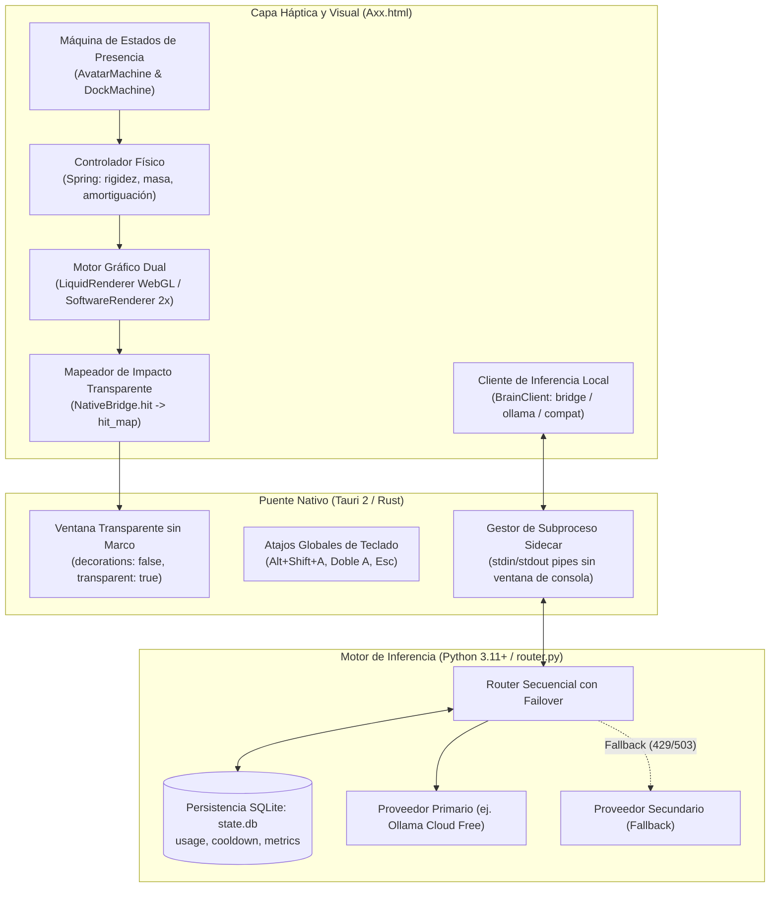

# Axx Desktop · Guía Maestra Técnica, Arquitectura y Protocolo de Ejecución

> **Propósito del documento:** Esta guía es la referencia técnica definitiva y exhaustiva de todo el repositorio de **Axx**. Detalla la arquitectura interna del frontend 3D, el motor de inferencia y failover, el empaquetado nativo en Windows 11, la forma de ejecución de cada componente y el protocolo de recuperación ante cualquier pérdida de rumbo.

---

## 1. Análisis Técnico Profundo de la Arquitectura

### 1.1 El Frontend y la Entidad 3D (`1.AXX/Axx.html`)

El archivo [`Axx.html`](file:///C:/Users/luigi/Desktop/Axx%20assistant/1.AXX/Axx.html) (17.076 líneas) es un sistema autocontenido de interacción háptica y visual. No es un chatbot HTML estándar; implementa un runtime completo compuesto por:



#### A. Motor de Renderizado Dual
1. **Pipeline Primario (`LiquidRenderer`):**
   - Utiliza WebGL sobre `<canvas id="avatar">`.
   - Malla procedural de **112 × 72 segmentos** (16.128 triángulos).
   - Shading procedural basado en raymarching, aberración cromática especular, Fresnel y LUT bilineal de 512 × 512 píxeles.
2. **Pipeline de Respaldo por Software (`SoftwareRenderer`, `CpuRaster`):**
   - Para entornos sin aceleración WebGL o tarjetas gráficas integradas de bajo consumo.
   - Utiliza `SoftwareShapeCache20` con un buffer reutilizable de ondas (máximo 8 entradas) y redondeo `Float32` estrictamente controlado.
   - Supermuestreo exacto al doble de resolución (`resolve2x`) con mezcla premultiplicada de alfa para evitar dientes de sierra en los bordes.

#### B. Catálogo Volumétrico (24 Formas Paramétricas)
- **12 Formas Originales:** `Core`, `Flow`, `Pearl`, `Torus`, `Split`, `Wave`, `Bloom`, `Fold`, `Spike`, `Drift`, `Orbit` y `Morph`.
- **12 Formas Avanzadas v20:** `Cushion`, `Trefoil`, `Nova`, `Heart`, `Infinity`, `Helix`, `Knot`, `Petal`, `Prism`, `Capsule`, `Crescent` y `Ripple`.
- **Paletas:** 9 paletas armónicas con gradientes tailoring HSL.
- **Autoridad:** Almacenada bajo la clave `axx-studio-v2` en `localStorage`. La bandera `keepForm: true` garantiza que las animaciones de tareas jamás alteren la identidad de forma permanente.

#### C. Control Háptico, Dock y Físicas
- **Controlador de Resorte (`Spring`):** Modela la inercia del cuerpo líquido mediante ecuaciones diferenciales de amortiguamiento crítico. Controla las variables CSS dinámicas `--axx-x`, `--axx-y`, `--axx-size`, `--dock-x` y `--dock-y`.
- **Umbral de Arrastre (*Jitter Filter*):** Cualquier desplazamiento menor a **7 píxeles** se descarta como arrastre involuntario, evitando activar tareas accidentales al hacer clic.
- **Máquina del Dock (`DockMachine`, `FlowDock`):**
  - *Nivel 0:* La figura reposa sola; al hacer clic se revela únicamente la cápsula mínima.
  - *Nivel 1:* Se abren las herramientas radiales alrededor del personaje.
  - *Nivel 2:* Se ancla un panel de detalle o el chat.

#### D. Puente Nativo y Paso de Clics (*Click-Through*)
- La clase `NativeBridge` interactúa con el host de escritorio:
  - Invoca `hit_map` enviando el mapa de píxeles opacos del avatar y los rectángulos de la interfaz.
  - El host Windows aplica `SetWindowRgn` o gestiona `WM_NCHITTEST`: los clics sobre zonas transparentes atraviesan directamente la ventana y hacen clic en las aplicaciones de fondo del usuario.
- **Atajos del Sistema:**
  - `Alt + Mayús + A`: Invocar y seguir al cursor.
  - `Alt + Mayús + A, A` (doble pulsación física < 450 ms): Orden de regreso a la base.
  - `Esc`: Cancelar seguimiento, interrumpir inferencia en vuelo o replegar niveles del dock.

---

### 1.2 El Motor de Inferencia y Resiliencia (`baseline/axx-api-router/router.py`)

El router implementa un patrón de **conmutación por error secuencial (failover)** sin dependencias externas:

#### A. Estructura de Datos en SQLite (`state.db`)
1. **`usage`:** `(name TEXT, day TEXT, attempts INTEGER, PRIMARY KEY(name, day))`
   - Controla el límite de solicitudes diarias por proveedor en horario UTC.
2. **`cooldown`:** `(name TEXT PRIMARY KEY, until REAL)`
   - Registra el timestamp UNIX exacto hasta el cual un proveedor está en pausa tras un error 429 (`Retry-After`) o 5xx.
3. **`metrics`:** `(name TEXT PRIMARY KEY, successes INTEGER, failures INTEGER, latency_ms REAL, last_status INTEGER)`
   - Telemetría local agregada para selección inteligente y diagnóstico.

#### B. Los 10 Defectos Auditados y sus Soluciones Obligatorias (H01–H10)
| ID | Defecto Detectado | Impacto en Producción | Solución Técnica Requerida |
|---|---|---|---|
| **H01** | Timeout de socket en vez de reloj de pared | Bloqueo indefinido si el proveedor envía bytes a goteo (*slowloris*) | Implementar deadline estricto de pared (70 s) y envoltorio cancelable |
| **H02** | Validación incompleta de JSON y tipos | Inyección de NaN, Infinito o excepciones no controladas | Sanitización tipada estricta; rechazar constantes no estándar |
| **H03** | `Retry-After` admite infinitos o fechas sin TZ | Pausas infinitas o fallos de parseo | Saturar a un máximo de 86.400 s (24 h); parseo RFC 2822 con zona horaria |
| **H04** | Cuotas independientes por nombre de modelo | Múltiples modelos de una misma cuenta saturan la cuota compartida | Vincular cuotas al identificador de cuenta (`quota_scope_id`) |
| **H05** | Validación laxa del mensaje devuelto | Acepta respuestas vacías `{}` como éxitos | Exigir `content` no vacío o `tool_calls` válidos y estructurados |
| **H06** | `enabled` ausente se asume `true` | Activación accidental de modelos plantilla | Exigir `enabled: true` explícito en `providers.json` |
| **H07** | Todo error 403 se trata como clave inválida | Reenvío erróneo ante bloqueos de moderación o región | Distinguir moderación/política de credenciales; no hacer failover si es política |
| **H08** | Inexistencia de cancelación activa | Procesos huérfanos tras pulsar `Esc` en Axx | Integrar terminación limpia de subprocesos (`TerminateProcess`) |
| **H09** | Estado `ready` aparenta salud remota | Confusión sobre saldos remotos no verificados | UI refleja únicamente `elegible localmente` |
| **H10** | Excepciones fuera de `UpstreamError` | Cierres abruptos del proceso sin JSON de salida | Normalizar todas las fronteras de error a códigos estables |

---

## 2. Forma de Ejecución de Cada Componente

A continuación se detalla **cómo se ejecuta cada elemento del proyecto**, con sus comandos exactos, precondiciones y verificaciones:

### 2.1 Verificación del Baseline (Pruebas Offline del Router)
- **Directorio de trabajo:** `C:\Users\luigi\Desktop\Axx assistant\2.analisis e integracion profunda\baseline\axx-api-router`
- **Precondición:** Python 3.11+ en el `PATH`.
- **Comando:**
  ```powershell
  python -m unittest discover -s tests -p "test_*.py" -v
  ```
- **Salida esperada:**
  ```text
  Ran 20 tests in 0.045s
  OK
  ```
- **Prueba con el script automatizado de PowerShell:**
  - Directorio: `2.analisis e integracion profunda/`
  - Comando: `powershell -ExecutionPolicy Bypass -File .\scripts\verify_baseline.ps1`
  - Salida esperada: Exit code 0, hashes coincidentes.

---

### 2.2 Ejecución del CLI del Router en Modo Directo
- **Directorio de trabajo:** `2.analisis e integracion profunda/baseline/axx-api-router`
- **Consulta de Estado:**
  ```powershell
  python router.py --config providers.example.json --state state.db status
  ```
  - *Salida:* Objeto JSON con el estado de cada proveedor (`disabled`, `ready`, etc.).
- **Envío de una Petición de Prueba:**
  ```powershell
  python router.py --config providers.example.json --state state.db chat < request.example.json
  ```
- **Reinicio Manual de un Proveedor en Cooldown:**
  ```powershell
  python router.py --config providers.example.json --state state.db reset-cooldown "ollama-cloud-starter"
  ```

---

### 2.3 Ejecución del Frontend en Servidor Local (Prototipo v20)
- **Directorio de trabajo:** `1.AXX/`
- **Precondición:** Node.js 22+.
- **Comando de arranque:**
  ```powershell
  node scripts/server20.mjs
  ```
- **Acceso:** Navegador web en `http://127.0.0.1:4173`.
- **Verificación:** Probar que el cuerpo 3D responda al ratón, que la tecla `Alt+Mayús+A` active el seguimiento y que `Esc` lo devuelva a la base.

---

### 2.4 Ejecución de la Suite de Navegador (Playwright / DOM)
- **Directorio de trabajo:** `1.AXX/`
- **Precondición:** `pip install playwright && playwright install`.
- **Comandos de prueba:**
  ```powershell
  python scripts/identity20-browser.py
  python scripts/chat20-browser.py
  python scripts/jitter20.py
  python scripts/layout20-browser.py
  python scripts/polish20.py
  ```
- **Salida esperada:** Comprobaciones aprobadas al 100%, registro de capturas en `evidence/v20/`.

---

### 2.5 Ejecución del Entorno Nativo Windows (Tauri 2 / Rust)
- **Directorio de trabajo:** Raíz del proyecto (donde resida `src-tauri/`)
- **Precondición:** Rust MSVC, Visual Studio C++ Build Tools, WebView2 Runtime.
- **Comandos:**
  1. *Comprobar dependencias nativas:*
     ```powershell
     npx tauri info
     ```
  2. *Arrancar en modo desarrollo con recarga en caliente:*
     ```powershell
     npx tauri dev
     ```
  3. *Ejecutar pruebas del backend Rust:*
     ```powershell
     cargo test --manifest-path src-tauri/Cargo.toml
     ```
  4. *Compilar instalador final de Windows:*
     ```powershell
     npx tauri build --bundles nsis
     ```
  - *Artefacto resultante:* Instalador `.exe` bajo `src-tauri/target/release/bundle/nsis/`.

---

## 3. Matriz de Documentación (Dónde Tomar Referencia)

Cada problema o necesidad técnica tiene un documento oficial que actúa como **fuente única de verdad**:

```
¿Qué necesitas consultar?
  │
  ├─► Preservar formas, paletas, 3D o háptica?
  │     └──> 1.AXX/IMPLEMENTACION.md
  │
  ├─► Dudas sobre cómo se usa o atajos de teclado?
  │     └──> 1.AXX/MANUAL-COMPLETO.md
  │
  ├─► Requisitos del sistema y herramientas de compilación en Windows?
  │     └──> 1.AXX/05-WINDOWS.md
  │
  ├─► Fallos conocidos del router y cómo corregirlos?
  │     └──> 2.analisis e integracion profunda/docs/01_ESTADO_Y_AUDITORIA.md
  │
  ├─► Formato del JSON de entrada, salida, errores o IPC?
  │     └──> 2.analisis e integracion profunda/docs/03_CONTRATOS.md
  │
  ├─► En qué orden realizar las tareas y qué archivos tocar?
  │     └──> 2.analisis e integracion profunda/docs/04_PLAN_IMPLEMENTACION.md
  │
  ├─► Configuración de proveedores gratuitos y evitar pagos?
  │     └──> 2.analisis e integracion profunda/docs/06_PROVEEDORES_Y_CATALOGO.md
  │
  ├─► Criterios obligatorios para dar por terminada una tarea?
  │     └──> 2.analisis e integracion profunda/docs/07_ACEPTACION_Y_PRUEBAS.md
  │
  ├─► Reglas de conducta técnica para agentes AI (evitar alucinaciones)?
  │     └──> 2.analisis e integracion profunda/docs/11_REGLAS_DEL_EJECUTOR.md
```

---

## 4. Protocolo: ¿Qué Hacer Cuando se Pierde el Rumbo?

Si durante la ejecución se produce confusión, errores encadenados, discrepancias entre módulos o el agente no sabe cómo continuar, se debe aplicar de inmediato este **procedimiento de rescate en 5 pasos**:

### Paso 1: Alto Inmediato (*Stop-the-line*)
- **Detener toda escritura de código.**
- No instalar librerías adicionales ni crear servidores web paralelos (como Express o FastAPI).
- No renombrar archivos base existentes.

### Paso 2: Verificación de Invariantes Críticos
Ejecutar mentalmente y por código este checklist:
1. *¿El archivo `1.AXX/Axx.html` sigue intacto en su identidad visual?*
   - Si se modificaron estilos o se borraron las 24 formas: revertir inmediatamente al original con `git checkout` o copia de respaldo.
2. *¿Se han introducido API keys en el frontend o en git?*
   - Si la respuesta es sí: purgarlas de inmediato; las claves residen solo en variables de entorno locales.
3. *¿Se ha intentado activar pagos automáticos o compras?*
   - Forzar `allow_paid: false`.

### Paso 3: Localizar la Fase en el Tablero de Control
- Abrir [`docs/04_PLAN_IMPLEMENTACION.md`](file:///C:/Users/luigi/Desktop/Axx%20assistant/2.analisis%20e%20integracion%20profunda/docs/04_PLAN_IMPLEMENTACION.md).
- Verificar en qué tarea se encuentra:
  - **T0:** ¿Está mapeado el proyecto en `PROJECT_MAP.md`?
  - **T1:** ¿Pasan los tests unitarios del router endurecido?
  - **T2:** ¿El adaptador maneja el deadline de 70 s y la cancelación?
  - **T3:** ¿El failover conmuta entre proveedores sin perder el hilo?
  - **T4:** ¿El chat de `Axx.html` recibe y muestra el resultado?
  - **T5:** ¿Se probaron proveedores reales gratuitos?
  - **T6:** ¿El binario de Windows compila sin consolas parásitas?
- **Regla de oro:** Si la tarea actual no tiene su puerta anterior aprobada, **regresar a la tarea anterior**.

### Paso 4: Ejecutar Diagnóstico Sanitario
Correr la suite de pruebas del router para asegurar que el motor de inferencia sigue en verde:
```powershell
python -m unittest discover -s "2.analisis e integracion profunda/baseline/axx-api-router/tests" -p "test_*.py" -v
```
Si fallan las pruebas unitarias, el problema está en la lógica pura de Python; solucionarlo antes de tocar cualquier integración con la UI.

### Paso 5: Consultar al Usuario con Pregunta Bloqueante
Si la duda persiste sobre permisos del sistema, credenciales de una cuenta o decisiones de diseño:
- Detenerse y consultar al usuario con preguntas concretas de opción múltiple o aclaración de ruta, sin inventar respuestas.
