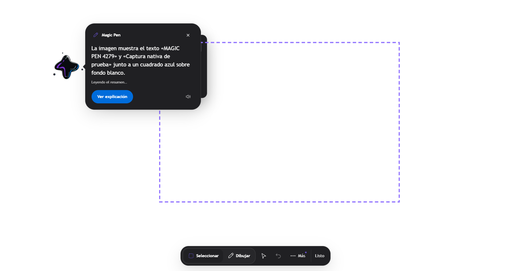
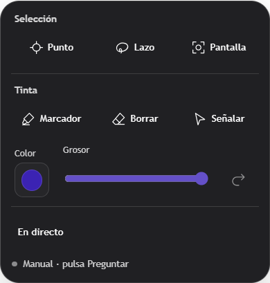

# Axx — asistente residente para Windows

Una interfaz 3D sobre el escritorio para conversar, seleccionar contenido, usar voz y revisar acciones antes de ejecutarlas.

## Download Axx for Windows

<!-- release:download:start -->
**[Download Windows x64 test installer · v0.22.11](https://github.com/luigilaxmaster-coder/AXX/releases/download/v0.22.11/Axx_0.22.11_x64-setup.exe)** · [Release files](https://github.com/luigilaxmaster-coder/AXX/releases/tag/v0.22.11) · [SHA-256](https://github.com/luigilaxmaster-coder/AXX/releases/download/v0.22.11/SHA256SUMS.txt)

Run the installer and open Axx. Python and Node are not required. Start with **Automático gratis · Sin claves**; Axx checks available free routes, whose availability can change. Personal API keys are optional in Settings. Credentials and conversation history are not included in the installer. Windows may need Internet to install WebView2. The installer is unsigned.

The packaged backend may take longer on its first launch while Windows extracts and scans it. The native host allows up to 90 seconds for backend readiness and reports a startup error if that limit is exceeded.

Source is **v0.22.14**; the published Windows installer is **v0.22.11**. Delivery of the newer source is pending publication. Android APKs remain local test artifacts until separately published. See [mobile setup and validation](docs/mobile/README.md) and the [version and release procedure](docs/RELEASING.md).
<!-- release:download:end -->

---

<p align="center">
  
</p>

## Demo y galería

[](https://github.com/luigilaxmaster-coder/AXX/raw/refs/heads/main/docs/media/axx-presentation.mp4)

El vídeo nuevo presenta las capturas nativas de Magic Pen del candidato Windows **0.22.12**, con captura e inferencia reales. Dura 15 segundos y no incluye audio ni nuevas acciones grabadas. El fondo transparente del WebView aparece negro. Estos medios no acreditan aceptación de 0.22.14. [Procedencia y límites](docs/images/showcase/README.md).

<p align="center">
  <a href="docs/images/showcase/magic-pen-native-response-0.22.12.png"></a>
</p>
<p align="center">
  <a href="docs/images/showcase/magic-pen-native-toolbar-0.22.12.png"></a>
</p>
<p align="center">
  <a href="docs/images/showcase/magic-pen-native-tools-0.22.12.png"></a>
</p>

## Cambios y estado de validación

Una prueba de código, una ejecución instalada y una comprobación física acreditan cosas distintas. Los resultados se limitan al flujo y a la versión probados.

| Funcionalidad | Qué cambió | Validación / estado | Límite actual |
| --- | --- | --- | --- |
| [Magic Pen](docs/MAGIC-PEN-DESKTOP.md) | Barra mínima, herramientas agrupadas y respuesta junto al avatar; tinta, cancelación e historial conservados. | 14 grupos de navegador: PASS. El candidato 0.22.12 pasó 12 comprobaciones instaladas y clic nativo Windows. | Aceptación instalada de 0.22.14 pendiente. Requiere un proveedor con visión. |
| [Voz MOSS](docs/voice/xxx-default.md) | Caché local limitada; referencia por solicitud, cuatro selectores compartidos y botón Usar Xxx default con estado de preparación/error. | 22 tests y contratos de interfaz: PASS. Backend instalado 0.22.14: PCM real de Xxx default y repetición desde caché verificados por HTTP. | Selección persistente y reproducción en la interfaz pendientes. No acredita altavoces físicos. |
| [Control del PC](docs/COMPUTER-USE.md) | Observaciones ligadas a ventana, proceso y captura; invalidación al cambiar de destino y comparación visual justo antes del gesto. | Fuente integrada y revisión P1 corregida; aceptación instalada en preparación. | La autorización de PC requiere consentimiento humano manual. Un cambio visual no acredita el objetivo. |
| Gateway administrado | Plazo de primer arranque ampliado a 40 s tras medir 18,5 s hasta autenticación. | 21/21 pruebas del módulo tras la corrección, incluido el gateway Node local. | El plazo no sustituye autenticación ni acredita inferencia remota. |
| [Taller de capacidades](docs/GENERATED-COMMANDS.md) | Propuestas de flujos y transformaciones puras, con revisión y activación explícitas. | Los contratos distinguen borrador, pruebas, aprobación y ejecución. | Una propuesta o sus pruebas no activan herramientas ni instalan código de sistema. |
| [Investigación aislada](docs/REVISION-CONJUNTA-20261027.md) | Revisión de candidatos del laboratorio M01–M15, separados de la aplicación. | M11: 23/23 casos existentes y manifiestos contrastados. El cierre posterior registra M15 bloqueado y currículo incompleto. | Sin promoción; los resultados del laboratorio no acreditan integración, modelos ni audio reales en Axx. |
| [Catálogo de aplicaciones](docs/APPLICATION-COMMANDS.md) | 48 perfiles y 160 operaciones descritas, distinguiendo guías y rutas ejecutables. | Alcance documentado por aplicación y acción. | No equivale a 160 integraciones ejecutadas; detectar una app no verifica sus controles. |
| [Chats](docs/CHAT-WORKSPACE.md) y [modelos](docs/PROVEEDORES-API-LOCAL.md) | Historial, grupos, borradores y contexto explícito; conexión y modelo seleccionables. | Contratos y políticas descritos en las guías. | Configurar o listar un modelo no demuestra inferencia. La selección explícita no cambia de proveedor silenciosamente. |
| [Android](docs/mobile/README.md) | Conversación y servicios del PC, con permisos separados para control remoto. | Artefactos locales y verificación por función documentados. | Versión independiente; aceptación física actual pendiente. La prueba de Windows no la sustituye. |

## Empezar

1. Instala Axx para Windows y espera a que el servicio local esté preparado.
2. Elige una conexión y un modelo en Ajustes; comprueba su disponibilidad antes de usarlos.
3. Abre el menú circular para conversar o usar Magic Pen. En Magic Pen, **Esc** cierra la selección y cancela su análisis.
4. Revisa los pasos, entradas y destinos antes de aprobar una acción. Conserva su recibo para comprobar el resultado.

El dictado del chat prepara un borrador; **Voz en vivo** inicia una conversación. Emparejar Android no concede automáticamente control del ratón, teclado ni acceso a tareas. [Chat y voz](docs/CHAT-WORKSPACE.md) · [Permisos móviles](docs/mobile/README.md).

### Datos y permisos

Las credenciales se protegen con DPAPI en Windows; historial y ajustes permanecen en el perfil local. Los proveedores externos reciben únicamente las solicitudes elegidas según su configuración. No publiques conversaciones, tokens, muestras de voz ni pesos de modelos.

PowerShell y CMD requieren aprobación y ejecutan con los permisos del usuario de Windows: esa aprobación no crea un entorno aislado. Un resultado incierto no debe repetirse automáticamente. [Ejecución y cancelación](docs/UNIFIED-EXECUTION.md).

<details>
<summary>Desarrollo y documentación técnica</summary>

> **Axx is under active development.** Source is **v0.22.14**; the published Windows installer is **v0.22.11**. Delivery of the newer source is pending publication. Validation is recorded per feature; a working UI or build does not by itself certify every hardware-dependent behavior.

Para desarrollo se necesitan Node.js, Rust con MSVC y Python, además de las dependencias declaradas por el proyecto. El instalador publicado no requiere instalar Python ni Node.

```powershell
npm ci
python -m pip install -r requirements-axx-connect.txt -r requirements-converter.txt -r requirements-mobile.txt -r requirements-computer-use.txt
npm run tauri dev
```

- [Compilar, instalar, verificar y publicar Windows](docs/RELEASING.md).
- [Tareas y límites de computer use](docs/COMPUTER-USE.md) · [Ampliaciones por aplicación](docs/COMPUTER-USE-EXPANSION.md).
- [Arquitectura de ejecución](docs/UNIFIED-EXECUTION.md) · [MCP local](docs/MCP-LOCAL.md).
- [Taller de capacidades](docs/SELF-IMPROVEMENT.md) · [Código generado](docs/GENERATED-COMMANDS.md) · [Flujo ECC](docs/ECC-WORKFLOW.md).
- [Historial de cambios](CHANGELOG.md) · [Avisos de terceros](src-tauri/resources/licenses/).

No se declara aquí una licencia general para redistribuir el repositorio; consulta al propietario.

</details>
