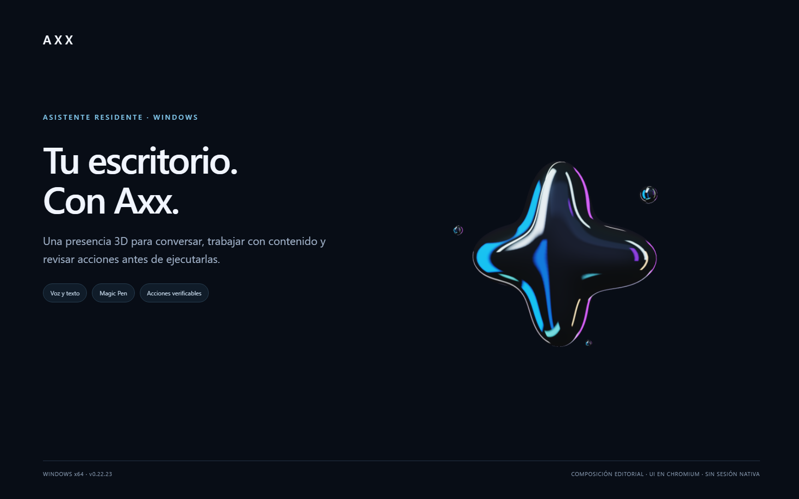
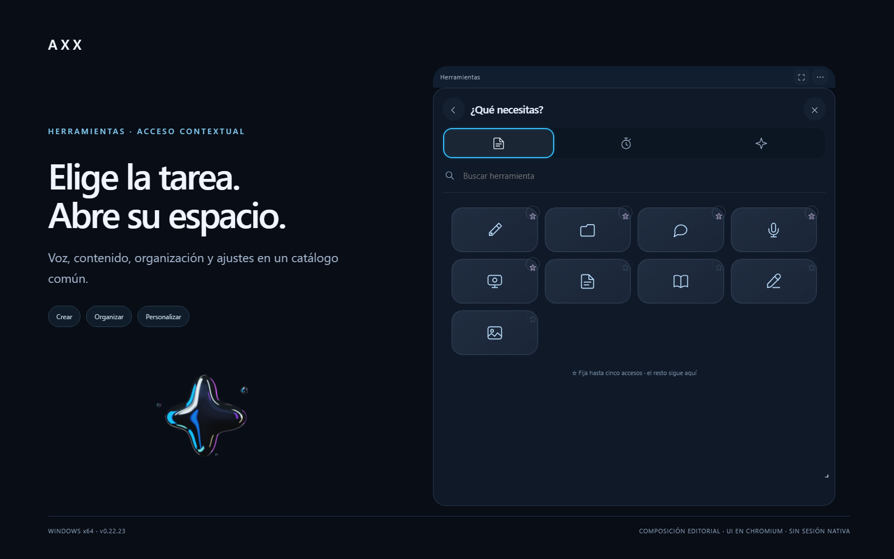
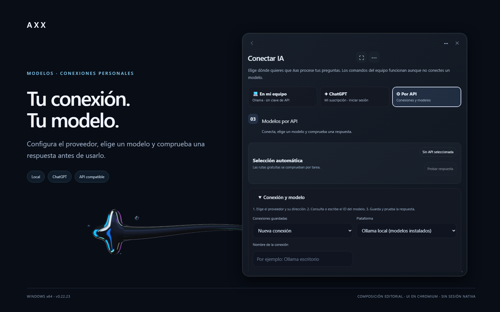
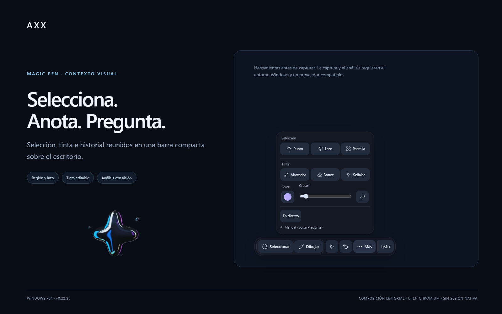
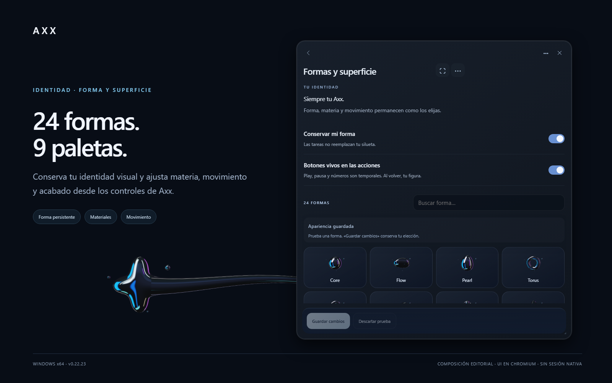
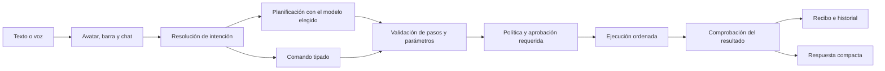

# Axx · Asistente residente para Windows

<p align="center">
  
</p>

<p align="center">
  <strong>Una presencia 3D para conversar, trabajar con contenido y ejecutar acciones revisadas.</strong><br />
  Windows x64 · Texto y voz · Magic Pen · Modelos locales, ChatGPT y APIs · Compañero Android
</p>

<p align="center">
  
  <a href="https://github.com/luigilaxmaster-coder/AXX/actions/workflows/version-consistency.yml">Integración continua</a> ·
  <a href="docs/releases/0.22.26.md">Notas de la versión</a> ·
  <a href="docs/COMMAND-TRAINING.md">Práctica y aceptación</a>
</p>

[Archivos entre dispositivos](docs/mobile/TRANSFER.md) · [Empezar](#empezar) · [Funciones](#funciones) · [Modelos](#modelos) · [Magic Pen](#magic-pen) · [Control del PC](#control-del-pc) · [Arquitectura](#arquitectura) · [Validación](#pruebas-y-estado) · [Desarrollo](#desarrollo)

> **Axx is under active development.** Source is **v0.22.28**; the published Windows installer is **v0.22.27**. Delivery of the newer source is pending publication. Validation is recorded per feature; a working UI or build does not by itself certify every hardware-dependent behavior.

## Download Axx for Windows

<!-- release:download:start -->
**[Download Windows x64 test installer · v0.22.27](https://github.com/luigilaxmaster-coder/AXX/releases/download/v0.22.27/Axx_0.22.27_x64-setup.exe)** · [Release files](https://github.com/luigilaxmaster-coder/AXX/releases/tag/v0.22.27) · [SHA-256](https://github.com/luigilaxmaster-coder/AXX/releases/download/v0.22.27/SHA256SUMS.txt)

Run the installer and open Axx. Python and Node are not required. Start with **Automático gratis · Sin claves**; Axx checks available free routes, whose availability can change. Personal API keys are optional in Settings. Credentials and conversation history are not included in the installer. Windows may need Internet to install WebView2. The installer is unsigned.

The packaged backend may take longer on its first launch while Windows extracts and scans it. The native host allows up to 90 seconds for backend readiness and reports a startup error if that limit is exceeded.

Source is **v0.22.28**; the published Windows installer is **v0.22.27**. Delivery of the newer source is pending publication. Android APKs remain local test artifacts until separately published. See [mobile setup and validation](docs/mobile/README.md) and the [version and release procedure](docs/RELEASING.md).
<!-- release:download:end -->

---

## Empezar

1. **Instala y abre Axx.** Espera a que el servicio local termine de arrancar. El instalador incluye el backend; no necesitas preparar un entorno de desarrollo.
2. **Elige cómo conversar.** En **Conectar IA**, selecciona una conexión, elige su modelo y comprueba una respuesta. Los comandos directos del equipo tienen su propia ruta tipada.
3. **Usa la presencia residente.** Al pasar por el avatar aparecen **Escribir, Magic Pen y micrófono**. Escribir abre la barra pequeña; una respuesta rápida se muestra en su widget. Tocar el avatar da acceso a las herramientas.
4. **Revisa la acción.** Una petición puede resolverse como comando o prepararse como plan. Comprueba pasos, parámetros y destinos antes de aprobar los efectos que lo requieran.
5. **Comprueba el resultado.** Consulta el recibo y el efecto observado. Cancelar detiene trabajo pendiente; no deshace automáticamente lo que ya ocurrió.

La barra admite **Intro** y **Enviar**. Si otra acción requiere atención, explica el bloqueo y conserva el borrador. El dictado del chat prepara un texto; **Voz en vivo** inicia una conversación. [Guía de chats](docs/CHAT-WORKSPACE.md) · [Voz y conversación](docs/VOICE-CONVERSATION.md).

## Funciones

<p align="center">
  <a href="docs/images/showcase/v0.22.23/02-herramientas.png"></a>
</p>

| Área | Qué ofrece | Guía |
| --- | --- | --- |
| Presencia y acceso rápido | Avatar 3D, barra pequeña, widget de respuesta, menú de herramientas y accesos favoritos. | [Controles completos](1.AXX/MANUAL-COMPLETO.md) |
| Chats y contexto | Conversaciones, grupos, borradores, adjuntos, búsqueda, exportación y contexto compartido explícito. | [Chats y grupos](docs/CHAT-WORKSPACE.md) |
| Comandos y secuencias | Catálogo tipado, planificación con el modelo elegido, revisión, ejecución ordenada, cancelación y recibos. | [Comandos desde el chat](docs/COMANDOS-DESDE-CHAT.md) |
| Voz | Dictado, conversación, lectura, selección de voces y modelos de voz según la configuración disponible. | [Conversación por voz](docs/VOICE-CONVERSATION.md) · [MOSS](docs/voice/xxx-default.md) · [Piper](docs/voice/piper.md) |
| Contexto visual | Magic Pen: seleccionar, anotar, preguntar y conservar captura e historial. | [Magic Pen](docs/MAGIC-PEN-DESKTOP.md) |
| Control del PC | Sesión con alcance de escritorio o ventana, observaciones frescas, entrada controlada y comprobación posterior. | [Computer Use](docs/COMPUTER-USE.md) |
| Aplicaciones | Inventario de Windows, operaciones registradas, observación UIA y perfiles documentales por aplicación. | [Catálogo de aplicaciones](docs/APPLICATION-COMMANDS.md) · [Control extensible](docs/CONTROL-DE-APLICACIONES.md) |
| Contenido y utilidades | Notas, tareas, calculadora, unidades, texto, imágenes, temporizador, concentración y cronómetro. | [Manual](1.AXX/MANUAL-COMPLETO.md) |
| Archivos y PDF | Biblioteca, preparación de contenido y conversiones habilitadas con salida y manifiesto verificados. | [Convertidor y PDF](docs/CONVERTIDOR-Y-PDF.md) |
| Pantalla y medios | Controles de captura/grabación y rutas multimedia disponibles; cada integración conserva sus límites. | [Manual](1.AXX/MANUAL-COMPLETO.md) |
| Conexiones y capacidades | MCP, procedimientos y propuestas de flujos o transformaciones revisadas. | [MCP local](docs/MCP-LOCAL.md) · [Capacidades generadas](docs/GENERATED-COMMANDS.md) |
| Android | Emparejamiento, texto, apariencia compartida y superficies remotas sujetas a autorización del PC. | [Axx Mobile](docs/mobile/README.md) |

### Comandos que puedes practicar

```text
lista mis ventanas
abre YouTube y luego busca Faint de Linkin Park
crea en artifacts el archivo nuevo prueba-axx.txt con el texto exacto HOLA_AXX y luego comprueba su hash SHA256
```

El tercer ejemplo crea un archivo y requiere revisión. Usa un nombre nuevo para cada ensayo. Buscar un video no significa reproducirlo; detectar una aplicación tampoco demuestra que sus controles estén disponibles.

Las secuencias conservan las cláusulas y su orden. Las comillas y el contenido literal de una orden de escritura no se convierten en instrucciones adicionales. El planificador dispone de **dos inferencias como máximo**, incluida una corrección de preparación; un plan inválido o incompleto no debe iniciar efectos. [Serie de escenarios reproducibles](docs/COMMAND-TRAINING.md).

## Modelos

<p align="center">
  <a href="docs/images/showcase/v0.22.23/03-modelos-api.png"></a>
</p>

| Modalidad | Configuración | Qué comprobar |
| --- | --- | --- |
| **En mi equipo** | Servidor local y modelo instalado, por ejemplo Ollama. | Que el servidor responda y el modelo exista en su catálogo. |
| **ChatGPT** | Conexión mediante Axx Connect y el runtime oficial de Codex. | Autenticación, modelo seleccionado y generación real. |
| **Por API** | Conexiones personales con nombre, dirección, modelo y clave cuando corresponda. | Guardar y seleccionar, después **Probar respuesta**. |
| **Automático gratis · Sin claves** | Evaluación de las rutas gratuitas disponibles para la tarea. | Que exista una ruta apta en ese momento; su disponibilidad puede cambiar. |

En **Conectar IA → Por API** puedes consultar el catálogo o escribir el ID cuando el proveedor no lo publique. La clave se introduce en su campo específico. Una conexión guardada o un modelo listado no acreditan inferencia: **Probar respuesta** envía una frase sintética, sin historial, y comprueba la ruta seleccionada.

Las conexiones contemplan Ollama local/cloud, LM Studio y proveedores compatibles con los contratos OpenAI o Anthropic Messages. La compatibilidad de texto no implica soporte de visión, audio o todas las herramientas multimedia. Los servicios con cuota conservan su autorización de uso; no se presupone que una API sea gratuita.

La selección manual mantiene conexión y modelo. Un fallo no autoriza cambiar silenciosamente a otra plataforma. La barra intenta reconectar a la selección guardada; una desconexión explícita conserva el modo sin proveedor. Las aclaraciones de un plan mantienen su selección. [Configuración y límites](docs/PROVEEDORES-API-LOCAL.md).

## Magic Pen

<p align="center">
  <a href="docs/images/showcase/v0.22.23/04-magic-pen.png"></a>
</p>

Magic Pen mantiene una barra pequeña para selección y dibujo, con herramientas secundarias agrupadas. Permite trabajar con región, punto o lazo; añadir tinta; revisar el contexto y formular una pregunta sobre la selección.

La captura original y las anotaciones tienen propietarios separados. El guardado y el historial conservan su estado; **Esc** cancela la selección y el análisis en curso. El análisis necesita un proveedor con visión y su precisión depende del modelo. Capturar, enviar al modelo, recibir una respuesta y verificar el resultado son etapas distintas. [Uso y aceptación nativa](docs/MAGIC-PEN-DESKTOP.md).

## Apariencia y presencia

<p align="center">
  <a href="docs/images/showcase/v0.22.23/05-apariencia.png"></a>
</p>

El renderer incluye **24 formas y nueve paletas**. Los controles permiten ajustar forma, acabado, escala, movimiento y las opciones de interfaz disponibles. **Conservar mi forma** mantiene la identidad elegida durante las tareas; los estados transitorios no sustituyen por sí solos la forma guardada.

La interfaz ofrece ajustes de color, transparencia, fuente, escala de widgets y transiciones. La calidad y el movimiento reducido se configuran de forma explícita. Las imágenes anteriores son composiciones editoriales de la interfaz del proyecto en Chromium aislado: no muestran una sesión nativa autorizada ni certifican ejecución. [Procedencia de las cinco imágenes](docs/images/showcase/v0.22.23/README.md).

## Control del PC

Se accede desde **Chat → Controlar PC**, **Asistencia → Computer Use** o **Datos y sistema → Configurar Computer Use**.

1. Comprueba la conexión ChatGPT y el modelo.
2. Elige **Escritorio completo** para cambiar entre aplicaciones o **Solo una ventana** para limitar el destino.
3. Revisa las dos autorizaciones y habilita la sesión desde la interfaz.
4. Da la petición desde la barra; observa los resultados y usa **Detener** cuando corresponda.

El acceso pertenece al chat actual y dura **15 minutos o 60 gestos**. Cambiar de chat o proveedor revoca la concesión. Cada gesto consume una observación fresca asociada al destino. Si cambia la ventana, el proceso, la geometría o la zona relevante, hay que observar de nuevo.

**Escape** interrumpe la entrada en curso y, desde Axx, revoca la sesión; no es un atajo global cuando Axx no tiene el foco. Un cambio visual o una pulsación entregada no bastan para acreditar el objetivo. UAC, escritorios bloqueados, terminales, autenticación y gestores de contraseñas conservan sus restricciones.

El alcance de escritorio está implementado, pero una sesión completa entre todas las aplicaciones no está certificada por las pruebas de comandos de esta versión. [Contrato, preparación y límites](docs/COMPUTER-USE.md) · [Ampliaciones por aplicación](docs/COMPUTER-USE-EXPANSION.md).

## Arquitectura



| Capa | Responsabilidad | Código |
| --- | --- | --- |
| Interfaz y renderer | Avatar, paneles, voz, widgets y presentación de operaciones. | [1.AXX](1.AXX/) |
| Host de Windows | Ventana residente, entrada selectiva, ciclo de vida y puente privado con el backend. | [src-tauri](src-tauri/) |
| Backend local | HTTP autenticado, validación, comandos, planificación, persistencia y servicios. | [backend](backend/) |
| Inferencia y Connect | Proveedores configurados, selección de rutas y conexión con Codex/MCP. | [inferencia](backend/inference/) · [Connect](backend/connect/) |
| Ejecutor | Adaptadores, límites, seguimiento de operaciones y postcondiciones. | [acciones](backend/actions/) · [comandos](backend/commands.py) |
| Contexto y capacidades | Memoria de procedimientos, contratos de objetivo y taller de propuestas. | [aprendizaje](backend/action_learning.py) · [taller](backend/capability_workshop.py) |
| Companion móvil | Cliente Android, enlace, apariencia y servicios remotos. | [mobile](mobile/) · [servicio móvil](backend/mobile/) |
| Entrega | Sincronización de versiones, compilación, instalación verificada y publicación con hashes. | [scripts](scripts/) · [RELEASING](docs/RELEASING.md) |

La distribución utiliza **Tauri 2 / Rust / WebView2**, interfaz HTML/CSS/JavaScript y backend Python empaquetado. Los chats se guardan en SQLite. Los modelos y proveedores conservan sus contratos propios; estar registrados no significa estar disponibles o comprobados.

Una operación tiene ID, entradas, estado y evidencia. Se distinguen preparación, aprobación, entrega, efecto observado y objetivo comprobado. Un resultado incierto no se repite automáticamente. Las secuencias se detienen cuando un paso falla; cancelar no revierte efectos consumados. [Arquitectura de ejecución](docs/UNIFIED-EXECUTION.md).

Las instrucciones se componen en el backend por función, con versión y presupuesto. Conversación, voz, traducción, planificación y percepción conservan contratos separados; las referencias no conceden permisos. [Integración y evaluación de 28 escenarios](docs/PROMPT-CONTRACTS.md).

### Taller de capacidades

El taller puede proponer flujos y transformaciones puras, validarlas y mantener versiones. **Borrador, pruebas, aprobación y activación son estados diferentes**. Las pruebas de una propuesta no conceden por sí solas autoridad para ejecutarla. Las integraciones sin interfaz comprobada permanecen como propuestas o investigación.

[Capacidades generadas](docs/GENERATED-COMMANDS.md) · [Auto-mejora y límites](docs/SELF-IMPROVEMENT.md) · [Flujo ECC](docs/ECC-WORKFLOW.md).

## Android

Android mantiene su versión independiente: **0.2.7 en fuente**, con instalación y aceptación físicas pendientes. Corrige los 24 casos del estudio de pantallas y exige los 120 escenarios en el protocolo; [corrección y conservación del diseño](docs/mobile/SCREEN-FIXES-20261029.md). El enlace permite compartir apariencia y trabajar con las funciones móviles habilitadas, sin conceder automáticamente acceso a mouse, teclado, audio o tareas del PC. En la versión 0.2.5 se verificaron en Samsung A21s copias de 1.049.652 bytes hacia Windows por LAN y Tailscale, guardado en Descargas con SHA-256 coincidente y persistencia del enlace tras reiniciar Axx. Ambas pruebas usaron la misma Wi-Fi. [Alcance de la prueba física](docs/mobile/TRANSFER-ACCEPTANCE-20261029.md); dos conexiones a Internet distintas, voz y segundo plano siguen pendientes de aceptación.

La validación de **0.2.4** registrada en Samsung A21s incluye sincronización de apariencia en ambos sentidos, conservación del enlace y borrador, texto al 100/170 %, teclado de 299 puntos y una consulta ejecutada en Windows. La escena medida obtuvo una mediana de 50 FPS; no es una garantía para otros teléfonos o escenas. Se registraron 17 pruebas UI y 59 de servicio.

El escaneo óptico del QR, la entrada física remota y el audio mantienen aceptación separada. Los APK siguen siendo artefactos locales de prueba hasta su publicación independiente. [Emparejar, compilar y verificar Android](docs/mobile/README.md).

## Pruebas y estado

| Área | Evidencia disponible | Alcance que no debe inferirse |
| --- | --- | --- |
| **Barra · 0.22.23** | Enviar con clic de ratón, Intro, respuesta compacta y segunda orden sin volver a enfocar, probados en el instalador final. | No certifica todos los dispositivos de entrada o configuraciones de pantalla. |
| **Secuencias · 0.22.23** | Desde la barra: abrir YouTube y buscar Faint; crear un archivo nuevo, calcular su SHA256 y comprobar el contenido final. Pasos ordenados y recibos verificados. | Buscar no acredita reproducción. Las acciones conservan su revisión. |
| **Modelo/API · 0.22.23** | La selección guardada sobrevivió a la reinstalación y preparó el plan de archivo con dos inferencias. Respuesta API sintética comprobada durante la aceptación. | La ruta configurada no certifica la identidad interna de los pesos del proveedor ni todos sus modelos. |
| **Planificación/Codex · 0.22.22** | Preparación real de planes API y Codex, reconexión y recuperación del gateway documentadas. | No equivale a ejecutar cualquier plan de cualquier modelo. |
| **Regresión automática** | 83 casos en la batería de CI; tres pruebas nativas se omiten en Linux y se comprobaron por separado en Windows. Biblioteca de UI: 33 grupos; escenarios de la barra; Rust: 18 aprobadas y un helper omitido. | CI no reemplaza la aceptación del EXE instalado. |
| **Instalación · 0.22.23** | Binarios, registro, atajos, 36 avisos de licencia, backend autenticado y cuatro archivos privados de configuración con hashes conservados. GitHub confirmó el hash del instalador publicado. | Un proceso arrancado no demuestra una acción realizada. |
| **Magic Pen · 0.22.14** | 14 comprobaciones con captura e inferencia reales, dos monitores, exportación y grabación verificadas. | No acredita precisión ilimitada de visión ni una repetición física de cada caso en 0.22.23. |
| **Voz MOSS · 0.22.14** | Voz predeterminada seleccionada, conservada al reiniciar y dos reproducciones Web Audio completas sin vaciados del búfer. | Micrófono, altavoces físicos y calidad subjetiva de pronunciación conservan comprobación separada. |
| **Computer Use** | Alcances y contratos implementados; gateway recuperado y consultas de ventanas verificadas. | Sesión visual completa entre aplicaciones pendiente de aceptación específica. |
| **Aplicaciones** | 48 perfiles y 160 operaciones descritas, con guías y rutas ejecutables diferenciadas. | No son 160 integraciones ejecutadas; la detección no certifica controles ni licencias. |
| **Convertidor/PDF** | Operaciones habilitadas con validación de entradas, salida y manifiesto; alcance descrito por dirección. | CAD/BIM, OCR y conservación visual completa de PDF no se deducen del catálogo. |
| **Android · 0.2.4** | Evidencia de A21s, sincronización, teclado y consulta del PC registrada por separado. | Emparejamiento no acredita control físico ni audio. |

La [batería de práctica](docs/COMMAND-TRAINING.md) cubre reconocimiento, contenido literal, planificación, autocorrección, comprobación final, fallo intermedio y ausencia de repetición. La integración continua ejecuta las regresiones en cada push y pull request. [Notas de 0.22.23](docs/releases/0.22.23.md) · [Historial completo](CHANGELOG.md).

<details>
<summary>Investigación aislada y medios históricos</summary>

La revisión del laboratorio M01–M15 no constituye una promoción a la aplicación. M11 registró 23/23 casos existentes; el cierre posterior conserva M15 bloqueado y el currículo incompleto. [Revisión conjunta](docs/REVISION-CONJUNTA-20261027.md).

El [video de presentación anterior](docs/media/axx-presentation.mp4) utiliza capturas nativas de Magic Pen del candidato 0.22.12, dura 15 segundos y no incluye audio ni nuevas acciones grabadas. Se conserva como material histórico; no acredita aceptación de la versión actual. Las capturas originales y su procedencia siguen disponibles en el [archivo de medios](docs/images/showcase/README.md).

</details>

## Datos, permisos y seguridad

- **Credenciales:** DPAPI para el usuario actual de Windows; las claves personales no se incluyen en el instalador ni en el código cliente.
- **Contexto:** los grupos comparten notas explícitas. Vincular chats requiere seleccionar su contexto; no comparte automáticamente otros hilos privados.
- **Persistencia:** historial y ajustes permanecen en el perfil local. Chats, adjuntos y notas comunes tienen su política documentada de vencimiento de 90 días; las exportaciones y los datos recibidos por terceros tienen controles propios.
- **Proveedores:** reciben las solicitudes elegidas según la configuración. La visión y el control de escritorio pueden transmitir contenido visible dentro del alcance autorizado.
- **Efectos:** archivos, envíos, borrados, terminal y otras acciones sensibles conservan sus políticas de revisión. Aprobar CMD o PowerShell no crea un entorno aislado: se ejecutan con los permisos del usuario de Windows.
- **Publicación:** no incluir conversaciones, tokens, voces de referencia, pesos de modelos ni estado de ejecución privado.

[Contexto y almacenamiento](docs/CHAT-WORKSPACE.md) · [Ejecución y cancelación](docs/UNIFIED-EXECUTION.md) · [Privacidad de Computer Use](docs/COMPUTER-USE.md).

## Desarrollo

El instalador es la opción directa para usar Axx. Para desarrollar se necesitan **Node.js 22+**, **Rust 1.90+ con herramientas MSVC**, **Python 3.11+** y las dependencias y recursos nativos del proyecto. El paquete actual de Windows se construyó con Python 3.12; Android conserva su propia cadena de compilación.

```powershell
python -m venv .venv
.\.venv\Scripts\Activate.ps1
python -m pip install -r requirements-axx-connect.txt -r requirements-converter.txt -r requirements-mobile.txt -r requirements-computer-use.txt
npm ci
```

Antes de compilar, prepara los sidecars, recursos y dependencias verificados que exige [RELEASING](docs/RELEASING.md) y su [manifiesto de dependencias](resources/dependency-manifest.json). Tener Node y Python instalados no sustituye esos recursos.

```powershell
# Compilar con recibo de fuentes y binarios.
powershell -NoProfile -ExecutionPolicy Bypass -File scripts/build-windows.ps1 -PythonExecutable .venv/Scripts/python.exe -EvidenceDirectory build/release-local

# Cerrar la instancia identificada de Axx antes de instalar.
powershell -NoProfile -ExecutionPolicy Bypass -File scripts/install-verified-windows.ps1 -BuildResult build/release-local/build-result.json -EvidenceDirectory build/release-local

# Desarrollo con los recursos nativos preparados.
npm run tauri dev
```

Para inspeccionar únicamente el frontend, ejecuta `node scripts/server20.mjs` desde `1.AXX` y abre `http://127.0.0.1:4173/`. Ese modo de navegador no proporciona los servicios nativos ni acredita control del escritorio.

### Comprobaciones

```powershell
python scripts/release.py check
python -m unittest discover -s scripts -p test_release.py -v
python -m unittest backend.tests.test_prompts backend.tests.test_command_language backend.tests.test_command_sequences backend.tests.test_action_learning backend.tests.test_goal_cycle backend.tests.test_command_library backend.tests.test_provider_settings -q
node scripts/test-prompt-contracts.cjs
node scripts/test-quick-reply.cjs
node 1.AXX/scripts/test-command-library.cjs
cargo test --manifest-path src-tauri/Cargo.toml --lib
```

Las comprobaciones de navegador necesitan Playwright y Chromium preparados; los helpers locales conservan sus rutas de entorno. Las pruebas Rust requieren los recursos del proyecto o la configuración de pruebas descrita en el flujo de trabajo correspondiente. Las pruebas con inferencia, micrófono, pantalla o dispositivos reales mantienen su aceptación independiente.

### Entregar una actualización

1. Sincronizar versiones con `python scripts/release.py sync --version X.Y.Z`.
2. Ejecutar las comprobaciones pertinentes y construir el paquete.
3. Instalar y verificar el EXE, su interfaz y los flujos cambiados.
4. Subir las fuentes y publicar con los recibos verificados.
5. Confirmar el hash del asset de GitHub y actualizar el enlace de descarga.

No sobrescribir un asset publicado con bytes diferentes. Un push de código no actualiza el instalador. [Procedimiento completo de entrega](docs/RELEASING.md).

## Documentación

| Tema | Referencias |
| --- | --- |
| Uso y controles | [Manual completo](1.AXX/MANUAL-COMPLETO.md) · [Chat](docs/CHAT-WORKSPACE.md) · [Comandos](docs/COMANDOS-DESDE-CHAT.md) |
| Voz y lenguaje | [Conversación](docs/VOICE-CONVERSATION.md) · [Lenguaje de comandos](docs/VOICE-COMMAND-LANGUAGE.md) · [MOSS](docs/voice/xxx-default.md) · [Piper](docs/voice/piper.md) |
| Visión y escritorio | [Magic Pen](docs/MAGIC-PEN-DESKTOP.md) · [Computer Use](docs/COMPUTER-USE.md) · [Expansiones](docs/COMPUTER-USE-EXPANSION.md) |
| Aplicaciones y archivos | [Perfiles](docs/APPLICATION-COMMANDS.md) · [Control de aplicaciones](docs/CONTROL-DE-APLICACIONES.md) · [Convertidor/PDF](docs/CONVERTIDOR-Y-PDF.md) |
| Modelos e integraciones | [Proveedores](docs/PROVEEDORES-API-LOCAL.md) · [MCP local](docs/MCP-LOCAL.md) · [Extensiones](docs/COMMAND-EXTENSIONS.md) |
| Instrucciones por función | [Compositor, contratos y evaluación](docs/PROMPT-CONTRACTS.md) |
| Aprendizaje y ejecución | [Entrenamientos](docs/COMMAND-TRAINING.md) · [Ejecución unificada](docs/UNIFIED-EXECUTION.md) · [Taller](docs/GENERATED-COMMANDS.md) · [Auto-mejora](docs/SELF-IMPROVEMENT.md) · [ECC](docs/ECC-WORKFLOW.md) |
| Android | [Instalación, enlace y contratos](docs/mobile/README.md) |
| Identidad y movimiento | [Implementación visual](1.AXX/IMPLEMENTACION.md) · [Tentáculos](docs/TENTACLE-RENDERING.md) |
| Entrega y trazabilidad | [Publicación](docs/RELEASING.md) · [Cambios](CHANGELOG.md) · [0.22.23](docs/releases/0.22.23.md) · [0.22.22](docs/releases/0.22.22.md) · [Investigación](docs/REVISION-CONJUNTA-20261027.md) |
| Imágenes y archivo | [Cinco imágenes nuevas](docs/images/showcase/v0.22.23/README.md) · [Medios históricos y procedencia](docs/images/showcase/README.md) |

## Licencias y redistribución

Los avisos de los componentes de terceros se conservan en [license-notices](src-tauri/resources/license-notices/) y [licenses](src-tauri/resources/licenses/), junto con las licencias específicas de los componentes correspondientes. El instalador verifica sus avisos durante la aceptación.

El repositorio no declara aquí una licencia general que conceda permiso para redistribuir todo el proyecto. Consulta al propietario y las condiciones de cada dependencia antes de redistribuir código, binarios o recursos.
