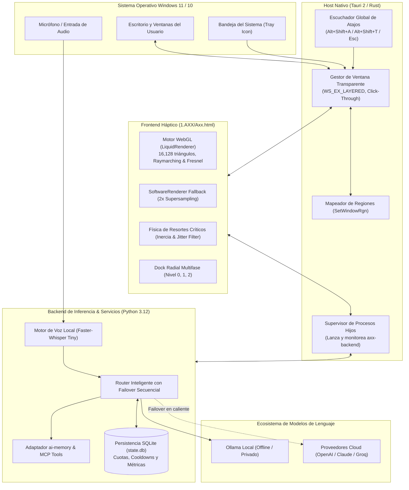
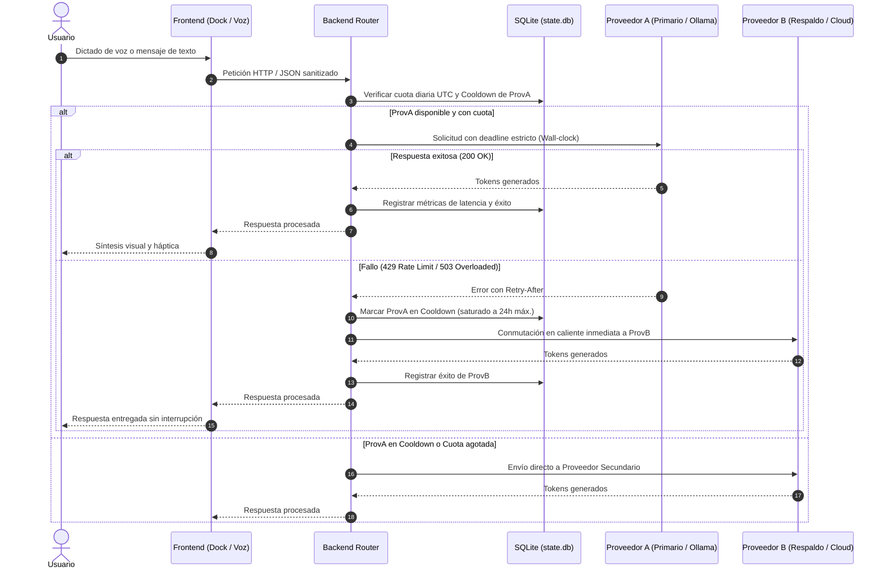
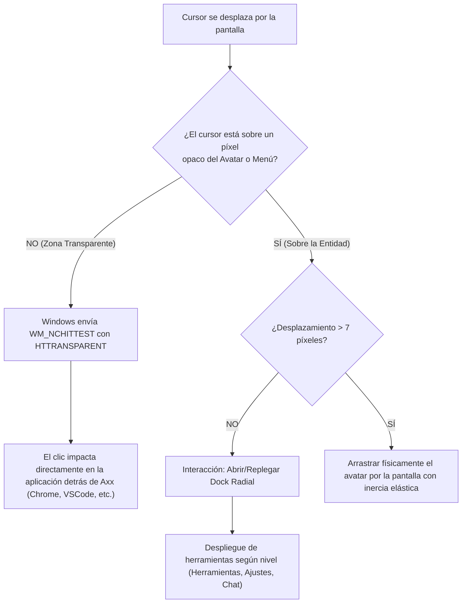

# Axx — Asistente de Escritorio Autónomo y Entidad Residente 3D

<p align="center">
  
</p>

<p align="center">
  <strong>Entidad residente para Windows 11 con interfaz 3D háptica, motor de inferencia multi-proveedor con tolerancia a fallos, reconocimiento de voz offline y memoria procedimental.</strong>
</p>

<p align="center">
  
  
  
  
  
  
  
  
</p>

<p align="center">
  <code>#ai-assistant</code> <code>#desktop-assistant</code> <code>#windows-11</code> <code>#tauri</code> <code>#rust</code> <code>#python</code> <code>#webgl</code> <code>#threejs</code> <code>#faster-whisper</code> <code>#ollama</code> <code>#mcp</code> <code>#failover</code> <code>#resident-avatar</code> <code>#offline-first</code>
</p>

---

## 💡 About — El Manifiesto de Axx

> *"La inteligencia artificial no debe vivir encerrada dentro de una pestaña del navegador ni detrás de un frío cuadro de chat. **Axx** rompe ese paradigma: una entidad viva, háptica y residente directamente sobre tu escritorio de Windows que te acompaña en tiempo real, respeta tu privacidad con modelos locales, jamás interrumpe tu pantalla y responde con máxima fiabilidad gracias a una arquitectura híbrida con conmutación por error en caliente."*

---

## 🚧 Estado del Proyecto: En Proceso Activo de Mejora Continua

> [!NOTE]
> **Axx se encuentra en desarrollo activo y evolución constante.** El núcleo actual opera sobre la entrega consolidada **v0.22.5**, mientras se integran y verifican las optimizaciones del **candidato v0.22.6+**.

### 🟢 Capacidades Consolidadas y Operativas (v0.22.5)
- **Arranque y Resiliencia Nativa:** Arranque controlado en menos de 10 segundos con registro de logs desacoplado, sin bloqueos ni pánicos por redirección de flujos estándar.
- **Entidad 3D y Shaders Líquidos:** Malla paramétrica de 24 formas volumétricas, sombreado de Fresnel en tiempo real y renderizador de respaldo por software 2x.
- **Click-Through Transparente:** La ventana ignora clics en zonas vacías mediante la API Win32 (`WM_NCHITTEST`), permitiendo usar tus aplicaciones de fondo con total fluidez.
- **Failover Multi-Proveedor:** Tolerancia a caídas con conmutación instantánea entre Ollama local y APIs en la nube ante errores 429 (`Retry-After`) o 5xx.
- **Memoria Episódica:** Integración de persistencia procedural y adaptadores MCP.

### 🟡 Áreas en Refinamiento y Pruebas Activas (Candidato 0.22.6+)
- **Calibración de Micrófono & ASR:** Certificación de captura de audio y supresión de eco en hardware variado antes de activar el dictado continuo como predeterminado.
- **Dinámica Multimonitor y DPI Asimétrico:** Perfeccionamiento del arrastre háptico y anclaje elástico cuando existen múltiples pantallas con factores de escala (DPI) mixtos.
- **Ampliación de Catálogo MCP:** Incorporación de nuevos conectores de sistema para automatización de tareas y desarrollo sin exponer credenciales.
- **Consumo de Memoria en Segundo Plano:** Optimización continua del footprint de RAM y tiempo de respuesta en reposo.

---

## 📸 Galería y Vistas del Sistema

| Entidad 3D en Reposo (Base) | Selector de Formas y Apariencia |
| :---: | :---: |
|  |  |
| *Avatar orgánico con sombreado de Fresnel y simulación de líquido* | *24 geometrías paramétricas y 9 paletas de color HSL* |

| Físicas y Dinámica de Movimiento | Configuración Axx Connect (MCP / Proveedores) |
| :---: | :---: |
|  |  |
| *Controlador de inercia por resortes y filtrado háptico* | *Gestor de proveedores LLM, tokens seguros y herramientas MCP* |

---

## 🌟 ¿Qué es Axx?

**Axx** es un asistente de inteligencia artificial de escritorio de última generación diseñado para integrarse de forma natural en el flujo de trabajo de Windows. A diferencia de las ventanas de chat tradicionales o navegadores web, Axx vive directamente sobre el escritorio como una entidad fluida y viva.

### Principios Fundamentales:
1. **Presencia Orgánica No Invasiva:** Flota en una ventana transparente sin bordes que ignora clics en áreas transparentes (*click-through* total mediante Win32 API), permitiendo interactuar con tus aplicaciones de fondo sin interrupciones.
2. **Inferencia Resiliente Híbrida:** Orquestador de modelos de IA con conmutación en caliente (*failover* automático) entre modelos locales offline (Ollama) y proveedores en la nube (OpenAI, Anthropic, OpenRouter).
3. **Privacidad y Voz Local:** Reconocimiento de voz por hardware local utilizando `faster-whisper-tiny`, sin transmitir fragmentos de audio a servidores externos.
4. **Memoria y Herramientas (MCP):** Memoria episódica y contextual persistente gestionada con `ai-memory` y compatibilidad con el estándar *Model Context Protocol* para ejecutar acciones del sistema de forma segura.

---

## 🏛️ Arquitectura del Sistema

Axx está diseñado con una arquitectura modular desacoplada de alto rendimiento compuesta por tres pilares: **Host Nativo (Rust/Tauri)**, **Frontend Gráfico Háptico (WebGL/HTML5)** y **Backend de Inferencia y Servicios (Python)**.



---

## 🔄 Diagramas de Flujo Operativos

### 1. Flujo de Inferencia con Failover Automático
Este diagrama describe cómo Axx gestiona cada solicitud del usuario garantizando alta disponibilidad sin importar caídas o saturaciones de proveedores:



---

### 2. Ciclo de Interacción Háptica y Paso de Clics (*Click-Through*)
Axx se mantiene sobre la pantalla sin bloquear el trabajo habitual del usuario mediante un algoritmo continuo de cálculo de opacidad:



---

## ⚡ Características Principales

### 🔮 1. Entidad 3D y Renderizado Dual
- **Motor WebGL Primario (`LiquidRenderer`):**
  - Malla procedural de **112 × 72 segmentos** (16.128 triángulos).
  - Sombreado de raymarching en tiempo real con aberración cromática especular, efecto Fresnel y tabla de mapeo (LUT) bilineal de 512 × 512.
- **Motor de Software de Respaldo (`SoftwareRenderer` / `CpuRaster`):**
  - Diseñado para laptops en modo de ahorro de energía o GPUs integradas de baja potencia.
  - Supermuestreo exacto a doble resolución (`resolve2x`) con mezcla premultiplicada de alfa para evitar bordes dentados.
- **24 Formas Paramétricas Volumétricas:**
  - *Catálogo Base:* `Core`, `Flow`, `Pearl`, `Torus`, `Split`, `Wave`, `Bloom`, `Fold`, `Spike`, `Drift`, `Orbit`, `Morph`.
  - *Catálogo Avanzado v20:* `Cushion`, `Trefoil`, `Nova`, `Heart`, `Infinity`, `Helix`, `Knot`, `Petal`, `Prism`, `Capsule`, `Crescent`, `Ripple`.
  - *Identidad Protegida:* La bandera `keepForm: true` en `localStorage` evita que animaciones temporales modifiquen permanentemente la forma elegida por el usuario.

### 🛡️ 2. Motor de Inferencia Resiliente (Router)
- **Tolerancia a Fallos Probada:** Implementa las 10 protecciones fundamentales de robustez:
  - Timeouts basados en reloj de pared (*wall-clock* estricto de 70 s) para evitar ataques o bloqueos por conexiones lentas (*slowloris*).
  - Sanitización de respuestas JSON y rechazo de constantes inválidas (`NaN`, `Infinity`).
  - Límite de `Retry-After` acotado a un máximo de 24 horas con parseo RFC 2822.
  - Distinción entre errores de credenciales (401) y políticas de moderación (403), evitando reintentos infinitos inútiles.
  - Cancelación activa limpia de subprocesos cuando el usuario pulsa `Esc`.

### 🎙️ 3. Voz y Transcripción Offline
- Modelo **Faster-Whisper Tiny** preinstalado en la ruta de recursos.
- Transcripción instantánea de comandos de voz con cero consumo de cuota externa y total confidencialidad.

### 🧠 4. Memoria Persistente y Herramientas MCP
- Motor `ai-memory` integrado para recordar preferencias del usuario, sesiones previas y estado del sistema.
- Interfaz extensible para ejecutar comandos en el sistema operativo mediante el estándar de la industria **Model Context Protocol (MCP)**.

### ⌨️ 5. Control Global del Sistema
| Atajo | Acción |
| :--- | :--- |
| `Alt + Mayús + A` | Invocar y ordenar a Axx que siga suavemente el cursor. |
| `Alt + Mayús + A, A` (doble pulsación < 450 ms) | Orden de regreso inmediato a la posición base de reposo. |
| `Alt + Mayús + T` | Abrir directamente el panel de herramientas y ajustes. |
| `Esc` | Cancelar seguimiento, abortar inferencia en curso o cerrar paneles. |

---

## 📂 Estructura del Repositorio

```plaintext
AXX/
├── 1.AXX/                         # Frontend WebGL, CSS háptico y lógica de la entidad
│   ├── Axx.html                   # Runtime completo de interacción, shaders y máquinas de estado
│   └── scripts/                   # Scripts auxiliares de integración UI
├── backend/                       # Núcleo de servicios en Python
│   ├── connect/                   # Módulos de conexión MCP, proveedores y API HTTP
│   ├── inference/                 # Integración con motores de lenguaje y Ollama
│   ├── memory/                    # Adaptador de memoria persistente SQLite/ai-memory
│   ├── speech/                    # Motor de reconocimiento de voz Faster-Whisper
│   └── server.py                  # Servidor principal de servicios locales
├── src-tauri/                     # Host de escritorio en Rust (Tauri 2)
│   ├── Cargo.toml                 # Dependencias nativas de Rust
│   ├── tauri.conf.json            # Configuración de ventana transparente y empaquetado
│   └── src/
│       ├── main.rs                # Punto de entrada de la aplicación nativa
│       ├── lib.rs                 # Comandos Tauri, bandeja del sistema e inicialización
│       └── resident.rs            # Gestión de ventana Win32, click-through y hotkeys
├── resources/                     # Modelos y manifiestos del sistema
│   ├── models/faster-whisper-tiny/# Pesos y tokenizador del modelo ASR offline
│   ├── command-library.json       # Catálogo de recetas de comandos verificados
│   └── providers.default.json     # Plantilla por defecto de proveedores
├── scripts/                       # Scripts de compilación, verificación y pruebas
│   ├── build-windows.ps1          # Pipeline integral de compilación nativa en Windows
│   ├── start-axx.ps1              # Lanzador rápido para desarrollo
│   └── verify-installed-files.py  # Verificador de integridad criptográfica SHA256
├── docs/                          # Documentación detallada e imágenes
│   └── images/                    # Capturas, diagramas e isotipo oficial
├── package.json                   # Dependencias de Node.js y scripts de Tauri
├── providers.json                 # Configuración activa de proveedores LLM
└── README.md                      # Esta guía técnica
```

---

## 🚀 Guía de Instalación y Ejecución

### Requisitos Previos
- **Sistema Operativo:** Windows 10 u 11 (64 bits).
- **Node.js:** v18.0 o superior (`npm` o `pnpm`).
- **Rust:** Versión estable 1.78+ con herramienta de compilación MSVC (`rustup toolchain install stable-x86_64-pc-windows-msvc`).
- **Python:** Versión 3.11 o 3.12 (recomendado 3.12) agregada al `PATH`.

### 1. Clonar el Repositorio
```bash
git clone https://github.com/luigilaxmaster-coder/AXX.git
cd AXX
```

### 2. Instalar Dependencias
```powershell
# Instalar dependencias de frontend y CLI de Tauri
npm install

# Instalar dependencias de Python del backend
pip install -r requirements-axx-connect.txt
```

### 3. Ejecutar en Modo Desarrollo
Puedes iniciar el entorno completo de desarrollo con recarga en caliente ejecutando:

```powershell
npm run tauri dev
```
*O utilizando el script automatizado de inicio:*
```powershell
powershell -ExecutionPolicy Bypass -File .\scripts\start-axx.ps1
```

---

## ⚙️ Configuración de Proveedores de IA (`providers.json`)

Para configurar tus modelos y proveedores de inferencia, personaliza el archivo `providers.json` en la raíz del proyecto:

```json
{
  "active_provider": "ollama_local",
  "providers": {
    "ollama_local": {
      "type": "ollama",
      "endpoint": "http://127.0.0.1:11434",
      "model": "llama3.2:latest",
      "enabled": true,
      "timeout_seconds": 60
    },
    "openai_cloud": {
      "type": "openai",
      "api_key_env": "OPENAI_API_KEY",
      "model": "gpt-4o-mini",
      "enabled": false,
      "max_daily_quota": 500
    },
    "claude_cloud": {
      "type": "anthropic",
      "api_key_env": "ANTHROPIC_API_KEY",
      "model": "claude-3-5-sonnet-20241022",
      "enabled": false
    }
  }
}
```

---

## 📦 Compilación para Producción (Instalador de Windows)

Para generar el instalador final verificado (`.exe` NSIS):

```powershell
powershell -ExecutionPolicy Bypass -File .\scripts\build-windows.ps1
```

El script ejecuta automáticamente:
1. Verificación de integridad criptográfica de modelos y dependencias contra los manifiestos JSON.
2. Empaquetado aislado del backend en Python mediante PyInstaller (`dist/axx-backend.exe`).
3. Compilación optimizada en modo Release con el compilador de Rust.
4. Generación del instalador NSIS para Windows listo para distribución en `src-tauri/target/release/bundle/nsis/`.

---

## 🔒 Privacidad y Seguridad

- **Cero Telemetría Forzada:** Toda la telemetría operativa y métricas de latencia se almacenan estrictamente en la base de datos local SQLite (`state.db`).
- **Aislamiento de Tokens:** Las claves y tokens de acceso se almacenan cifradas mediante DPAPI de Windows a nivel de usuario en perfiles protegidos.
- **Ejecución Segura:** Las herramientas y comandos del sistema operativo implementan una lista estricta de validación que impide la ejecución arbitraria de comandos no aprobados.

---

## 📄 Licencia

Este proyecto se distribuye bajo los términos de la licencia especificada en el repositorio. Consulta los archivos de licencias de dependencias en `src-tauri/resources/licenses/` para más detalles sobre librerías de terceros (Faster-Whisper, NumPy, AI-Memory).

---

<p align="center">
  Hecho con excelencia y dedicación por <a href="https://github.com/luigilaxmaster-coder"><strong>luigilaxmaster-coder</strong></a>
</p>
