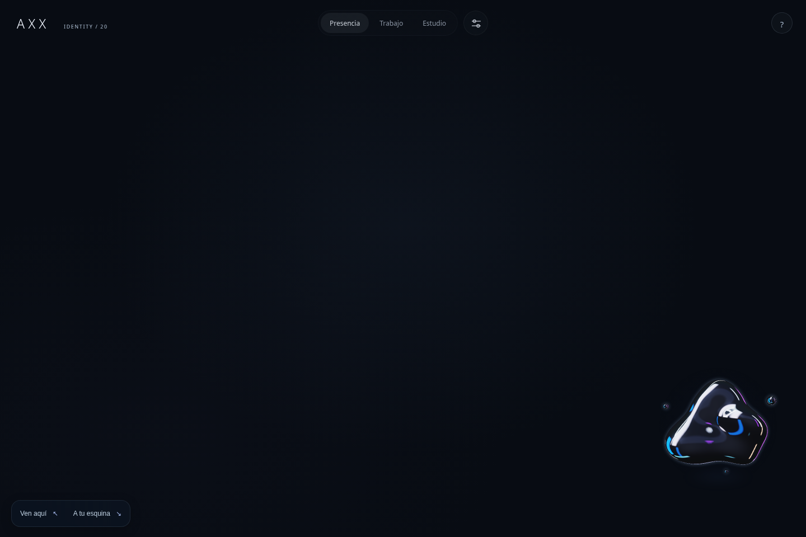
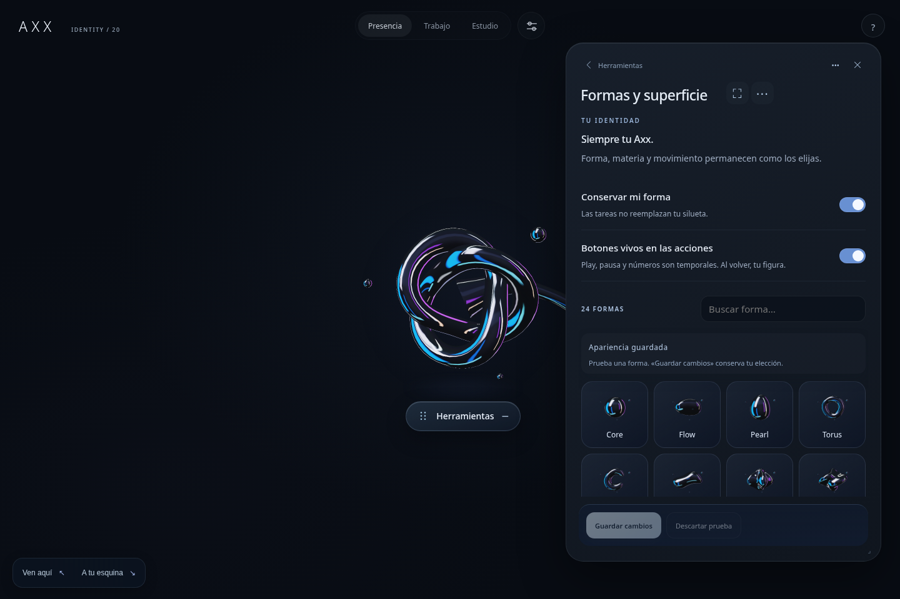
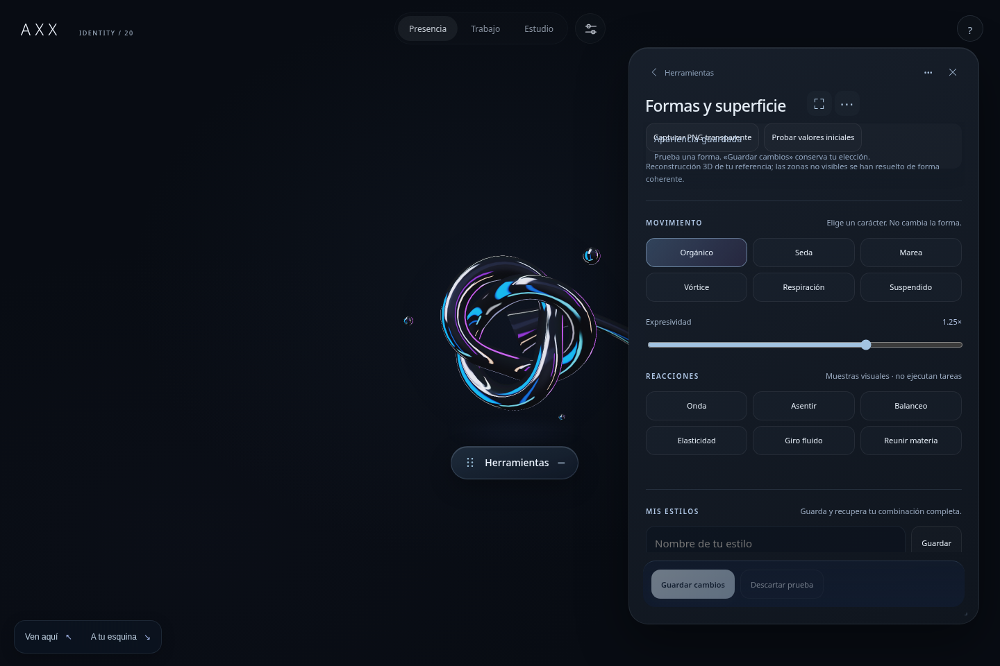
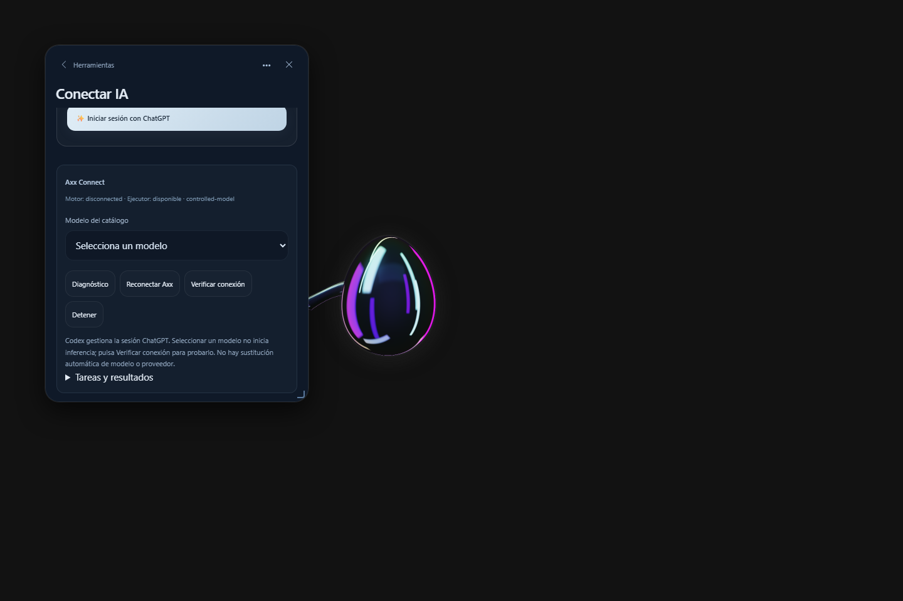
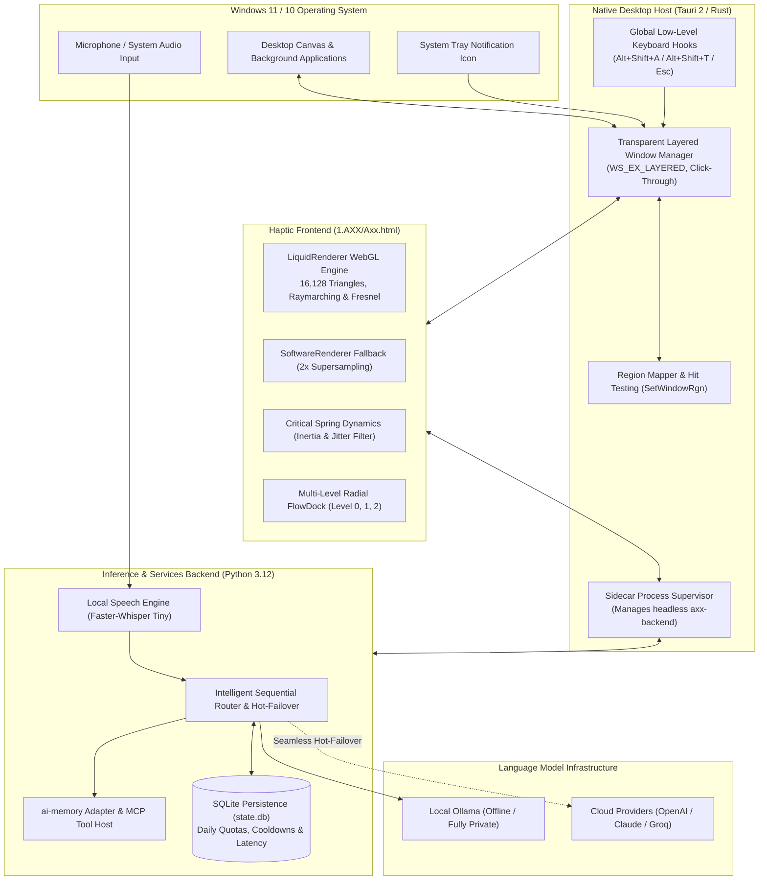
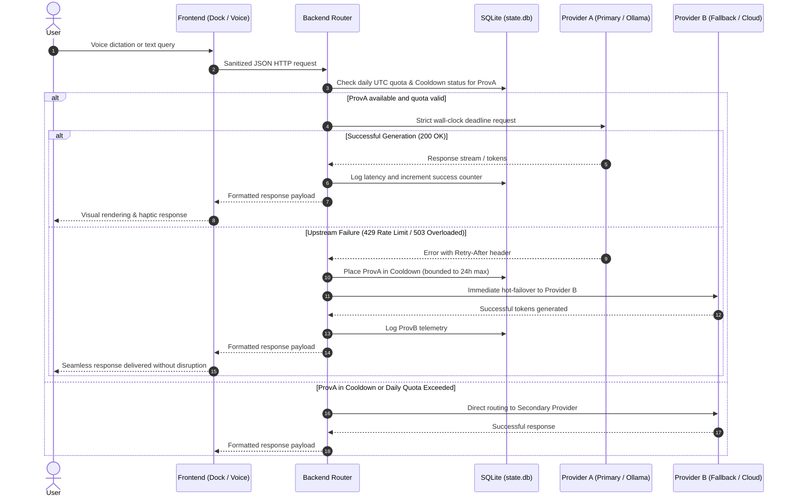
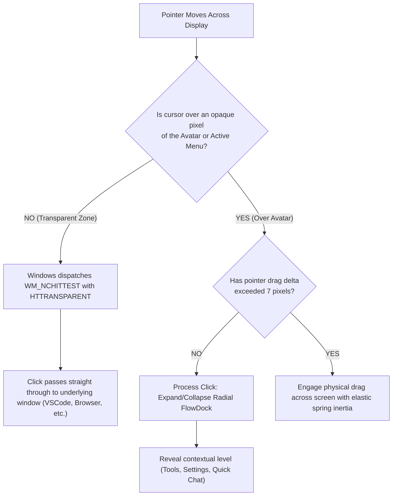

# Axx — Autonomous Resident Desktop AI Assistant & 3D Entity

## Descargar Axx 0.20.10 para Windows

**[⬇ Descargar instalador para Windows x64 · 247 MB](https://github.com/luigilaxmaster-coder/AXX/releases/download/v0.20.10/Axx_0.20.10_x64-setup.exe)**

[Ver la versión de prueba y sus archivos](https://github.com/luigilaxmaster-coder/AXX/releases/tag/v0.20.10) · [Cambios y pruebas](docs/REVISION-ENTREGA-20261022.md) · [Comprobar SHA256](https://github.com/luigilaxmaster-coder/AXX/releases/download/v0.20.10/SHA256SUMS.txt)

Descarga el `.exe`, ejecútalo en la otra PC y abre Axx desde su acceso instalado. **No necesitas instalar Python ni Node.** Para las preguntas de IA, configura un proveedor en Ajustes; tus credenciales y tu historial no se transfieren con el instalador.

Incluye **Magic Pen**, paneles modernizados, menú circular transparente, mejoras del movimiento del muñeco, acciones de escritorio y conversión local de imágenes/PDF. Es una **versión de prueba**: siguen pendientes la validación en otra PC, el atajo físico `Alt+Shift+A`, DPI mixtos y un fallo intermitente de arrastre.

---

<p align="center">
  
</p>

<p align="center">
  <strong>A resident entity for Windows 11 featuring a haptic 3D interface, multi-provider inference engine with automated failover, offline voice recognition, and procedural memory.</strong>
</p>

<p align="center">
  
  
  
  
  
  
  
  
</p>

<p align="center">
  <code>#ai-assistant</code> <code>#desktop-assistant</code> <code>#windows-11</code> <code>#tauri</code> <code>#rust</code> <code>#python</code> <code>#webgl</code> <code>#faster-whisper</code> <code>#ollama</code> <code>#mcp</code> <code>#failover</code> <code>#resident-avatar</code> <code>#offline-first</code>
</p>

---

## 💡 About — The Axx Manifesto

> *"Artificial intelligence should not remain trapped inside a browser tab or behind a sterile chat box. **Axx** shatters that paradigm: a living, haptic entity residing directly on your Windows desktop that accompanies you in real time, respects your privacy with local models, never obstructs your screen, and responds with rock-solid reliability through a hot-failover hybrid architecture."*

---

## 📸 System Showcase & Visual Interface

### Concept video

[](https://github.com/luigilaxmaster-coder/AXX/raw/refs/heads/main/docs/media/axx-presentation.mp4)

[▶ Watch or download the video](https://github.com/luigilaxmaster-coder/AXX/raw/refs/heads/main/docs/media/axx-presentation.mp4) · MP4 with audio · 10 seconds · 1280 × 720.

A visual presentation of Axx's liquid character. See the validation reports below for tested application behavior.

| 3D Entity at Rest (Base) | Parametric Shapes & Appearance Selector |
| :---: | :---: |
|  |  |
| *Organic fluid avatar with dynamic Fresnel shading and liquid physics* | *24 parametric volumetric geometries and 9 harmonic HSL color palettes* |

| Movement Dynamics & Spring Physics | Axx Connect Settings (MCP & Providers) |
| :---: | :---: |
|  |  |
| *Critically-damped spring controllers and haptic jitter filtering* | *LLM provider manager, DPAPI-encrypted tokens, and MCP tool registry* |

---

## 🚧 Project Status: Active Continuous Improvement

> [!NOTE]
> **Axx is under active development.** The current source manifests use **v0.20.10**, and a [Windows x64 test installer is published](https://github.com/luigilaxmaster-coder/AXX/releases/tag/v0.20.10). Validation is recorded per feature; a working UI or build does not by itself certify every hardware-dependent behavior.

### 🟢 Implemented capabilities
- **Native Startup:** Resident Windows application with a local backend and a launcher fallback to the executable built from this repository.
- **Dual 3D Shading Engine:** Parametric mesh of 24 volumetric shapes, real-time Fresnel shaders, and a 2x super-sampled CPU software fallback.
- **Transparent Click-Through:** Borderless desktop window that dynamically passes pointer clicks through transparent zones using the Win32 API (`WM_NCHITTEST`), ensuring complete background desktop usability.
- **Multi-Provider Connections:** Local/LAN Ollama, Ollama Cloud, LM Studio, Anthropic, Groq and compatible APIs, with model discovery and DPAPI-protected credentials. Explicit connection selection keeps requests on the selected provider/model; it does not silently switch platforms on failure.
- **Episodic Memory & MCP Core:** Integrated procedural SQLite memory and Model Context Protocol schema validation.

### Latest changes — October 22, 2026 · v0.20.10

- **Magic Pen MP-H1:** clean capture, point/rectangle/lasso selection, basic editable ink, questions through a configured vision provider and verified PNG export.
- **Desktop panels:** shared minimal styling, a transparent circular menu and one drag controller. The avatar previews movement locally and commits its position on release.
- **Desktop actions:** installed-app discovery, explicit action plans with approval, verified file hashing and reusable procedures.
- **Local converter:** PNG/JPEG conversion and PDF page merge/extraction, with input limits and verified output.
- **Validation:** 99 Python tests and 14 Rust tests passed, with one Rust helper ignored. Previous native checks covered opening/closing 31 views. One browser drag assertion failed intermittently; two subsequent runs passed. The physical summon shortcut and mixed-DPI hardware checks remain pending.

See the [delivery review](docs/REVISION-ENTREGA-20261022.md), [converter guide](docs/CONVERTIDOR-Y-PDF.md) and [published installer](https://github.com/luigilaxmaster-coder/AXX/releases/tag/v0.20.10).

### Previous changes — October 21, 2026

- Clickable tool controls, icon buttons, smoother tentacle rendering and sound recovery.
- More usable chat composition, reading and scrolling; stable dictation controls and isolated speech cancellation.
- [Provider and local model setup](docs/PROVEEDORES-API-LOCAL.md), including separate local/cloud Ollama catalogs.
- [Desktop commands from chat](docs/COMANDOS-DESDE-CHAT.md): open supported apps/sites, search the web and review explicitly typed PowerShell before execution.
- **System music:** discover Windows media sessions, select a player and tap Axx to pause/resume. Real Edge transport was verified. Output-level animation is implemented, but positive physical audio metering was not verified because the test session exposed no active output devices. Apps without Windows media controls cannot be universally paused.
- **Area recording:** drag a rectangle on the desktop, see its boundary halo, and tap Axx to pause/resume. MP4 video is saved automatically to `%LOCALAPPDATA%/Axx/artifacts/recordings`; no browser picker or base64 video transfer is needed. This native mode currently records video without audio. [Usage and limits](docs/GRABACION-DE-AREA.md).

See the [change log](CHANGELOG.md) and [music validation evidence](evidence/system-music-20261021/VERIFICATION.md) for checks and limits. These changes preceded the v0.20.10 test installer linked above.

### 🟡 Active refinement and remaining validation
- **Microphone Hardware Calibration & ASR Tuning:** Deep acoustic verification across diverse audio hardware and noise profiles prior to enabling continuous hands-free dictation by default.
- **Multi-Monitor & Mixed-DPI Dynamics:** Hardening haptic drags and elastic screen snapping across multi-monitor layouts with heterogeneous display scaling factors.
- **Expanded MCP Tool Library:** Ingestion of sandboxed system automation and developer utility tools with token isolation.
- **Background Memory Footprint:** Ongoing optimization of standby RAM footprint and idle CPU wake cycles.

---

## 🌟 What is Axx?

**Axx** is a next-generation resident desktop artificial intelligence assistant built specifically for Windows. Unlike conventional web-based chat apps, Axx lives directly on the user's desktop canvas as a fluid, responsive companion.

### Core Architectural Pillars:
1. **Non-Invasive Desktop Presence:** Floats in a borderless, transparent window that forwards clicks in empty spaces to the underlying active applications via native Win32 window region mapping.
2. **Resilient Hybrid Inference:** Autonomous model routing with automated hot-failover between offline local models (Ollama) and cloud APIs (OpenAI, Anthropic, OpenRouter).
3. **Local Voice & Privacy by Design:** On-device hardware-accelerated speech-to-text using `faster-whisper-tiny`. Audio never leaves the local machine.
4. **Persistent Memory & MCP Tools:** Long-term episodic context powered by `ai-memory` paired with industry-standard *Model Context Protocol* (MCP) for safe, structured desktop tool invocation.

---

## 🏛️ System Architecture

Axx is engineered with a modular, high-performance architecture split across three primary tiers: **Native Host (Rust/Tauri 2)**, **Haptic Graphical Frontend (WebGL/HTML5)**, and **Inference & Services Backend (Python 3.12)**.



---

## 🔄 Operational Flowcharts

### 1. Multi-Provider Inference with Automated Failover
This sequence diagram demonstrates how Axx processes incoming user queries while guaranteeing high availability against upstream outages, rate limits, or quota exhaustions:



---

### 2. Haptic Interaction & Click-Through Lifecycle
Axx hovers over the active workspace without obstructing background productivity through continuous opacity calculations:



---

## ⚡ Core Features

### 🔮 1. Dual 3D Rendering Pipeline
- **Primary WebGL Engine (`LiquidRenderer`):**
  - Procedural surface mesh composed of **112 × 72 segments** (16,128 triangles).
  - Real-time procedural raymarching with specular chromatic aberration, Fresnel contours, and a 512 × 512 bilinear lookup table (LUT).
- **CPU Software Engine Fallback (`SoftwareRenderer` / `CpuRaster`):**
  - Engineered for battery-saving laptops, virtualized environments, and low-power integrated graphics.
  - Strict 2x super-sampling resolution (`resolve2x`) with pre-multiplied alpha blending to eliminate edge aliasing.
- **24 Volumetric Parametric Geometries:**
  - *Classic Catalog:* `Core`, `Flow`, `Pearl`, `Torus`, `Split`, `Wave`, `Bloom`, `Fold`, `Spike`, `Drift`, `Orbit`, `Morph`.
  - *v20 Advanced Catalog:* `Cushion`, `Trefoil`, `Nova`, `Heart`, `Infinity`, `Helix`, `Knot`, `Petal`, `Prism`, `Capsule`, `Crescent`, `Ripple`.
  - *Protected Identity:* The `keepForm: true` flag in local persistence guarantees that ephemeral animation routines never overwrite the user's selected shape.

### 🛡️ 2. Production-Hardened Inference Router
- **Battle-Tested Resilience:** Built upon 10 strict defensive reliability patterns (H01–H10):
  - True wall-clock timeouts (70-second absolute deadline) to nullify slowloris stream stall attacks.
  - Strict JSON typing and rejection of non-standard numeric constants (`NaN`, `Infinity`).
  - RFC 2822 timezone-aware `Retry-After` parsing clamped to a maximum 24-hour window.
  - Clean separation between credential authentication faults (401) and policy/regional blocks (403).
  - Clean asynchronous child-process cancellation whenever the user hits `Esc`.

### 🎙️ 3. Private Local Voice Processing
- Bundled **Faster-Whisper Tiny** model verified with SHA256 integrity checks.
- Rapid local audio transcription with zero latency overhead and absolute privacy.

### 🧠 4. Episodic Memory & MCP Protocol
- Embedded `ai-memory` adapter storing cross-session contextual recall.
- Open integration via Anthropic's **Model Context Protocol (MCP)**, allowing Axx to inspect and interact with the local operating system safely.

### ⌨️ 5. Global Keyboard Shortcuts
| Shortcut | Action |
| :--- | :--- |
| `Alt + Shift + A` | Summon Axx to smoothly track the cursor position. |
| `Alt + Shift + A, A` (double-tap < 450 ms) | Command Axx to return immediately to its resting base position. |
| `Alt + Shift + T` | Open the Tools & Settings radial palette directly. |
| `Esc` | Abort active tracking, cancel in-flight inference, or collapse open menus. |

---

## 📂 Repository Structure

```plaintext
AXX/
├── 1.AXX/                         # WebGL frontend, haptic CSS, and resident runtime
│   ├── Axx.html                   # Complete 3D runtime, GLSL shaders, and state machines
│   └── scripts/                   # UI bridging and interaction scripts
├── backend/                       # Python service core
│   ├── connect/                   # MCP host, HTTP API endpoints, and provider registries
│   ├── inference/                 # LLM client adapters and local Ollama integrations
│   ├── memory/                    # SQLite procedural memory and ai-memory adapters
│   ├── speech/                    # Offline Faster-Whisper transcription engine
│   └── server.py                  # Primary headless local services server
├── src-tauri/                     # Native Rust host (Tauri v2)
│   ├── Cargo.toml                 # Rust dependencies and compiler optimizations
│   ├── tauri.conf.json            # Transparent window settings and NSIS bundle config
│   └── src/
│       ├── main.rs                # Application native entrypoint
│       ├── lib.rs                 # Tauri commands, system tray, and lifecycle
│       └── resident.rs            # Win32 API window manager, click-through & hotkeys
├── resources/                     # Model weights and cryptographic manifests
│   ├── models/faster-whisper-tiny/# Pre-packaged local ASR weights, config & tokenizer
│   ├── command-library.json       # Catalog of verified desktop actions and recipes
│   └── providers.default.json     # Default template for upstream LLM providers
├── scripts/                       # Build automation, verification & diagnostic test harnesses
│   ├── build-windows.ps1          # Production packaging script for Windows
│   ├── start-axx.ps1              # Rapid development launcher
│   └── verify-installed-files.py  # SHA256 cryptographic post-build audit
├── docs/                          # Architectural documentation and assets
│   └── images/                    # High-resolution screenshots, flowcharts & official logo
├── package.json                   # Node.js dependencies and Tauri CLI scripts
├── providers.json                 # Active upstream model provider configuration
└── README.md                      # Technical repository documentation
```

---

## 🚀 Getting Started & Development

### Prerequisites
- **Operating System:** Windows 10 or 11 (64-bit).
- **Node.js:** v18.0 or later (`npm` or `pnpm`).
- **Rust:** Stable 1.78+ with the MSVC toolchain (`rustup toolchain install stable-x86_64-pc-windows-msvc`).
- **Python:** Version 3.11 or 3.12 (3.12 recommended) on the system `PATH`.

### 1. Clone the Repository
```bash
git clone https://github.com/luigilaxmaster-coder/AXX.git
cd AXX
```

### 2. Install Dependencies
```powershell
# Install frontend packages and Tauri CLI
npm install

# Install Python backend dependencies
pip install -r requirements-axx-connect.txt
pip install -r requirements-converter.txt
```

### 3. Launch in Development Mode
To start the live development environment with hot-reloading:

```powershell
npm run tauri dev
```
*Alternatively, you can run the automated launcher script:*
```powershell
powershell -ExecutionPolicy Bypass -File .\scripts\start-axx.ps1
```

---

## ⚙️ Provider Configuration (`providers.json`)

Customize `providers.json` at the root of the project to define local models or cloud endpoints:

```json
{
  "active_provider": "ollama_local",
  "providers": {
    "ollama_local": {
      "type": "ollama",
      "endpoint": "http://127.0.0.1:11434",
      "model": "llama3.2:latest",
      "enabled": true,
      "timeout_seconds": 60
    },
    "openai_cloud": {
      "type": "openai",
      "api_key_env": "OPENAI_API_KEY",
      "model": "gpt-4o-mini",
      "enabled": false,
      "max_daily_quota": 500
    },
    "claude_cloud": {
      "type": "anthropic",
      "api_key_env": "ANTHROPIC_API_KEY",
      "model": "claude-3-5-sonnet-20241022",
      "enabled": false
    }
  }
}
```

---

## 📦 Building for Production (Windows NSIS Installer)

To compile and package the audited release executable (`.exe` NSIS):

```powershell
powershell -ExecutionPolicy Bypass -File .\scripts\build-windows.ps1
```

The script automatically executes:
1. Cryptographic SHA256 integrity validation of all local models and binaries against declared manifests.
2. Isolated packaging of the Python backend into a standalone binary via PyInstaller (`dist/axx-backend.exe`).
3. Release-mode compilation of the Rust host.
4. Final packaging of the NSIS installer located at `src-tauri/target/release/bundle/nsis/`.

---

## 🔒 Security & Privacy Guarantees

- **Zero Forced Telemetry:** Runtime metrics and performance data remain strictly inside local SQLite stores (`state.db`).
- **DPAPI Secret Encryption:** API keys and credentials are encrypted using the Windows Data Protection API (DPAPI) locked to the current Windows user profile.
- **Sandboxed Command Execution:** Operating system commands execute strictly within an approved catalog, preventing arbitrary or untrusted code execution.

---

## 📄 License

This project is distributed under the license terms specified in the repository. Refer to `src-tauri/resources/licenses/` for license notices regarding third-party components (Faster-Whisper, NumPy, AI-Memory).

---

<p align="center">
  Engineered with precision and dedication by <a href="https://github.com/luigilaxmaster-coder"><strong>luigilaxmaster-coder</strong></a>
</p>
