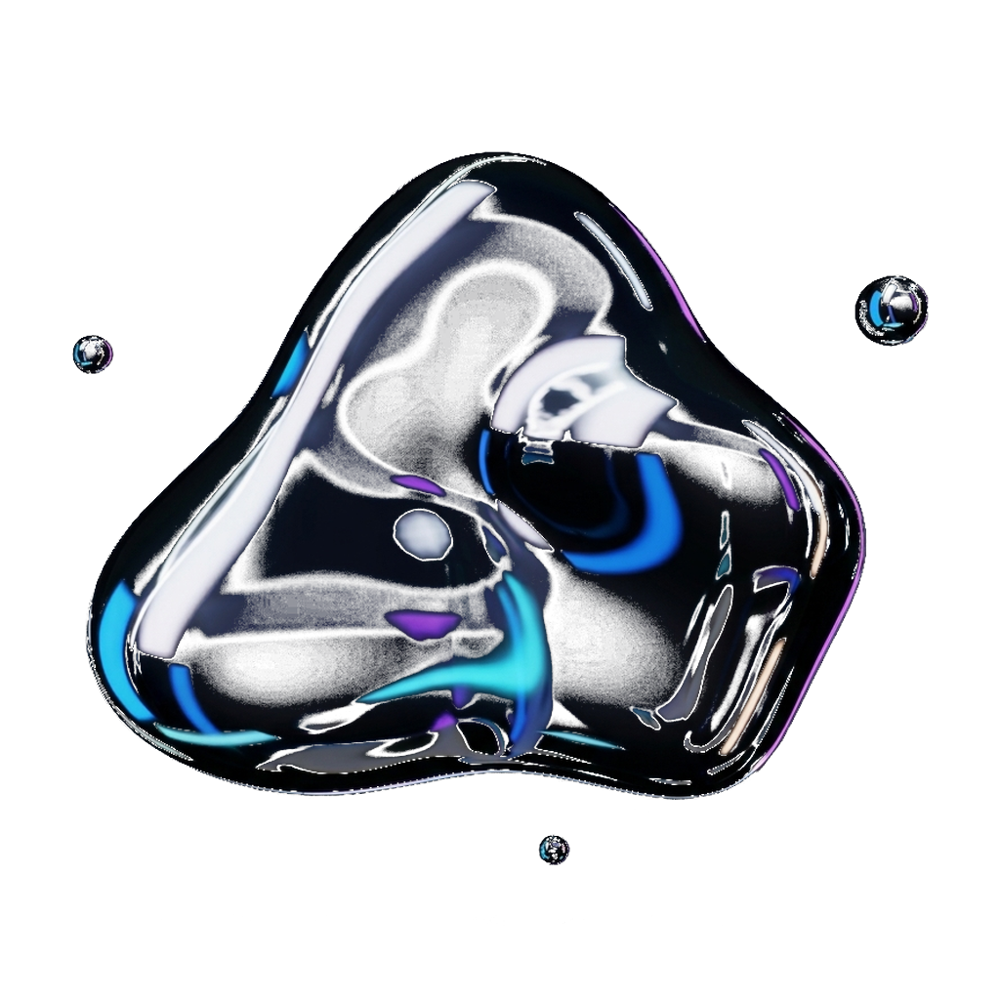
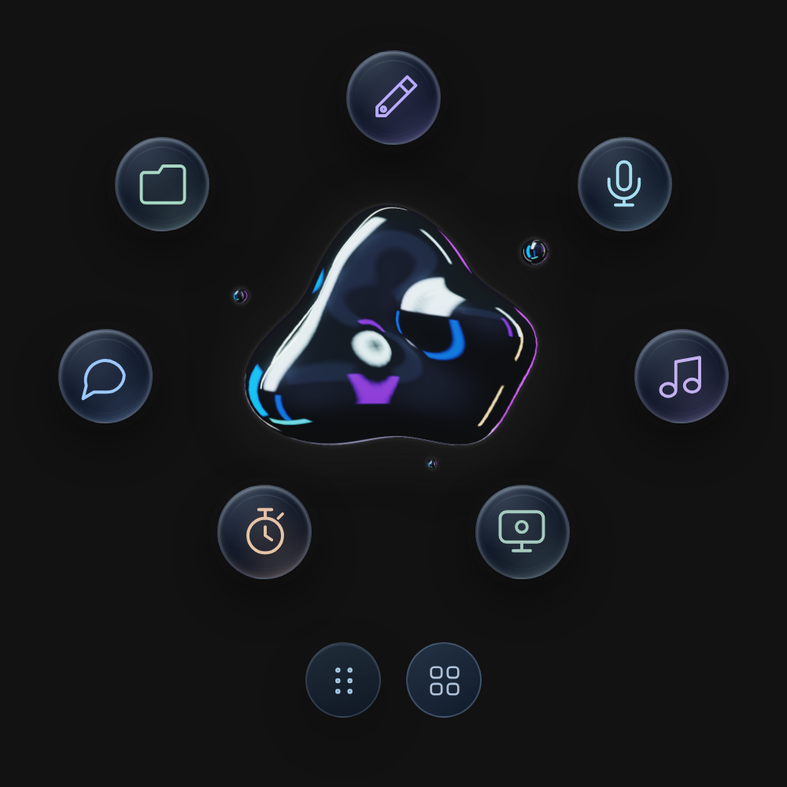
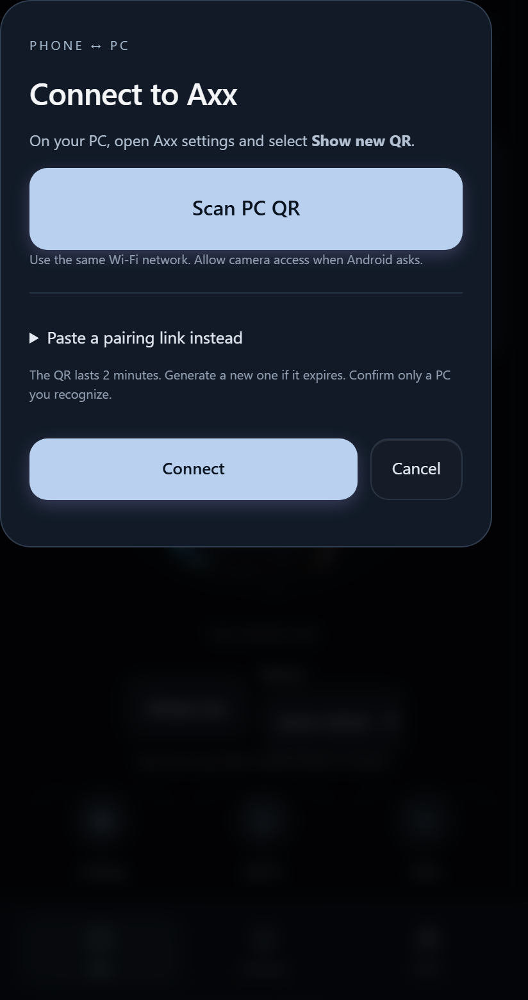
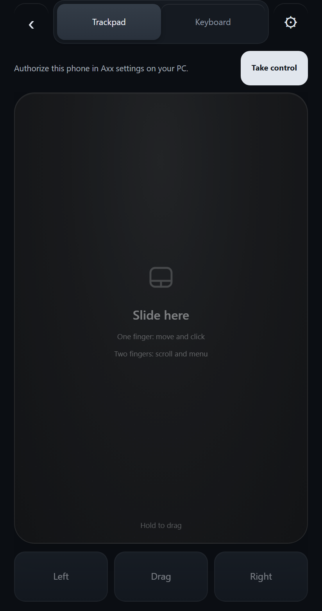
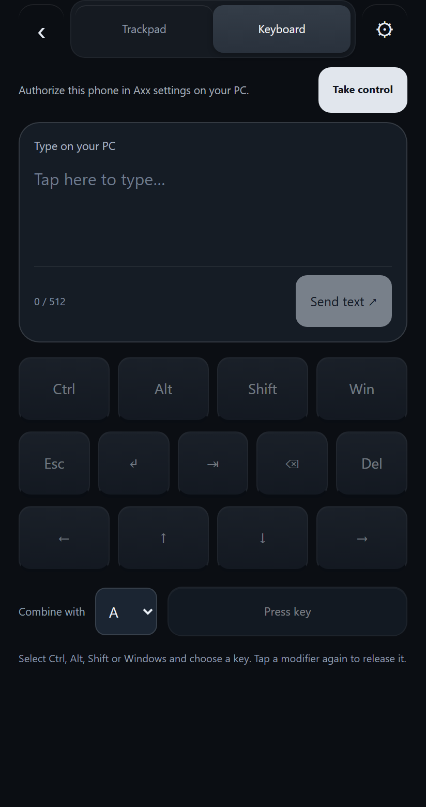
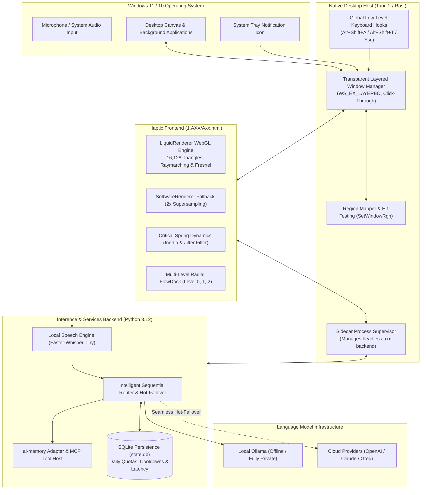
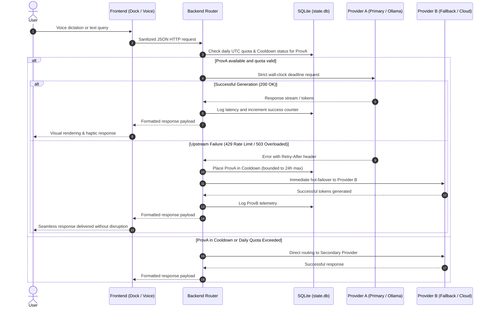
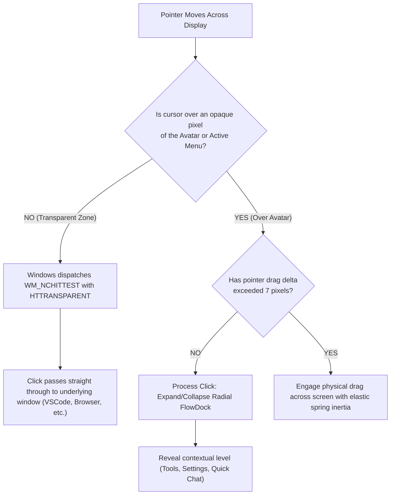

# Axx — Autonomous Resident Desktop AI Assistant & 3D Entity

## Download Axx for Windows

<!-- release:download:start -->
**[Download Windows x64 test installer · v0.20.18](https://github.com/luigilaxmaster-coder/AXX/releases/download/v0.20.18/Axx_0.20.18_x64-setup.exe)** · [Release files](https://github.com/luigilaxmaster-coder/AXX/releases/tag/v0.20.18) · [SHA-256](https://github.com/luigilaxmaster-coder/AXX/releases/download/v0.20.18/SHA256SUMS.txt)

Run the installer and open Axx. Python and Node are not required. Configure your own AI provider in Settings; credentials and conversation history are not included in the installer. Windows may need Internet to install WebView2. The installer is unsigned.

The packaged backend may take longer on its first launch while Windows extracts and scans it. The native host allows up to 90 seconds for backend readiness and reports a startup error if that limit is exceeded.

Source and published Windows installer are both **v0.20.18**. Android APKs remain local test artifacts until separately published. See [mobile setup and validation](docs/mobile/README.md) and the [version and release procedure](docs/RELEASING.md).
<!-- release:download:end -->

---

<p align="center">
  
</p>

<p align="center">
  <strong>A resident Windows assistant with a 3D interface, selectable AI providers, local speech tools, and procedural memory.</strong>
</p>

<p align="center">
  
  
  
  
  
  
  
  
</p>

<p align="center">
  <code>#ai-assistant</code> <code>#desktop-assistant</code> <code>#windows-11</code> <code>#tauri</code> <code>#rust</code> <code>#python</code> <code>#webgl</code> <code>#faster-whisper</code> <code>#ollama</code> <code>#mcp</code> <code>#failover</code> <code>#resident-avatar</code> <code>#offline-first</code>
</p>

---

## 💡 About — The Axx Manifesto

> *"Axx brings a 3D assistant to the Windows desktop. Its local model and speech options keep those requests on the PC when configured; other providers follow their own connection settings."*

---

## Axx on desktop and Android

The desktop remains the coordinator. Axx Mobile connects to the same conversation, tasks and services on your PC.

### The character and its circular menu

<p align="center">
  
</p>

The existing renderer, reflections and radial shortcuts, captured at twice the display resolution with a close framing.

### Connect, move and type

<table>
  <tr>
    <th align="center">Pair with your PC</th>
    <th align="center">Full-screen trackpad</th>
    <th align="center">Remote keyboard</th>
  </tr>
  <tr>
    <td valign="top"></td>
    <td valign="top"></td>
    <td valign="top"></td>
  </tr>
  <tr>
    <td>Scan the PC QR and confirm the connection.</td>
    <td>Request permission, then use the dedicated touch area.</td>
    <td>Compose text and use modifier keys and shortcuts.</td>
  </tr>
</table>

These are presentation captures of the current UI in an isolated browser. The mobile views show the state before control authorization; they are not hardware acceptance evidence. [Capture details](docs/images/showcase/README.md) · [Physical verification and build hashes](docs/mobile/PAIRING-VERIFICATION.md).

**Start on the same Wi-Fi:** open Axx Settings → **Connect your phone → Show new QR**, then choose **Scan PC QR** in Android. Mouse and keyboard access require a separate grant on the PC. [Setup, permissions and recovery](docs/mobile/README.md).

<details>
<summary>Watch the character concept video</summary>

[](https://github.com/luigilaxmaster-coder/AXX/raw/refs/heads/main/docs/media/axx-presentation.mp4)

[Watch or download](https://github.com/luigilaxmaster-coder/AXX/raw/refs/heads/main/docs/media/axx-presentation.mp4) · MP4 with audio · 10 seconds · 1280 × 720. This is a concept presentation; feature validation is recorded separately.

</details>

---

## 🚧 Project Status: Active Continuous Improvement

> [!NOTE]
> **Axx is under active development.** Source and published Windows installer are both **v0.20.18**. Validation is recorded per feature; a working UI or build does not by itself certify every hardware-dependent behavior.

### 🟢 Implemented capabilities
- **Native Startup:** Resident Windows application with a local backend and a launcher fallback to the executable built from this repository.
- **Dual 3D Shading Engine:** Parametric mesh of 24 volumetric shapes, real-time Fresnel shaders, and a 2x super-sampled CPU software fallback.
- **Transparent Click-Through:** Borderless desktop window that dynamically passes pointer clicks through transparent zones using the Win32 API (`WM_NCHITTEST`), ensuring complete background desktop usability.
- **Multi-Provider Connections:** Local/LAN Ollama, Ollama Cloud, LM Studio, Anthropic, Groq and compatible APIs, with model discovery and DPAPI-protected credentials. Explicit connection selection keeps requests on the selected provider/model; it does not silently switch platforms on failure.
- **Episodic Memory & MCP Core:** Integrated procedural SQLite memory and Model Context Protocol schema validation.

### Source update · October 23, 2026

| Area | Behavior in this source | Operational limit |
| --- | --- | --- |
| Phone access | Pair each phone by a one-use QR, then approve its capabilities on the PC. Approved permissions persist and can be revoked. | A new installation or lost Android signing key can require pairing again. The phone and PC must be reachable on the local network. |
| Remote character | Rotate and move the character from Android; the desktop receives gesture events and applies them to the native character. | Visual timing still depends on the network and active desktop window; verify with the physical phone. |
| Work | Inspect the PC, open an allowed app, search, write a new artifact, choose an executable command, and review operation results. A lost response can be checked by operation ID; the phone can explicitly discard its local follow-up record. | Work permission is separate from mouse/keyboard permission. Discarding the record does not cancel a PC operation. |
| Shell commands | Send `/powershell <script>` or `/cmd <command>` from the phone or desktop chat. The PC must approve each request; output and exit code are returned. | These are **arbitrary commands with the current Windows user's privileges**. Review the exact text before approval. Execution is capped at 30 seconds and 64 KiB of output; approval is not a sandbox. Voice dictation and model responses cannot directly run shell text. |
| Chat | Select the configured local Ollama model for token-by-token text in the native window. The backend verifies that `ollama-local` points to `127.0.0.1:11434` before enabling the direct stream. Connecting preloads the selected model and requests a 30-minute keep-alive. The user can tune response style and language. | The first model load can still take tens of seconds; the preload starts in the background on connection. Other providers use their existing complete-response path. Prompt settings adjust responses; no model weights are trained. |
| Speech | Automatic Windows voice starts quickly; optional Axx Alba, Nova, Aura, and Titán voices use local MOSS ONNX plus user-supplied reference audio. Text is cleaned before speech so punctuation markers are not read aloud. Speech can start from completed phrases while the local chat continues. | The custom voices require a separate local MOSS installation and samples in `%LOCALAPPDATA%\Axx\speech\voices\`; neither weights nor user audio are stored in Git. Their initial model load is much slower than Windows SAPI. Available Windows voices and language quality depend on the machine. |

For the four optional voices, copy the reference clips as 24 kHz mono PCM WAV files named `axx-alba.wav`, `axx-nova.wav`, `axx-aura.wav`, and `axx-titan.wav` into `%LOCALAPPDATA%\Axx\speech\voices\`. Set `AXX_MOSS_TTS_ROOT` to the local `MOSS-TTS-Nano` directory if it is outside `~/Downloads/tts nano/MOSS-TTS-Nano`; that directory must contain its `.venv`, ONNX models, and runtime. Open the voice selector to choose one. The voice names are Axx names in both Spanish and English; audio quality in each language depends on the reference clip and local model.

### Latest updates · October 22, 2026

| Area | Changes | Status |
| --- | --- | --- |
| Android companion | Real desktop character/material, shared conversation and tasks, transparent home shortcut | Implemented; physical checks recorded per feature |
| Pairing | Explicit camera permission, PC identity preview, one-use TLS-pinned QR, full 120-second renewal window, external camera links | Regression tests pass; user confirmed optical scan and connection |
| Remote input | Full-screen trackpad and larger keys, bounded input queue, local input priority, 3-second lease, material-derived cursor, event-driven Windows input monitoring | Partial physical validation; full gesture and mixed-DPI acceptance pending |
| Remote voice | PC shortcut → Android capture → existing local Whisper → review/desktop conversation | Real capture/transcription checked; spoken command-to-result acceptance pending |
| Presentation | English mobile UI, compact update summary and a new high-resolution desktop/mobile gallery | UI previews; hardware results linked separately |

[Mobile operation, contracts and test report](docs/mobile/README.md) · [Feature traceability](docs/mobile/TRAZABILIDAD.md) · [Changelog](CHANGELOG.md)

<details>
<summary>Earlier desktop updates</summary>

- **v0.20.11:** avatar edge dragging, stale-position response rejection and panel bounds. Earlier validation: 12 interaction checks, 99 Python tests and 29 Rust tests; physical drag/shortcut and second-PC checks remain pending. [Report](docs/ARRASTRE-Y-ATAJO-0.20.11.md).
- **v0.20.10:** Magic Pen MP-H1, desktop panels, reviewed desktop actions and local image/PDF conversion. [Delivery review](docs/REVISION-ENTREGA-20261022.md) · [Converter guide](docs/CONVERTIDOR-Y-PDF.md).
- **October 21:** provider discovery, chat actions, native music controls and silent area recording. [Providers](docs/PROVEEDORES-API-LOCAL.md) · [Chat actions](docs/COMANDOS-DESDE-CHAT.md) · [Area recording](docs/GRABACION-DE-AREA.md).

</details>

### 🟡 Active refinement and remaining validation
- **Microphone Hardware Calibration & ASR Tuning:** Deep acoustic verification across diverse audio hardware and noise profiles prior to enabling continuous hands-free dictation by default.
- **Multi-Monitor & Mixed-DPI Dynamics:** Hardening haptic drags and elastic screen snapping across multi-monitor layouts with heterogeneous display scaling factors.
- **Expanded MCP Tool Library:** Ingestion of sandboxed system automation and developer utility tools with token isolation.
- **Background Memory Footprint:** Ongoing optimization of standby RAM footprint and idle CPU wake cycles.

---

## 🌟 What is Axx?

**Axx** is a next-generation resident desktop artificial intelligence assistant built specifically for Windows. Unlike conventional web-based chat apps, Axx lives directly on the user's desktop canvas as a fluid, responsive companion.

### Core Architectural Pillars:
1. **Non-Invasive Desktop Presence:** Floats in a borderless, transparent window that forwards clicks in empty spaces to the underlying active applications via native Win32 window region mapping.
2. **Resilient Hybrid Inference:** Autonomous model routing with automated hot-failover between offline local models (Ollama) and cloud APIs (OpenAI, Anthropic, OpenRouter).
3. **Local Voice & Privacy by Design:** On-device hardware-accelerated speech-to-text using `faster-whisper-tiny`. Audio never leaves the local machine.
4. **Persistent Memory & MCP Tools:** Long-term episodic context powered by `ai-memory` paired with industry-standard *Model Context Protocol* (MCP) for safe, structured desktop tool invocation.

---

## 🏛️ System Architecture

Axx is engineered with a modular, high-performance architecture split across three primary tiers: **Native Host (Rust/Tauri 2)**, **Haptic Graphical Frontend (WebGL/HTML5)**, and **Inference & Services Backend (Python 3.12)**.



---

## 🔄 Operational Flowcharts

### 1. Multi-Provider Inference with Automated Failover
This sequence diagram demonstrates how Axx processes incoming user queries while guaranteeing high availability against upstream outages, rate limits, or quota exhaustions:



---

### 2. Haptic Interaction & Click-Through Lifecycle
Axx hovers over the active workspace without obstructing background productivity through continuous opacity calculations:



---

## ⚡ Core Features

### 🔮 1. Dual 3D Rendering Pipeline
- **Primary WebGL Engine (`LiquidRenderer`):**
  - Procedural surface mesh composed of **112 × 72 segments** (16,128 triangles).
  - Real-time procedural raymarching with specular chromatic aberration, Fresnel contours, and a 512 × 512 bilinear lookup table (LUT).
- **CPU Software Engine Fallback (`SoftwareRenderer` / `CpuRaster`):**
  - Engineered for battery-saving laptops, virtualized environments, and low-power integrated graphics.
  - Strict 2x super-sampling resolution (`resolve2x`) with pre-multiplied alpha blending to eliminate edge aliasing.
- **24 Volumetric Parametric Geometries:**
  - *Classic Catalog:* `Core`, `Flow`, `Pearl`, `Torus`, `Split`, `Wave`, `Bloom`, `Fold`, `Spike`, `Drift`, `Orbit`, `Morph`.
  - *v20 Advanced Catalog:* `Cushion`, `Trefoil`, `Nova`, `Heart`, `Infinity`, `Helix`, `Knot`, `Petal`, `Prism`, `Capsule`, `Crescent`, `Ripple`.
  - *Protected Identity:* The `keepForm: true` flag in local persistence guarantees that ephemeral animation routines never overwrite the user's selected shape.

### 🛡️ 2. Production-Hardened Inference Router
- **Battle-Tested Resilience:** Built upon 10 strict defensive reliability patterns (H01–H10):
  - True wall-clock timeouts (70-second absolute deadline) to nullify slowloris stream stall attacks.
  - Strict JSON typing and rejection of non-standard numeric constants (`NaN`, `Infinity`).
  - RFC 2822 timezone-aware `Retry-After` parsing clamped to a maximum 24-hour window.
  - Clean separation between credential authentication faults (401) and policy/regional blocks (403).
  - Clean asynchronous child-process cancellation whenever the user hits `Esc`.

### 🎙️ 3. Private Local Voice Processing
- Bundled **Faster-Whisper Tiny** model verified with SHA256 integrity checks.
- Rapid local audio transcription with zero latency overhead and absolute privacy.

### 🧠 4. Episodic Memory & MCP Protocol
- Embedded `ai-memory` adapter storing cross-session contextual recall.
- Open integration via Anthropic's **Model Context Protocol (MCP)**, allowing Axx to inspect and interact with the local operating system safely.

### ⌨️ 5. Global Keyboard Shortcuts
| Shortcut | Action |
| :--- | :--- |
| `Alt + Shift + A` | Summon Axx to smoothly track the cursor position. |
| `Alt + Shift + A, A` (double-tap < 450 ms) | Command Axx to return immediately to its resting base position. |
| `Alt + Shift + T` | Open the Tools & Settings radial palette directly. |
| `Esc` | Abort active tracking, cancel in-flight inference, or collapse open menus. |
| `Ctrl + Alt + Shift + V` | Toggle the paired Android remote microphone session while Axx Mobile is visible and microphone permission is granted. |

---

## 📂 Repository Structure

```plaintext
AXX/
├── 1.AXX/                         # WebGL frontend, haptic CSS, and resident runtime
│   ├── Axx.html                   # Complete 3D runtime, GLSL shaders, and state machines
│   └── scripts/                   # UI bridging and interaction scripts
├── backend/                       # Python service core
│   ├── connect/                   # MCP host, HTTP API endpoints, and provider registries
│   ├── inference/                 # LLM client adapters and local Ollama integrations
│   ├── mobile/                    # LAN gateway, pairing, shared state, remote input and voice
│   ├── memory/                    # SQLite procedural memory and ai-memory adapters
│   ├── speech/                    # Offline Faster-Whisper transcription engine
│   └── server.py                  # Primary headless local services server
├── mobile/                        # Android companion (Capacitor + native Android modules)
│   ├── android/                   # Native transport, microphone, camera and home widget
│   ├── client.html                # Operational mobile entrypoint
│   └── js/                        # Shared desktop integration and full-screen controls
├── src-tauri/                     # Native Rust host (Tauri v2)
│   ├── Cargo.toml                 # Rust dependencies and compiler optimizations
│   ├── tauri.conf.json            # Transparent window settings and NSIS bundle config
│   └── src/
│       ├── main.rs                # Application native entrypoint
│       ├── lib.rs                 # Tauri commands, system tray, and lifecycle
│       └── resident.rs            # Win32 API window manager, click-through & hotkeys
├── resources/                     # Model weights and cryptographic manifests
│   ├── models/faster-whisper-tiny/# Pre-packaged local ASR weights, config & tokenizer
│   ├── command-library.json       # Catalog of verified desktop actions and recipes
│   └── providers.default.json     # Default template for upstream LLM providers
├── scripts/                       # Build automation, verification & diagnostic test harnesses
│   ├── build-windows.ps1          # Production packaging script for Windows
│   ├── start-axx.ps1              # Rapid development launcher
│   └── verify-installed-files.py  # SHA256 cryptographic post-build audit
├── docs/                          # Architectural documentation and assets
│   └── images/                    # High-resolution screenshots, flowcharts & official logo
├── package.json                   # Node.js dependencies and Tauri CLI scripts
├── providers.json                 # Active upstream model provider configuration
└── README.md                      # Technical repository documentation
```

---

## 🚀 Getting Started & Development

### Prerequisites
- **Operating System:** Windows 10 or 11 (64-bit).
- **Node.js:** v18.0 or later (`npm` or `pnpm`).
- **Rust:** Stable 1.78+ with the MSVC toolchain (`rustup toolchain install stable-x86_64-pc-windows-msvc`).
- **Python:** Version 3.11 or 3.12 (3.12 recommended) on the system `PATH`.

### 1. Clone the Repository
```bash
git clone https://github.com/luigilaxmaster-coder/AXX.git
cd AXX
```

### 2. Install Dependencies
```powershell
# Install frontend packages and Tauri CLI
npm install

# Install Python backend dependencies
pip install -r requirements-axx-connect.txt
pip install -r requirements-converter.txt
pip install -r requirements-mobile.txt
```

### 3. Launch in Development Mode
To start the live development environment with hot-reloading:

```powershell
npm run tauri dev
```
*Alternatively, you can run the automated launcher script:*
```powershell
powershell -ExecutionPolicy Bypass -File .\scripts\start-axx.ps1
```

---

## ⚙️ Provider Configuration (`providers.json`)

Customize `providers.json` at the root of the project to define local models or cloud endpoints:

```json
{
  "active_provider": "ollama_local",
  "providers": {
    "ollama_local": {
      "type": "ollama",
      "endpoint": "http://127.0.0.1:11434",
      "model": "llama3.2:latest",
      "enabled": true,
      "timeout_seconds": 60
    },
    "openai_cloud": {
      "type": "openai",
      "api_key_env": "OPENAI_API_KEY",
      "model": "gpt-4o-mini",
      "enabled": false,
      "max_daily_quota": 500
    },
    "claude_cloud": {
      "type": "anthropic",
      "api_key_env": "ANTHROPIC_API_KEY",
      "model": "claude-3-5-sonnet-20241022",
      "enabled": false
    }
  }
}
```

---

## 📦 Building for Windows (NSIS Installer)

With the pinned Node dependencies installed (`npm ci`), the Python build requirements available, and the declared local dependencies present, build the Windows test installer:

```powershell
powershell -ExecutionPolicy Bypass -File .\scripts\build-windows.ps1
```

The script executes:
1. SHA-256 validation of the declared AI memory binary and Faster-Whisper model files. Optional MOSS weights and user voice samples are external and are not packaged.
2. Isolated packaging of the Python backend into a standalone binary via PyInstaller (`dist/axx-backend.exe`).
3. Release-mode compilation of the Rust host.
4. Final packaging of the NSIS installer located at `src-tauri/target/release/bundle/nsis/`.

---

## 🔒 Security and privacy boundaries

- **Zero Forced Telemetry:** Runtime metrics and performance data remain strictly inside local SQLite stores (`state.db`).
- **DPAPI Secret Encryption:** API keys and credentials are encrypted using the Windows Data Protection API (DPAPI) locked to the current Windows user profile.
- **Shell approval:** PowerShell and CMD accept arbitrary user-written scripts only after explicit PC approval. They run with the Axx process user's Windows permissions; the workspace is a working directory, not an isolation boundary. Do not approve text you have not inspected.
- **Phone authorization:** Pairing a phone does not grant all capabilities. Grant and revoke control or Work separately in desktop settings. Keep the PC and Android app updated together when the mobile protocol changes.

---

## 📄 License

See `src-tauri/resources/licenses/` for third-party notices. No repository-wide license is declared here; contact the repository owner before assuming redistribution rights.

---

<p align="center">
  Engineered with precision and dedication by <a href="https://github.com/luigilaxmaster-coder"><strong>luigilaxmaster-coder</strong></a>
</p>
