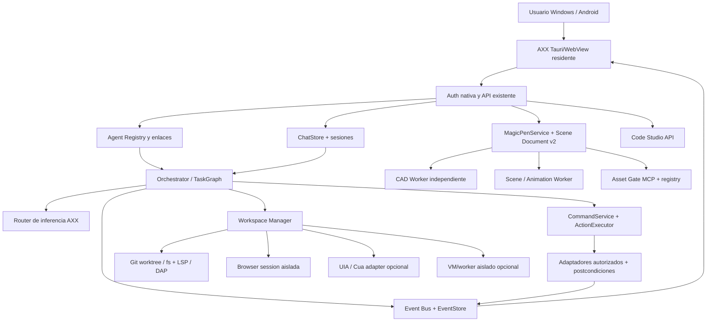
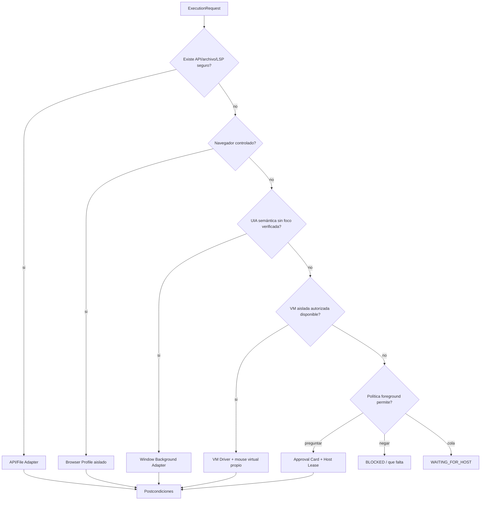
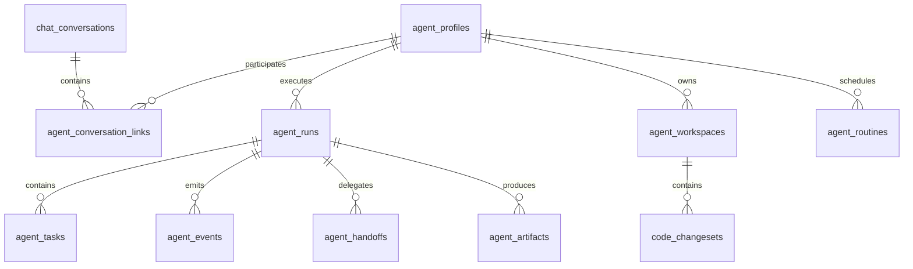
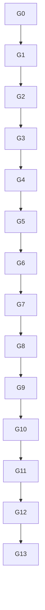

> **Estado:** arquitectura y especificaciones propuestas. No constituye ejecución, instalación o pruebas reales de AXX. Base de código inspeccionada: `508bceabc718905db9bcf4042992d91f4c6c0705` (`main`, fuente 0.22.52).


> **Uso:** seguir las fases y gates; no sustituir funciones ni reescribir la aplicación. Las APIs y esquemas nuevos son propuestas.


## Guía de uso del paquete

**Estado:** especificación de implementación, no software instalado. **Fecha de corte:** 2026-11-21. **Idioma:** español. **Propietario del proyecto:** autor humano de AXX. **Repositorio:** <https://github.com/luigilaxmaster-coder/AXX>.

> **REGLA PRINCIPAL:** ampliar AXX sin sustituir sus chat, CommandService, ActionExecutor, memoria, router de inferencia, sistema de voz, avatar ni Magic Pen. Todo cambio es aditivo, reversible, medible y aprobado por pruebas.

## Alcance

Esta documentación une tres planes sucesivos en **un único backlog**:

1. **AXX Evolution / Magic Pen:** Superpowers, Diagram Design, CAD preciso, Motion Educator, viz3d/creator-generalist, Codevember, OpenVINO, Gaussian Splat, Asset Gate y Diorama.
2. **AXX Agent Workspace:** personalización exhaustiva de agentes, conversión de chats existentes, equipos multiagente, handoffs, memoria por alcance, permisos y continuidad.
3. **AXX Independent Workspaces + Code Studio:** ejecución en segundo plano sin interferir con usuario, mouse virtual comprobable, navegadores aislados, entornos virtuales, edición profesional de código, Git, LSP, DAP, tests y verificación.

No se ha editado el código de AXX, lanzado sus tests nativos ni instalado nada durante la preparación de este paquete. Los contratos nuevos son **propuestas versionadas** que se deben integrar y probar, nunca descripciones de endpoints ya disponibles.

## Documentos: leer en este orden

| Archivo | Objetivo |
|---|---|
| `docs/00_BASELINE_Y_REGLAS.md` | Hechos comprobados, fuentes, autoridad y prohibiciones de regresión |
| `docs/01_REQUISITOS_PRODUCTO.md` | Requisitos, historias, modos, UX y criterios no funcionales |
| `docs/02_ARQUITECTURA_OBJETIVO.md` | Componentes, fronteras, dependencias, datos y diagramas |
| `docs/03_AGENT_DESIGNER_CHAT.md` | Personalización y transformación de chats sin pérdida |
| `docs/04_ORQUESTACION_MULTIAGENTE.md` | TaskGraph, eventos, handoffs, autonomía y recovery |
| `docs/05_SEGURIDAD_Y_PERMISOS.md` | Amenazas, controles, secretos, scopes, aprobaciones |
| `docs/06_COMPUTER_USE_SEGUNDO_PLANO.md` | Mouse propio, UIA/Cua, aislamiento, limitaciones Windows |
| `docs/07_CODE_STUDIO.md` | Editor profesional, LSP/DAP, Git, parches y tests |
| `docs/08_MAGIC_PEN_Y_ASSETS.md` | Evolución 2D/3D, CAD, simulación, assets y fidelidad |
| `docs/09_DATOS_Y_MIGRACIONES.md` | Datos SQLite y migración segura |
| `docs/10_API_Y_EVENTOS.md` | HTTP, SSE, auth, errores y contratos de eventos |
| `docs/11_RENDIMIENTO_Y_INFRAESTRUCTURA.md` | Política de recursos, nube y workers |
| `docs/12_PRUEBAS_Y_ACEPTACION.md` | Pruebas por módulo y matriz de no regresión |
| `docs/13_FASES_Y_GATES.md` | Orden dependiente y entregas verificables |
| `docs/14_DESPLIEGUE_Y_ROLLBACK.md` | Conservación, backups, publicación y reversión |
| `docs/15_REFERENCIAS_Y_LICENCIAS.md` | Inventario upstream, compatibilidad y adopción |
| `docs/16_PROMPT_MAESTRO_CODEX.md` | Instrucción ejecutable para equipos de agentes |
| `docs/17_DECISIONES_Y_RIESGOS.md` | ADRs, alternativas rechazadas y decisiones pendientes |
| `docs/18_CONTRATOS_DE_INTERACCION.md` | Casos de uso de extremo a extremo, UX y errores |
| `docs/19_MAPA_DE_CAMBIOS_POR_ARCHIVO.md` | Acoplamiento concreto a ficheros actuales y nuevos módulos |
| `docs/20_PLAN_DE_PRS.md` | Descomposición granular en 20 PRs con dependencias y gates |
| `schemas/*.json` | Ejemplos de JSON Schema (Draft 2020-12) para nuevas entidades |
| `sql/001_agent_foundation.sql` | DDL propuesto de foundation; **no ejecutar en producción antes de revisión** |
| `qa/acceptance-matrix.csv` | Matriz rastreable, implementable como pruebas |
| `qa/PHASE_GATE_TEMPLATE.md` | Acta estándar de cierre de fase |
| `records/ADR_TEMPLATE.md` | Plantilla para decisiones arquitectónicas |
| `records/upstream-lock.json` | Revisiones upstream comprobadas y pendientes de fijación |

## Orden de adopción

**No saltar fases.** Fases 0–7: modernización y aceptación de Magic Pen. Fase 8: perfiles de agente sobre chats existentes. Fase 9: Code Studio Core. Fase 10: workspaces en segundo plano. Fase 11: orquestación multiagente. Fase 12: Code Studio Pro y más integraciones. Fase 13: automatizaciones y transferencia entre dispositivos. Cada fase requiere los gates de `13_FASES_Y_GATES.md`.

### Semántica de estado

- **ACTUAL/VERIFICADO-EN-FUENTE:** observado en la rama publicada; no prueba instalado/funcionando en PC.
- **PROPUESTO:** contrato o componente que no forma parte aún de la fuente revisada.
- **NO VALIDADO EN WINDOWS:** dependerá de pruebas en el equipo real y permisos del usuario.
- **GATE:** requisito binario para habilitar, fusionar o publicar.
- **BLOQUEO:** no se puede asumir éxito o degradar permisos para continuar.

## Cómo entregar este paquete a Codex/Antigravity

1. Extraer el ZIP **en el repositorio de trabajo o junto a él**, idealmente bajo `docs/evolution-3/` **en una rama aislada**; conservar `main` intacta.
2. Leer primero `AGENTS.md`, `docs/RELEASING.md`, `docs/mobile/COMPATIBILITY-PROTOCOL.md` de **la copia actual** de AXX. Ante discrepancia, el repositorio prevalece sobre este paquete.
3. Comparar commit, tests y archivos presentes contra `00_BASELINE_Y_REGLAS.md`. No implementar con rutas supuestas.
4. Ejecutar `docs/16_PROMPT_MAESTRO_CODEX.md` **fase por fase**; cada cambio conserva recibos y matriz de aceptación.
5. Versionar la documentación junto al código y registrar los cambios de contrato en `docs/17_DECISIONES_Y_RIESGOS.md`.

## Invariantes irrenunciables

**I-01** No segundo ejecutor con efectos en host. **I-02** No ampliar permisos al delegar. **I-03** No repetir efecto `unknown`. **I-04** No alterar formas/material/voz/tentáculos sin autorización visual. **I-05** No romper `/v1`, pairing o Android. **I-06** No borrar historial/borradores/credenciales. **I-07** No afirmar una simulación como CAD exacto. **I-08** No ejecutar código generado en host como sandbox. **I-09** No fallback oculto de proveedores. **I-10** No confundir un cursor decorativo con entrada independiente. **I-11** No publicar con validaciones fallidas o incompletas. **I-12** No tocar configuraciones ajenas de otra rama o sesión.

## Entregables exigidos por cada fase

Inventario de cambios, manifiesto de licencias, migración arriba/abajo, tests positivos y negativos, evidencias Windows cuando corresponda, `AGENTS.md` y compatibilidad respetados, reporte PASS/FAIL/BLOCKED/SKIPPED, plan de rollback, diffs revisados y documentación actualizada. Una prueba simulada no certifica funcionalidad instalada.


\newpage

# 00 — Baseline comprobada y reglas de preservación

## 0.1 Autoridad de fuentes

**Repo de AXX revisado el 2026-11-21:** `luigilaxmaster-coder/AXX` en `main`, SHA `508bceabc718905db9bcf4042992d91f4c6c0705`. README: versión fuente y release publicada `0.22.52` (declaración de esa revisión). El equipo del propietario puede tener cambios locales o una instalación más reciente: verificar antes de editar.

Fuentes canónicas del propio AXX, en orden: `AGENTS.md`; `docs/mobile/COMPATIBILITY-PROTOCOL.md`; `docs/RELEASING.md`; `docs/UNIFIED-EXECUTION.md`; `docs/CHAT-WORKSPACE.md`; `docs/MAGIC-PEN-DESKTOP.md`; `docs/spatial-intelligence/IMPLEMENTATION-STATUS.md`; código y tests actuales. Este documento es una especificación complementaria; nunca anula la política del repositorio.

### Mapa verificado de responsabilidades

| Archivo/ruta existente | Responsabilidad observada | Qué **no** hacer |
|---|---|---|
| `src-tauri/src/` | Host nativo Tauri/Windows, captura, estado de superficie y entrada | Crear otra ventana de escritorio privilegiada no auditada |
| `backend/chat_store.py` | ChatStore, grupos, contexto, identidades, TTL de mensajes | Sustituir o migrar destructivamente `chat_conversations` |
| `1.AXX/scripts/chat-workspace.js` | UI actual Chats y grupos; autenticación host | Montar otra app de chat o cambiar IDs existentes |
| `1.AXX/scripts/agent-profile.js` | Perfil global, tono, herramientas preferidas | Reutilizar perfil global como almacén de todos los agentes |
| `backend/commands.py` + `backend/actions/executor.py` | Comandos tipados, permisos, efecto, comprobación | Dar herramientas directas al LLM sin CommandService |
| `backend/action_learning.py` | Procedimientos, planificación y acciones aprendidas | Duplicar la lógica de capacidades con otro motor separado |
| `backend/memory/skill_memory.py` | Skills y contexto versionado | Aceptar habilidad importada como ejecutable por sí sola |
| `backend/memory/task_memory.py` | Identidad/generación de memoria por tarea | Compartir memoria privada por un mero vínculo de bot |
| `backend/computer_use.py` | Grant/ticket y admisión efímera del control PC | Convertir el ticket en permiso persistente de agente |
| `backend/actions/desktop_input.py` | Entrada ligada a observación actual y ventana exacta | Inyectar entrada global desde un worker sin adjudicación |
| `backend/actions/browser_bridge.py` | CDP a navegador explícito en loopback | Conectar automáticamente al perfil personal predeterminado |
| `backend/actions/process_runner.py` | Ejecución revisada, Job Object, límites | Tratarlo como un sandbox de código arbitrario |
| `backend/actions/file_inspection.py` | Hash/inspección limitada | Usar scans sin scope y sin límite de tamaño |
| `backend/actions/file_workflows.py` | Descubrimiento/bundles verificados | Sobrescribir sin comprobar versión del destino |
| `backend/magic_pen.py` | Captura, visión, revisiones de Magic Pen | Reiniciar sesiones al convertir un chat en agente |
| `backend/presentation_plan.py` | Plan declarativo espacial validado | Generar/evaluar JS o Python de modelo en WebView privilegiada |
| `backend/shape_registry.py` | Catálogo de componentes técnicos | Confundir con formas visuales del avatar |
| `1.AXX/scripts/shape-library.js` | Exportación del catálogo técnico de partes | Usarlo como autoridad de formas del avatar |
| `1.AXX/scripts/spatial-scene.js` | Visor Three.js espacial | Mezclar versiones incompatibles de Three.js en el mismo contexto |
| `1.AXX/scripts/magic-pen.js` | UI captura/edición/visualización | Reemplazar controles, coordenadas o histórico existentes |
| `mobile/js/avatar-engine.js` | Catálogo móvil documentado de 24 formas y 9 paletas | Suponer correspondencia de índices con PC sin comprobar |
| `backend/inference/adapter.py` | Frontera de inferencia, cancelación, límites | Cambiar modelo/proveedor silenciosamente |

### Hechos específicos de compatibilidad

- `chat_store.py` define `chat_conversations`, `chat_messages`, `chat_groups`, `chat_context`, adjuntos, enlaces y preferencias. Mensajes y notas comunes del chat vencen a los **90 días**; la memoria de agente nueva no debe alterar ese contrato.
- `docs/CHAT-WORKSPACE.md` establece que los grupos comparten **solo notas compartidas expresamente**; los mensajes privados de otros chats no se incluyen. Se debe respetar revocación y renovación de IDs de Connect cuando cambia contexto.
- `docs/UNIFIED-EXECUTION.md` describe el circuito: `Chat/voz/Comandos/Axx Connect -> CommandService -> ActionExecutor -> adaptador -> verificador -> SQLite`. Los modos declarados incluyen `background` limitado, `foreground` y `isolated` **no disponible actualmente**. No se admite fallback entre modos.
- La ejecución persiste `running` **antes** de despachar. Tras interrupción puede quedar `unknown`; ni el mismo ID ni uno nuevo equivalente deben reemitir la mutación ciegamente. Cancelar no revierte efectos realizados.
- `backend/computer_use.py` concede entrada solo desde un grant explícito. Los procesos bloqueados, identificadores de ventana, PID y observaciones no se omiten para facilitar los nuevos agentes.
- El avatar original es una entidad de usuario. La identidad de agente nuevo es un *perfil* visual derivado del catálogo, no una sustitución del avatar aprobado. La especificación móvil enumera 24 formas/9 paletas; la compatibilidad exacta PC/móvil requiere prueba.
- OpenVINO puede ser proveedor opcional local, no sustituto automático de modelos 50B/100B ni garantía de rendimiento Iris Xe.

## 0.2 Reglas obligatorias de AGENTS.md

1. Autoría humana; no añadir `Co-authored-by` de IA, no cambiar identidad Git, no reescribir atribución.
2. En cambio de versión escritorio, sincronizar mediante `python scripts/release.py sync --version X.Y.Z`; nunca editar metadatos sueltos.
3. Seguir `docs/RELEASING.md`: build, instalar, verificar, push y publicación confirmada; un push no equivale a un lanzamiento.
4. `AGENTS.md` exige `python scripts/validate_companion.py --output build/companion-validation.json` sobre fuente integrada; el recibo correcto es requisito de publicar.
5. `/v1` tiene compatibilidad obligatoria: no retirar rutas, campos ni cambiar semántica. Versionar cambios incompatibles.
6. Mantener desktop/Android con versiones independientes, pairing/credenciales/IDs de operaciones intactos.
7. Respetar `mobile/design-baseline.json`; no refrescar hashes para hacer pasar una regresión visual. La autorización visual exige comparación y aprobación.
8. Nunca subir pesos de modelos, voces personales, claves, configuración privada ni estado runtime.

## 0.3 Inventario de no regresión (baseline obligatorio)

Ejecutar *antes* de cualquier parche y guardar: rama/SHA, estado de `git`, entorno Windows, logs, comandos, duración, stdout/stderr, capturas visuales aprobadas, datos de pruebas, latencia p50/p95 y hash de instalador verificado. No ejecutar una prueba instalada sin controlar el proceso/puerto y conservar la posibilidad de restaurar preferencias.

`git status --porcelain=v1`, `git rev-parse HEAD`, `git branch --show-current`, `python --version`, `node --version`, `rustc --version`, `cargo --version`, `pnpm --version` si procede. Las suites concretas están en `12_PRUEBAS_Y_ACEPTACION.md`; primero confirmar que las rutas aún existen.

## 0.4 Protección por área

- **Avatar/OrganicTendrils:** cámara, encuadre, contorno, materiales ópticos, hit mask, anclajes, estados, accesos radiales, memoria de posiciones, reacción a cursor, iconos y hotkeys son inmutables por defecto.
- **Magic Pen:** captura a DPI físico, lazo/rectángulo/punto, dibujo, historial, undo/redo, cancelación, metadatos de origen y proveedores elegidos intactos.
- **Voz/dictado:** ASR, VAD, TTS, interrupción, inserción de texto en apps, modelo de voz y selección de micrófono intactos.
- **Computer Use/CLI:** mismas autorizaciones, observaciones/leases, scopes, postcondiciones, idempotencia y logs.
- **Android/Telegram/Axx Connect:** scopes, identidad, rutas y privilegios conservados; no heredar permiso host por estar en el chat del agente.
- **Git y archivos:** no staging indiscriminado, no modificar `main`, no pisar trabajos de otras sesiones, no borrar archivos de usuario.

## 0.5 Fuentes vs objetivos

**Código fuente confirmado** no significa **aceptado en ejecutable real**. **Propuesta detallada** no significa **implementada**. **Librería MIT** no significa **assets de terceros libres**. **Cursor visual** no significa **múltiples cursores físicos reales**. **Contenedor** no significa **aislamiento seguro para cualquier amenaza**. Esta distinción es condición de los informes y las notas de release.


\newpage

# 01 — Requisitos funcionales, UX y no funcionales

## 1.1 Visión de producto

AXX sigue siendo una presencia residente mínima. La vista principal muestra chat y entrada de voz. Herramientas y paneles siguen saliendo del cuerpo (Morph Reach), se arrastran y recuerdan tamaño/posición. Se añade un **modo de agente** dentro del sistema de chats existente, no otra interfaz que compita con él. Cada agente es una combinación de identidad, contexto, capacidad, permisos, recursos y sesión de ejecución; cada tarea puede delegarse y producir evidencia.

### Historias de usuario esenciales

- **UR-001:** convertir una conversación histórica en chat con agente sin cambiar `conversation_id`, mensajes, adjuntos, drafts, identidades de Connect ni operaciones pendientes.
- **UR-002:** crear agente desde `Chats y grupos` mediante asistente de perfil o lenguaje natural; previsualizar exactamente una de 24 formas AXX y nueve paletas; no crear mascota externa.
- **UR-003:** agente programador modifica un *worktree* mientras el usuario edita `main`, sin capturar el foco de la PC.
- **UR-004:** agente visual genera diagrama/escena, permite seleccionar objeto, editar parámetros sin reconstruir todo y comparar revisiones.
- **UR-005:** agente CAD crea STEP paramétrico con dimensiones introducidas y vista GLB, identifica inferencias geométricas cuando solo posee foto.
- **UR-006:** agente de navegador consulta páginas en perfil aislado; cookies y secretos no fluyen entre perfiles.
- **UR-007:** usuario puede exigir aprobación antes de que cualquier agente mueva el ratón en host; el motor debe poder decir «no disponible en segundo plano».
- **UR-008:** conversación de equipo muestra quién trabaja, artefactos, aprobaciones, errores y costes en una sola línea temporal.
- **UR-009:** delegación transmite un scope igual o más limitado, nunca un permiso nuevo.
- **UR-010:** cierre inesperado permite recuperar artefactos y trabajos conocidos; efectos `unknown` quedan bloqueados hasta reconciliación.
- **UR-011:** usuario puede importar plantilla de equipo sin credenciales ni grants heredados; las rutinas importadas comienzan desactivadas.
- **UR-012:** todos los modelos, voces, tamaños, permisos, políticas de fondo, canales y recursos se pueden configurar por agente y sobreescribir por sesión con scopes autorizados.
- **UR-013:** sincronización móvil sigue sin escalada: observar progreso de agente no equivale a controlar el PC.
- **UR-014:** usuario puede borrar memoria de agente sin que sobrevivan índices o caches de contenido retirado; TTL de chats preservado.

## 1.2 Modos de operación del agente

**Conversation:** responde sin ejecutar herramientas salvo interacciones existentes autorizadas. **Agent:** una identidad persistente con capacidad de planificar tareas y sugerir herramientas. **Team:** varios agentes en un chat, con coordinador, miembros y política de intervención. **Autonomous routine:** tarea programada/evento autorizado con controles propios; no activa automáticamente micrófono ni control host. **Code workspace:** agente activo dentro de un proyecto Git. **Magic Pen session:** agente vinculado a documento/captura con revisiones.

Regla de resolución: actividad directa sencilla pasa al agente activo; una tarea compleja puede usar TaskGraph; un equipo se activa por petición explícita, mención de agentes o reglas configuradas y transparentes. La ausencia de routing confiable vuelve al agente principal; nunca inventar un especialista o un modelo accesible.

## 1.3 Personalización «full»

**Apariencia:** forma ID canónica 0–23, paleta ID 0–8, material/preset validado, brillo, tamaño y movimiento dentro de límites del renderer; preview/aplicar/descartar reversible; miniatura cacheada; animación reduce-motion; sin sobrescribir identidad principal.

**Personalidad:** nombre, idioma, rol, estilo, instrucciones, objetivos, nivel de detalle, herramientas preferidas, preferencias de verificación, formato de salida. Instrucciones no autorizan herramientas.

**Inteligencia:** manual/automático, modelo por texto/visión/voz/programación, presupuesto de tokens/coste y latencia, context window compatible, conexiones autorizadas, fallback `ask|none|allowed-profile` explícito.

**Memoria:** agentes, proyectos, conversaciones y usuario global separados; documentación de retención y procedencia; indexado por scopes y revocación.

**Computadora:** `none|api|browser|window_background|foreground|isolated_vm|remote`, aplicaciones permitidas, carpetas permitidas, acceso red, perfil navegador, policy de foco `ask|queue|isolated|deny`, caducidad de grant, horas permitidas y cuota.

**Colaboración:** especialistas permitidos, cantidad máxima, profundidad máxima de delegación, permisos de lectura/escritura por artefacto, difusión limitada de contexto, revisión obligatoria en caso de datos sensibles.

**Recursos:** prioridad, concurrencia, RAM/GPU/cpu, máximo de jobs pesados, coste diario/mensual, inactividad y suspensión.

## 1.4 Diseño de interfaz, sin regresión

- La pestaña existente «Chats y grupos» pasa a «Chats y agentes» conservando todos los comandos anteriores.
- «Nuevo» ofrece «Chat», «Agente», «Equipo»; conversión reversible de chat a agente, nunca migración destructiva.
- La configuración se abre como panel emergente de AXX: no bandeja fija externa ni rediseño del avatar.
- Ficha de agente: miniatura real, rol, modelo, presupuesto, conectores, estado de trabajo, espacio, botón abrir, pausar y editar. Menú contextual: duplicar **solo configuración no secreta**, exportar, archivar, desvincular.
- Dentro del chat, respuestas llevan agente/operación, artefactos, solicitud de permiso, diff, preview, estado y factura estimada/real. No mostrar cadenas de pensamiento privadas ni fingir pasos.
- El Code Studio puede abrirse como panel grande separado y persistente, con pestañas y arrastre; al cerrarlo los cambios sin guardar permanecen en borradores seguros.
- El modo de cursor visual únicamente muestra eventos de movimiento/acción reales y se etiqueta como *cursor virtual del agente*, no como ratón físico adicional.

## 1.5 Objetivos medibles, no promesas

Los siguientes son **umbrales iniciales de aceptación por definir tras baseline**: regresión cero en funciones legadas; 100% de acciones mutantes registradas; 100% de grants auditables; 0 escrituras cruzadas a raíces no autorizadas; 0 acciones host foreground durante política `deny`; no duplicación de efectos en prueba de crash; progreso SSE reconectable; caída de worker sin pérdida de artefactos confirmados; 30 FPS mínimo para escena 3D de referencia en hardware objetivo *si la baseline lo permite*; métricas de latencia p50/p95 sin inventar límite absoluto.

Se deben publicar números con hardware, dataset, resolución, número de participantes y método. Un valor aislado de FPS no certifica estabilidad.

## 1.6 Fuera de alcance por defecto

- Reescribir AXX completamente en Rust o cambiar de Tauri a Electron.
- Reemplazar avatar o voces, subir muestras de voz, eliminar grupos existentes.
- Crear agentes que se autoasignen permisos ilimitados.
- Ejecutar automáticamente Python de modelos en el host sin revisión ni aislamiento real.
- Afirmar «cada agente tiene su propio ratón físico en la misma sesión Windows»; los workers pueden disponer de ratón **virtual en sesión aislada**.
- Autorizar pagos, publicaciones, emails o scripts peligrosos sin política correspondiente.
- Certificar precisión estructural/eléctrica/médica a partir de escenas conceptuales.


\newpage

# 02 — Arquitectura objetivo y fronteras

## 2.1 Arquitectura C4 simplificada



**Frase de arquitectura:** «AXX orquesta y presenta; CommandService autoriza efectos; los trabajadores hacen trabajo especializado; SQLite registra estado; Magic Pen y Code Studio son vistas y capacidades, no ejecutores alternativos». El panel del usuario nunca monta shells o intérpretes desde texto producido por el modelo.

## 2.2 Límites de confianza

1. **WebView/UI:** no contiene claves de proveedores, comandos de host ni rutas privilegiadas no validadas. Solo interactúa con API autenticada del host.
2. **Backend AXX:** autoridad de identidades, sesiones, grants, scopes, journal de acciones, record/reconcile y datos de usuario.
3. **Worker local:** acceso explícito a carpetas, red y procesos; no se considera sandbox solo por ejecutar fuera de proceso.
4. **Worker remoto:** confianza diferenciada; cifrado, autenticación mutua, grants temporales, prohibido enviar capturas/archivos privados por defecto, retención declarada.
5. **Proveedor de modelos:** recibe únicamente el contexto necesario y autorizado por scope/proveedor; salida no confiable, nunca autoridad de permisos.
6. **Assets/plantillas/MCP:** datos externos no confiables; sanitizar HTML/SVG/glTF/archivos y verificar licencia, URL, hash.
7. **Identidad móvil/Telegram:** autorización propia; nunca usar el acceso del agente en PC como permiso móvil universal.

## 2.3 Subsistemas y contratos

| Subsistema | Entrada canónica | Salida canónica | Persistencia | Límite de permisos |
|---|---|---|---|---|
| Agent Registry | AgentProfileSpec | AgentProfile v# | tablas agente | perfil no ejecuta acciones |
| Conversation Binding | conversation_id + agent_id | membership | ChatStore + tabla aditiva | contexto explícito |
| TaskGraph | GoalSpec + scopes | tareas DAG con estados | SQLite | hereda permisos efectivos |
| Handoff Router | TaskContract | HandoffResult | SQLite + event log | atenuación de grants |
| Runtime Scheduler | ExecutionRequest | lease/deny/queue | SQLite + proceso | exclusividad por recurso |
| Workspace Manager | WorkspaceSpec | workspaceRef | DB+disco | root allowlist/sandbox |
| Code Studio | CodeChangeProposal | ChangeSet + tests | Git/worktree + DB | escritura limitada |
| Magic Pen Studio | SourceRevision/ScenePatch | SceneRevision | asset hash + DB | revisión/scope |
| Asset Registry | AssetDescriptor + license | AssetRef inmutable | content-addressed store | validación de origen |
| Event Hub | RuntimeEvent | SSE + snapshot | SQLite journal | ACL por conversación |

## 2.4 Estructura de código propuesta (no presente todavía)

```text
backend/
  agents/
    registry.py  bindings.py  profiles.py  policy.py
    orchestrator.py  task_graph.py  handoffs.py  events.py
    scheduler.py  recovery.py  routines.py
  workspaces/
    manager.py  leases.py  browser_sessions.py
    vm_provider.py  remote_protocol.py  focus_guard.py
  code_studio/
    projects.py  patch_engine.py  git_workspace.py
    file_versions.py  language_servers.py  debug_adapters.py
    test_runner.py  indexer.py  artifact_link.py
  spatial/
    scene_document.py  patches.py  asset_registry.py
    cad_contracts.py  render_jobs.py
1.AXX/scripts/
  agents/
    agent-designer.js  agent-roster.js
    agent-timeline.js  team-chat.js  work-approvals.js
  code-studio/
    code-workspace.js  code-editor.js  code-diff.js
    git-panel.js  problems-panel.js  terminal-panel.js
  magic-pen/
    diagram-editor.js  cad-editor.js
    scene-history.js  asset-browser.js  timeline-editor.js
workers/
  cad-worker/  scene-worker/  code-worker/  vm-gateway/
docs/evolution-3/  [copiar este paquete aquí]
```

Nombres modulares orientativos. Antes de abrir un PR, revisar estructura real y reutilizar servicios ya existentes (por ejemplo en `backend/actions`, `backend/inference`, `backend/memory`), sin duplicar semántica. Mantener adaptadores detrás de `CommandService`.

## 2.5 Contratos internos de referencia

- `AgentProfile` no incluye token de API ni conexión autenticada; solo referencias opacas a credenciales.
- `Task` tiene `task_id`, `run_id`, `graph_version`, `input_refs`, `agent_id`, `parent_id`, `lease`, `required_capabilities`, `state`, `attempt` y `idempotency_key`.
- `ExecutionRequest` incluye identidad de usuario, proyecto, conversación, scope de memoria vigente, operador, superficie, objeto destino, política de foco, presupuesto y postcondición.
- `SceneDocument v2` no transporta binarios en JSON; usa hashes y refs de STEP/GLB/SVG/PNG con metadata de fidelidad.
- `ChangeSet` incluye ref de worktree, archivo, sha256 antes/después, hunk, codificación, base revision, pruebas ejecutadas y estado de integración.
- `RuntimeEvent` identifica agente/ejecución/seq con payload limitado, sin secretos ni cadena de pensamiento.

## 2.6 Definiciones de ‘background’, ‘isolation’ y ‘mouse propio’

- **Background API/file:** no requiere foco Windows, puede continuar mientras usuario trabaja.
- **Background UIA:** acción semántica específica en una ventana con observación vigente y sin tomar foco; no implica compatibilidad universal.
- **Virtual pointer:** representación gráfica de interacción del agente; NO crea canal de entrada física separado.
- **Isolated desktop:** sesión de escritorio independiente (VM o runtime remoto) con mouse/teclado de dicha sesión; utiliza recursos reales y su disponibilidad debe probarse.
- **Same desktop multi-pointer:** experimental; no garantiza teclado/foco independiente. No base de aislamiento de agentes.

## 2.7 Descomposición operacional de un requerimiento

1. Normalizar texto/voz/pen a `GoalSpec` vinculado a conversación y contexto.
2. Seleccionar ruta rápida (respuesta sin herramientas) o TaskGraph complejo.
3. Resolver permisos y capacidad *antes* de asignar runtime.
4. Reservar workspaces/recursos, preparar artefactos de entrada por hash.
5. Ejecutar tareas permitidas; los efectos al host pasan por CommandService.
6. Verificar objetivos de salida mediante testers externos a la generación.
7. Consolidar resultados en chat original, con refs, estado y costes reales.
8. Si se cancela, liberar leases y conservar efectos confirmados; no fabricar rollback.

## 2.8 Decisiones anti-fragilidad

Agregar campos opcionales/versionados; no cambiar `chat_conversations` in place salvo migración explicada; evitar cadenas cíclicas de importaciones; separar adaptadores de presentación; proteger recursos del GPU; worker crash no tumba WebView; SSE con replay acotado; SQLite en transacciones cortas; operaciones con estado incierto recuperables por inspección, nunca inferidas completadas.


\newpage

# 03 — Agent Designer y evolución de Chats y grupos

## 3.1 Principio de migración UX

El usuario pidió que cada chat pueda funcionar como un agente **sin abrir una aplicación ni un chat artificial separado**. Implementación: `conversation_id` conserva su identidad y se le añaden N enlaces `chat_agent_memberships`; el chat sigue renderizándose por `chat-workspace.js`. Cada agente puede participar en N conversaciones; su memoria no concede acceso cruzado a otros hilos.

**Prohibido:** crear una nueva colección independiente de conversaciones y trasladar mensajes a ella. El modelo será `AgentProfile (1..N) <-> ChatConversation (0..N)` mediante memberships. El perfil global actual (`agent-profile.js`) sigue controlando el AXX principal; crear un nuevo agente crea perfil separado, no actualiza global.

## 3.2 Agent Designer: tabs y campos

| Pestaña | Campos | Validación |
|---|---|---|
| Identidad | nombre, alias, descripción, rol, idioma, instrucciones | longitud, Unicode controlado, sin secretos en prompts |
| Apariencia | form_id, palette_id, material, idle_motion, tamaño, respuesta visual | 24/9 canónicos, material compatible, reduce motion |
| Inteligencia | provider_profile_ref, modelo preferido, modalidad, esfuerzo, max tokens | capability check, sin fallback oculto |
| Voz | voz existente, idioma, TTS provider, velocidad, lectura automática | conservar preferencias de micrófono del usuario |
| Memoria | fuentes, reglas de retención, usuario/proyecto/agente/chat | scopes ACL, revocación efectiva |
| Herramientas | allowlist de command IDs, MCP, browser, file/code/CAD | capacidades verificadas, permisos por efecto |
| Computadora | mode, entorno, procesos permitidos, raiz, network, política de foco | no autorizar ambiente no disponible |
| Autonomía | ask/auto_safe, triggers, budgets, horarios, timeout | defaults restrictivos, auditoría |
| Colaboración | equipos, skill roles, límites, revisores, delegaciones | scopes atenuados, ciclos prohibidos |
| Recursos | concurrencia, CPU/RAM/GPU, red, cuotas | límites host + proveedor |

**UX reversible:** preview -> aplicar -> descartar. Previews visuales no alteran preferencias canónicas. Límite inicial de inputs, validación de schema y frecuencia de autosave. La forma principal retorna tras cerrar un chat de agente.

## 3.3 Formas AXX

La implementación móvil inspeccionada enumera 24 formas: Core, Flow, Pearl, Torus, Split, Wave, Bloom, Fold, Spike, Drift, Orbit, Morph, Cushion, Trefoil, Nova, Heart, Infinity, Helix, Knot, Petal, Prism, Capsule, Crescent, Ripple; paletas Obsidian, Nebula, Ocean, Sunset, Amethyst, Emerald, Champagne, Silver, Void. **No asumir IDs equivalentes PC/móvil sin comprobar catálogo de escritorio**. `backend/shape_registry.py` y `1.AXX/scripts/shape-library.js` son **partes técnicas**, no autoritativas para el avatar.

- Crear `AvatarFormAdapter` que obtenga catálogo canónico de la instalación, versión de renderer y compatibilidad por plataforma.
- Guardar `appearance.form_id` y `form_catalog_version` o ID estable; no basar todo en índice si el catálogo puede reordenarse.
- Miniatura de agente a 128–256 px, sin activar renderer de cuerpo completo para agentes en reposo; caché invalidada por material/paleta/form/version.
- El agente activo puede aparecer como instancia visual dentro de chat o elegir una transición reversible de la presencia principal. Si hay tareas concurrentes, no multiplicar cuerpos con bucles WebGL permanentes.
- Reutilizar preferencias actuales de reducción de movimiento, hit-mask, tentáculos, control radial, Morph Reach, posiciones/arrastre. No reemplazar la textura/material aprobado.
- Una forma expresa identidad visual, no privilegios ni capacidades.

## 3.4 Flujos UX concretos

### Crear agente desde chat actual

`Chats y grupos > Este chat > Convertir a agente > Configurar > Preview > Guardar`. Validación atómica: registro agente + membership + revision de perfil. Ni `chat_messages` ni Connect IDs se modifican salvo que cambie explícitamente el contexto enviado al proveedor; esa actualización usa el mecanismo existente de renovación.

### Crear equipo

`Nuevo > Equipo`: elegir miembros existentes, responsable, propósito, modo (consulta/colaboración), presupuesto y política de delegación. Se crea un `agent_team` y membership de sus miembros en **el mismo hilo**. Agentes sin permiso de leer el proyecto solo ven el resumen explícitamente aprobado.

### Conversación con actividad por agente

Timeline muestra `agent_id`, estado, tarea, diff/artefacto, costes y solicitudes de aprobación. Estados visuales sugeridos: `idle`, `queued`, `thinking`, `acting`, `waiting_approval`, `verifying`, `completed`, `failed`, `paused`; mapear a animaciones canónicas sin cambiar su guardado permanente.

### Cambiar modelo sin perder agente

Actualizar `AgentProfile.revision` de proveedor, cerrar/adaptar sesión del proveedor y preservar hilo local como fuente de verdad. No trasladar tokens de sesión, credenciales ni suposiciones de acceso. Mostrar `unavailable` si el modelo no responde con herramientas/modalidad necesarias.

### Duplicar/compartir agente

Exportar solo JSON de configuración depurado y skills declarativos con hashes/licencias. No exportar tokens, bookmarks locales, grant IDs, conversaciones, caches, secretos, memoria personal, rutinas activas ni capacidad PC. Importación: vista previa, validación, mapeo de modelos/herramientas y estado `disabled` para integraciones no autorizadas.

## 3.5 Accesibilidad y foco

Roving tabindex en selector; etiquetas accesibles; no capturar teclas cuando editor de código está activo; compatibilidad de lectores de pantalla, escalado/DPI, modos claro/oscuro; iconos no indican estado por color solamente; cambios de perfil no rompen dictado/teclado. Las tarjetas de solicitud de permiso tienen foco y anuncios controlados, sin superposiciones que impidan acceso al botón Denegar.

## 3.6 Casos límite

- Chat archivado con agente activo: permitir ver resultados previos pero cerrar futuras ejecuciones o exigir desarchivar.
- Borrar chat vinculado: revocar bindings y rutinas dependientes, conservar perfil agente si usado en otro chat, limpiar materiales que referencian conversación expirada.
- Borrar agente en tarea activa: marcar `draining`, detener nuevas tareas, resolver acciones pendientes, ofrecer exportación de artefactos, luego desactivar perfil.
- Apagar PC: no prometer ejecución local; tarea queda en cola/reanudable o worker remoto previamente autorizado.
- Dos ventanas AXX: usar revision CAS y leases para configuración; evitar que un form antiguo sobrescriba una versión nueva.
- Desactivar micrófono o voz: no cambia capacidades de texto; no escuchar de forma automática.
- Copia de agente externo con rol «admin»: el rol en texto no cambia el nivel de autorización.

## 3.7 Aceptación

`T-AG-001` creación/edición/cancelación sin tocar perfil global; `T-AG-002` conversión de chat conserva identidad, mensajes, adjuntos, borrador y operations; `T-AG-003` 24 formas/9 paletas reales, mismas reglas de renderización; `T-AG-004` teams no filtran memoria; `T-AG-005` import/export excluye claves; `T-AG-006` cambiar proveedor no reenvía llamadas con permisos anteriores; `T-AG-007` a11y, multi-monitor y reduce-motion; `T-AG-008` borrado con grants revocados.


\newpage

# 04 — Orquestación, TaskGraph, handoff, eventos y recuperación

## 4.1 Fuentes y decisión

Superpowers (`obra/superpowers`) aporta el proceso brainstorming/planificación/TDD/revisión/verificación. OpenMausBot (`server/harness/registry.ts`, `bus.ts`, `group-goal-run.ts`) aporta patrones de agentes persistentes, fan-in de eventos, coordinación de grupos, historial por equipo, fallback explícito. OpenDots (`src/server/dot-agent.ts`, `runner.ts`, `runtime-scope.ts`) aporta scopes, trabajos persistentes, revisión humana y canal de eventos. AXX ya tiene `ActionLearning`, `SkillMemory` y `CommandService`: se **componen** estos enfoques, no se monta una flota paralela.

## 4.2 Agente, rol y modelo no son lo mismo

- **AgentProfile:** identidad persistente y restricciones.
- **RoleCapability:** contrato de skill, tools y verificación.
- **ModelRuntime:** proveedor temporal que interpreta/resuelve tareas.
- **ExecutionEnvironment:** sandbox/worktree/VM/browser/físico.
- **Conversation:** comunicación y trazabilidad.
- **TaskGraph:** DAG versionado que ejecuta trabajo independiente.

Un agente puede cambiar de modelo sin cambiar de identidad. Un mismo modelo puede servir a varios agentes sin exponer su memoria. Una tarea puede ejecutarse sin cursor ni VM.

## 4.3 Modelo de tareas

```text
submitted -> validated -> planned -> ready -> leased -> running
                                  |                   |
                                  v                   v
                             waiting_input       verifying -> completed
                                  |                   |
                             ready (revision)         +-> repairable_failed -> ready
                     running -> waiting_approval -> running
                     running -> interrupted -> reconcile -> (completed|ready|blocked)
                     any pre-effect -> cancelled
                     dispatched-effect -> cancelled_with_effects | unknown
```

No permitir estados terminales ambiguos. Las mutaciones deben registrar su operación **antes** de despachar y verificar postcondición **después**. `cancelled` no implica rollback, y `unknown` nunca vuelve a `ready` por timeout simple. `READY` exige que dependencias hayan terminado con evidencia o que las dependencias se hayan dispensado explícitamente.

### Reglas TaskGraph

- DAG acíclico, `node_id` estable, `graph_version`, `task_id`, `parent_id`, `inputs` como refs con SHA y revision.
- Máximos configurables iniciales: 2–3 workers en portátil según benchmark; profundidad de delegación <= 2; límite de reintentos por clase de error; presupuesto total del grafo.
- `task_result` debe incluir estado + evidencias + qué **no** se pudo comprobar.
- Pueden ejecutarse simultáneamente lecturas independientes, ramas Git aisladas, navegadores/perfiles distintos. Las mutaciones compiten por recursos y solo entran si Scheduler otorga lease.
- Prohibido declarar completado por el mensaje del LLM: el verificador requiere postcondiciones independientes.

## 4.4 Handoff tipado

Consultar `schemas/handoff.schema.json`. El padre emite paquete con `task_id`, origen/destino, scopes/permissions delegados (no editables por el modelo), refs de artefactos de entrada, objetivos, formato de salida, límites de tiempo/coste, deadline, criterios de aceptación, `idempotency_key` y `correlation_id`.

La respuesta incluye `handoff_id`, estado, `artifact_refs`, `evidence_refs`, errores estructurados y consumo real. No transferir chats enteros por defecto; preferir resumen mínimo autorizado del proyecto. La transcripción de un agente nunca se convierte en instrucciones de sistema para otro. Tratarla como contenido no confiable.

### Handoff no autorizado

Ejemplo: agente A puede leer un repo pero agente B solicita editar un archivo fuera del proyecto. Resultado: `permission_denied` verificable y posible solicitud de aprobación al usuario. El coordinador no puede elevar scopes reescribiendo un prompt.

## 4.5 Routing de agentes

1. Filtros deterministas de tipo de tarea, tools, modality y scopes.
2. Evaluar `capability_certifications` y disponibilidad real; modelos con herramienta declarada pero no probada se etiquetan experimental.
3. Seleccionar candidatos por coste/p95, compatibilidad con archivo/entorno y política de riesgo.
4. Si ambiguo: lead original, no transferir permisos.
5. Registrar decisión (modelo/versión/criterios) sin exponer razonamiento privado.
6. Fallos de proveedor: solo fallback si previamente autorizado; no cambiar de modelo manual seleccionado sin avisar.

## 4.6 Recursos y locks

`ResourceLease` = `(resource_type, resource_key, owner_run_id, expires_at, fencing_token, state)`; tipos `host_input`, `window(hwnd+pid+start)`, `browser_profile`, `workspace_write`, `repo_branch`, `gpu_heavy`, `vm_instance`, `microphone`, `remote_worker`. Fencing token monotónico, revalidación al despacho. TTL no garantiza deshacer una acción: un lease expirado solo autoriza reasignación tras conciliación del estado real.

**Orden global de locks:** scope de proyecto -> workspace/repo -> archivo -> ventana/host_input -> GPU/worker. Implementadores no deben mantener transacción SQLite abierta mientras aguardan proceso externo.

## 4.7 EventHub

`agent.created`, `agent.updated`, `run.queued`, `task.started`, `task.progress`, `tool.prepared`, `approval.requested`, `approval.resolved`, `tool.dispatched`, `tool.verified`, `artifact.created`, `handoff.created`, `handoff.completed`, `run.failed`, `run.unknown`, `run.completed`, `run.cancelled`. Schema en `schemas/runtime-event.schema.json`.

SSE `Last-Event-ID`, snapshots idempotentes, secuencia por conversación en transacción, límites de payload, poda según política. No guardar tokens/keys o eventos gigantes. Deltas textuales opcionales y efímeros, eventos terminales persistidos antes de notificación. El render de una tarjeta nunca supone una aprobación.

## 4.8 Crash/reinicio y recovery

- En startup, marcar sesiones `running` sin lease confirmado como `interrupted` y listar trabajos pendientes.
- Comparar dispatch journal del CommandService para cada efecto. Si no hubo dispatch, puede replanificar conservando ID/contrato. Si pudo haber efecto externo: `unknown`; no repetir hasta reconciliación específica.
- Se pueden reanudar cálculos puros con inputs versionados/hashes. Para tasks costosas usar checkpoint y semilla determinista.
- Antes de reanudar, comprobar caducidad de grants, scope memory generation, revisión de archivo, existencia de modelo/worker, presupuesto y conexiones.
- Si se perdió un worker remoto: autenticar la identidad, confirmar logs/artefactos firmados antes de aceptar `completed`.
- Errores de verificador se etiquetan `verification_unavailable`, no éxito.

## 4.9 Revisión de código y Magic Pen

Un agente constructor propone; un verificador independiente inspecciona contra contrato. Checks mínimos: `spec_compliance` y `quality`. En código: diff, tests, permisos, dependencia y regresiones. En CAD: geometría y unidad. En escena: hashes, snapshots, animación, FPS. En Computer Use: observación postefecto. La revisión es complementaria a pruebas reales, no reemplazo.

## 4.10 Pruebas de orquestación

DAG cíclico rechazado; 2 tareas independientes en paralelo; 2 mutaciones mismo archivo serializadas; cross-agent intent read denied; scopes revocados a mitad de run; timeout de proveedor; crash antes/después de despacho; pérdida SSE + replay; reintentos idempotentes puros; `unknown` permanece bloqueado; cost budget cancela trabajos pendientes; cancelación no confunde con undo; tool output malicioso no modifica políticas; relay a PC sin grant bloqueado.


\newpage

# 05 — Seguridad, permisos, aislamiento y modelo de amenazas

## 5.1 Principio de confianza mínima

`EffectivePermission = UserGrant ∩ ConversationPolicy ∩ AgentPolicy ∩ ProjectACL ∩ ResourcePolicy ∩ RuntimeCapability`. La intersección es del lado del backend; el LLM puede proponer acciones pero no modificar la resolución. Pertenecer a un grupo/equipo, cambiar forma/nombre/rol, importar skill o escribir un prompt no añade permisos. El grant delegado a subagente solo puede ser igual o más estrecho, con caducidad finita y target específico.

Acciones mutantes usan el `CommandService` existente y su journal. No habrá otro endpoint que ejecute comandos arbitrarios como bypass. Endpoints nuevos siguen autorización del host, validación CSRF/origen/identidad según las rutas actuales.

## 5.2 Clases de operaciones

| Nivel | Ejemplo | Política inicial |
|---|---|---|
| `read_scoped` | Leer archivo de proyecto, status Git, diff | Permitido si grant específico |
| `compute_pure` | Analizar AST, compilar en worker aislado | Configurar scope y límites |
| `write_workspace` | Patch de worktree, generar diagrama local | Revisión si no se autorizó policy explícita |
| `host_window` | UIA en ventana concreta | Grant efímero + observación vigente |
| `host_global_input` | Foco/teclas/clic/arrastre Windows | Pedir y obtener lease exclusivo |
| `external_write` | Enviar email, publicar PR, posts, pagos | Confirmación específica por destino/argumentos |
| `privileged` | Credenciales, elevar permisos, instalar drivers | No automático; flujo separado autorizado |

Modo `auto_safe` **no debe autorizar** acciones que los contratos actuales de AXX obligan a revisar. Nunca traducir el `unrestricted` guardado del chat en `bypassPermissions` de un proveedor; el backend sigue su política propia.

## 5.3 Amenazas relevantes

| Amenaza | Ataque | Control |
|---|---|---|
| Prompt injection | README, página web o asset exige exfiltrar datos | Rutas de data sin autoridad, aislamiento de instrucciones, scope de tools |
| Handoff confused deputy | Agente receptor usa permiso mayor | Contexto/actor firmado por backend, atenuación de permisos |
| Cross-tenant leak | Un bot lee otra conversación | ACL por conversation/project + generation, tests negativos |
| Secret exposure | Token guardado en prompt/export/log | Credenciales referenciadas y write-only, redactado, export limpio |
| Race filesystem | Archivo/symlink cambia tras validación | Handles seguros, resolución y revalidación antes/después, hashes CAS |
| Path traversal | `../` o junction de Windows fuera de root | Canonicalización, volumen/realpath, rechazo reparse points según policy |
| UI spoofing | Ventana falsa reutiliza título/PID | HWND+PID+creation time+observation TTL, verificación de proceso |
| Input collision | Agentes disputan mouse y foco | Lease host único, policy de interferencia, no fallback silencioso |
| Duplicate effects | Reintentar `unknown` | Journal existente, idempotencia y reconciliación |
| Untrusted code | Modelo genera script de instalación | Solo propuesta, revisión, worker aislado real, no host eval |
| Tool discovery abuse | MCP publica comandos nuevos | Allowlist por tool schema, origen y revisión; no auto grant |
| Browser token theft | Reutilizar Chrome personal | Perfiles aislados, no exponer CDP general ni puerto público |
| Supply chain | Asset/code externo con licencia/instrucciones | Pin SHA, SBOM, hash, firma si disponible, revisión de licencia |
| DoS | Agente recursivo o GPU thrash | Budget, TTL, limite fanout, rate limit, ResourceGovernor |

## 5.4 Definición de aislamiento y restricciones Windows

- Virtualenv, Job Object, subprocess y worktree **no** son aislamiento de seguridad completo. Sirven para gestión de dependencias, recursos o archivos, respectivamente.
- Sandbox real requiere límite de procesos, FS, red, privilegios, credenciales y superficie de kernel conforme a riesgo. Windows Sandbox se puede usar en ediciones/entornos compatibles; validar persistencia, host integration y requisitos antes de ofrecerlo como opción. En Linux usar contenedores con no-root, seccomp/apparmor según infraestructura y tests de escape; contenedor sin configuración no es frontera suficientemente fuerte para código hostil.
- No enviar disco completo o credenciales del host a VM remota. Montajes por workspace autorizados y de solo lectura salvo write grant.
- Cursor visual no es input físico independiente. `PostMessage` no equivale a control fiable de un canvas 3D moderno.
- Para host physical control, usar lista de procesos/ventanas que AXX ya bloquea y conservar las reglas de `backend/computer_use.py`.

## 5.5 Gestión de secretos

Windows Credential Manager/DPAPI o almacén seguro existente; credenciales en backend/proceso autorizado, nunca HTML/JS, URL de evento, export de agente, JSON de paquete ni consola. Abrir conexiones de proveedor con tokens de corta duración si infraestructura lo permite. Rotar al revocar. Auditar secretos ya registrados en logs; redactar argumentos sensibles con esquema tipado, no solo regex.

## 5.6 Permisos de archivo y cambios de código

Validar proyecto y raíz explícita; escritura de agente preferentemente solo en worktree. En Windows, revisar junctions, symlinks, path UNC, casos de mayúsculas/minúsculas, alternate data streams y archivos de sistema; rechazar rutas que salgan del perímetro autorizado tras resolver. Comparar `SHA256` de origen antes de aplicar patch; guardar backup/reflog si corresponde. No restaurar/modificar cambios del usuario automáticamente.

## 5.7 Permisos de otros agentes

`TeamACL`: conocimiento público del proyecto no equivale a memoria personal; no compartir contexto de grupos salvo nota explícita. Handoffs contienen `approved_context_refs` inmutables y `tool_grant_refs` no transferibles fuera de sus límites. Cuando se revoca el scope, futuras llamadas se deniegan aunque el modelo mantenga texto en su prompt; no se puede garantizar borrado retroactivo de contenido ya enviado a proveedores externos.

## 5.8 Política de aprobación y auditoría

La tarjeta debe contener: agente, objetivo, comando tipado, argumentos, app/ventana/PID, carpeta/host, impacto probable, fecha/TTL, modo foreground/background/isolated, efectos externos y botón cancelar/denegar. Se firma o liga por ID a los argumentos preparados; cambiar argumentos invalida aprobación. El log registra actor, timestamp, resultado, referencia de postcondición, correlation_id y modo; evita guardar secretos y el texto completo de chats por defecto.

## 5.9 Validación de contenido importado

SVG/HTML de diagramas no se cargan con scripts en WebView privilegiada; sanitizar o renderizar fuera; evitar `foreignObject`, URL remotas o eventos activos. GLB/glTF con límites de tamaño, dimensiones, extensiones y recursos; detectar materiales/texturas excesivos o referencias externas no autorizadas. Modelos importados no se convierten automáticamente en CAD exacto. Archivos ZIP deben controlar zip slip/zip bomb. Procesar upstreams como **datos hostiles** aunque el proyecto raíz tenga MIT.

## 5.10 Aceptación seguridad

Prueba de prompt injection desde README, página y textura; conector MCP alterado; symlink/hardlink race; revocación al vuelo; espera de aprobación sin auto-continue; exposición accidental en SSE; `Last-Event-ID` ajeno; dispatch duplicado; payload sobredimensionado; códigos de error constantes; localhost auth; port binding; pérdida de worker, reinicio y restauración. En caso de incertidumbre: FAIL CLOSED sin corrupción y con mensaje diagnóstico claro.


\newpage

# 06 — Computer Use 2.0: mouse independiente, segundo plano y entornos gráficos

## 6.1 Objetivo realista

«Cada agente tiene su propio ratón» se traduce en **identidad visual y control lógico independiente**. En un escritorio físico Windows convencional, varios cursores virtuales no generan varios focos/teclados físicos independientes. AXX debe ofrecer una selección explícita entre: (a) APIs/archivos sin mouse, (b) navegador aislado con input propio de ese proceso, (c) acciones semánticas UIA/Win32 comprobadas que no roben foco, (d) escritorio VM/worker verdaderamente separado, (e) host foreground con consentimiento y lease exclusivo.

### Capacidades existentes en AXX

`docs/UNIFIED-EXECUTION.md` confirma `background` limitado a determinadas lecturas, `foreground` para acciones que afectan escritorio e `isolated` **NO disponible**. `backend/computer_use.py` contiene admisión efímera con ticket y `backend/actions/desktop_input.py` ata acciones a observación. Se prohíbe reclasificar una acción de `foreground` como `background` para satisfacer UX, o deshabilitar validación de observaciones.

### Referencias upstream

- `trycua/cua`: drivers y entornos de computer use; investigar por versión módulos de background control, cursor visual y compatibilidad con Windows. **No asumir que toda acción de toda app es background**.
- `alstonmendonca/openMouse`: multipuntero Windows experimental; su README confirma un solo foco Windows y restricciones teclado, validación inicial en un solo PC. Usarlo como referencia, NO como requisito de producción.
- `microsoft/winappCli`: descubrimiento de UI y automatización/sandbox Windows; estado public preview; investigar APIs antes de integrar.
- `OpenMausBot`: uso local/VM/nube según entorno y permisos; no importar infraestructura Electron al host Tauri.
- `Playwright` y browser-use: navegador aislado en CDP/perfil separado, evitar screenshots en todas las acciones si DOM/CDP resuelve.

## 6.2 Router de interacción



Router debe informar `selection_reason`, `requires_focus`, `isolation_level`, `app_capability_evidence` y si existe alternativa. Las capacidades se basan en tests versionados por app/OS, no en publicidad de un SDK.

## 6.3 Política de interferencia por agente

`foreground_policy` enum `ask`, `queue`, `isolated_only`, `deny`; si usa `ask`, la tarjeta debe especificar ventana/HWND/PID, tipo de acción y tiempo; en `queue` se espera una señal de disponibilidad del usuario, no solamente un cronómetro; en `isolated_only`, sin VM compatible la acción queda blocked. `deny` jamás hace fallback a host input. Existe opción separada `allow_observation_of_user_desktop` que no concede escritura.

`AttentionGuardian` usa únicamente actividad gruesa/ventana activa/estado de entrada, no keylogging ni contenido del documento. Respetar fullscreen, RDP, UAC y escritorio seguro. UAC/Secure Desktop nunca se automatiza eludiendo seguridad. Si el usuario toca el mouse durante un lease foreground, pausar nuevas acciones y preferir devolver control. No prometer cancelación retroactiva.

## 6.4 Mouse de agente

**Cursor visual:** overlay transparente con `agent_id`, color/paleta y tipología de acción. Fuente: telemetría `tool.dispatched` y `tool.progress` del runtime. No inventar pasos de «cursor trabajando» cuando realmente se está editando por API. Mantener hit testing/arrastre actual del avatar y la exclusión de input. Overlay se oculta cuando no hay mouse. «Ver su escritorio» abre stream de su VM/navegador solo con permiso de compartir captura; no colocar capture permanente del host.

**Cursor real independiente:** solo dentro de sesión gráfica distinta o interfaz multipuntero que supere pruebas y tenga garantía por app; multi-pointer en un solo desktop no resuelve foco de teclado. No utilizar hooks globales experimentales como requisito core.

## 6.5 Recursos: leases

- `host_input`: exclusividad global; proteger ventana enfocada y permisos, watchdog de liberación.
- `window(hWnd,pid,created)`: granularidad de ventana cuando UIA sin foco y no necesita exclusividad; distintos procesos pueden operar en paralelo tras certificar interacción.
- `browser_profile(agent_id)`: perfil segregado, CDP loopback no accesible desde red pública.
- `vm(session_id)`: identidad de sesión, CPU/RAM/storage/TTL, costo, snapshots; no reusar un guest con secretos de otro agente.
- `remote_computer`: autenticación de worker y scopes por tarea, confirmación explícita de transferencia de archivos.

Cualquier lease puede expirar, pero la acción física en vuelo no se deshace; al re-asignar verificar estado y obtener fencing token fresco. Windows inputs se tramitan mediante `CommandService`, no mensajes directos de modelos.

## 6.6 Diseño de VM/worker

`VMProvider` interfaz: `probe()`, `create(config)`, `start(id)`, `status(id)`, `observe(id,target)`, `act(id,action,proof)`, `upload_artifact`, `download_artifact`, `stop(id)`, `destroy(id)`. `probe` presenta requisitos reales; Windows Sandbox es efímero; Hyper-V o VM persistente es alternativa pero depende de edición Windows, soporte y memoria. Workers de Windows y Linux deben declarar capabilities, OS, driver y versión de herramientas. Nunca atribuir la capacidad de una VM Linux a una app específica de Windows.

**Aislamiento:** no heredar navegador principal del usuario, clipboard global ni directorios Home; usar staging y tokens temporales. Clips/montajes compartidos requieren autorización. Los logs/capturas tienen política de retención independiente.

## 6.7 Matriz por aplicaciones

| Categoría | Ruta preferente | Fallback | Estado esperado inicial |
|---|---|---|---|
| Edición código/archivos | FS patch/Git/LSP | editor visual y VM | Producción tras tests |
| Web app (formularios) | CDP/Playwright | VM browser | Ensayo con perfiles separados |
| Win32 UIA convencional | UIA semántica | foreground aprobado | Capacidad por control |
| Chromium canvas/SketchUp/AutoCAD | API/plugin nativo o bridge cuando exista | VM o foreground aprobado | No asumir background |
| Photoshop/Blender | CLI/API/plugins/adaptador acotado | VM o foreground aprobado | No asumir background |
| Diálogo privilegios/UAC | Ninguna automatizada | Usuario directo | Bloqueado |

No fingir que una ventana puede recibir escritura en segundo plano por `PostMessage(WM_CHAR)` cuando es WebView, canvas WPF, Chromium o UWP. Validar aplicación/versión/driver y postcondición.

## 6.8 Secuencia de verificación de no interferencia

1. Usuario mantiene foco en una ventana de edición con texto sin guardar; grabar ventana/estado inicial en test controlado.
2. Lanzar agente con `background` en otra app/VM; comprobar que GetForegroundWindow y cursor físico del usuario no cambian al ejecutar cada acción.
3. Inyectar acción que requiere foco; debe devolver `requires_foreground` o `blocked` sin efectuar movimiento.
4. En política `ask`, aceptar solo esa acción y observar foco y devolución; denegar debe dejar el escritorio intacto.
5. Crash del worker a mitad de tarea: liberar lease al detectar fallo; marcar operación `unknown` si hubo despacho.
6. Dos agentes apuntan a la misma ventana; garantizar exclusividad o rechazar. Usuario interactúa durante la prueba: nueva acción se detiene según AttentionGuardian.
7. Probar DPI 100/125/150%, múltiples monitores, ventana movida, PID reutilizado, pantalla bloqueada, RDP y UAC; no ampliar soporte no probado.

## 6.9 Antipatrones que se bloquean

- Intentar background y después usar `SendInput` silenciosamente.
- Crear cursores dibujados y afirmar que son dispositivos físicos.
- Compartir CDP del Chrome personal con todos los agentes.
- Levantar 4 VM Windows en laptop de 16 GB sin presupuesto/medición.
- Mantener secuencia de click después de perder target/proceso, observación o foco.
- Apagar sandbox con escritura pendiente y declarar rollback automático.


\newpage

# 07 — AXX Code Studio: editor integrado, agentes, Git, LSP y debugger

## 7.1 Alcance y estrategia

AXX debe poder comprender, editar, probar, depurar, revisar y versionar código propio o de un proyecto aprobado. En su evolución inicial **no** construirá una bifurcación completa de VS Code. Elegir `Monaco Editor` (MIT) para el área de edición, `monaco-languageclient` y servidores LSP para IDE semántico, `tree-sitter` para parsing estructural, Git worktree para aislamiento, `Debug Adapter Protocol` con adaptadores instalados para depurar, y un `PatchEngine` propio ligado a CommandService. `Eclipse Theia` queda como alternativa Pro bajo demanda si las características avanzadas superan el coste de integrar componentes individualmente.

### Referencias

- `microsoft/monaco-editor`: edición basada en navegador. **Extensiones de VS Code no son plug-and-play** en Monaco.
- `TypeFox/monaco-languageclient`: comunicación editor <-> LSP.
- `microsoft/vscode-languageserver-node`: implementación/infraestructura LSP.
- `tree-sitter/tree-sitter`: parsing incremental y gramáticas versionadas.
- `microsoft/debug-adapter-protocol`: contrato DAP, sin depuradores universales incluidos.
- `OpenHands/software-agent-sdk`: agentes de software con herramientas filesystem/terminal/workspace y runs.
- `Aider-AI/aider`: repomap, edición incremental, Git, tests, lint.
- `anomalyco/opencode`: planes/agent build, motor opcional de agente CLI; no darle acceso paralelo directo al host sin adaptar permisos.
- `eclipse-theia/theia`: IDE extensible y Theia AI, condicionado a peso y licencias.
- `continuedev/continue`: referencia histórica; repo declara sin mantenimiento activo, no usar como dependencia principal.

## 7.2 UI y workflows

UI principal: Explorador de archivos, Monaco editor con tabs, explorador de símbolos, búsqueda global, minimapa opcional, diff, panel Problems, terminal controlada, Git (branches/diff/commit/review), tests, debugger, preview, Activity y conversación contextual con agente. Paneles se pueden sacar desde avatar y mover/guardar posición; no reemplazar UI radial de AXX. El IDE no se inicia al arrancar app; lazy load con control de RAM/WebGL.

Flows: `abrir repo` -> `escoger carpeta autorizada` -> `indexar` -> `análisis` -> `proponer patch` -> `mostrar diff` -> `aplicar a worktree` -> `lint/tests` -> `solicitar revisión` -> `integrar`, o flujo interactivo humano guardando directamente archivos propios con confirmación de conflicto.

### Modos de agente Code Studio

`plan` = read-only y análisis; `edit` = patch limitado a worktree; `test` = ejecutar herramientas aprobadas en worker; `review` = comprobación independentemente de generación; `merge` = requerir gate de integración. No aplicar los permisos permisivos del CLI externo directamente a host.

## 7.3 Editor Monaco

- Cargar monaco desde bundle fijo local, sin CDN ni `eval` de contenido remoto.
- No abrir archivos binarios como texto; detectar BOM/UTF-8/UTF-16, fin de línea CRLF/LF, tamaño y exclusiones.
- Soportar archivo grande mediante modo solo lectura/degradado; avisar claramente de truncamiento.
- Documento con `file_version`, dirty flag, `original_sha256`, etag, encoding, line endings.
- Autosave manual/optional, protegida con CAS y verificación de disco. `Save conflict`: diff 3-vías/descartar/copia nueva, nunca pisar el archivo en silencio.
- CSP restrictiva; editor y terminal nunca comparten credenciales crudas. Bloquear HTML emitido en diagnósticos como scripts.

## 7.4 Language Server Protocol

`LanguageServerManager`: `discover` -> `authorize` -> `spawn with workspace root` -> `initialize capabilities` -> `didOpen/change/save` -> diagnostics/completion/definition/references/rename -> `shutdown`. Múltiples workspaces deben crear sesiones separadas. Un servidor de lenguaje es código ejecutable de terceros: requerir instalación autorizada, hash/version, `cwd` permitido y no crear LSP arbitrarios desde archivos del repo sin revisión.

Inicialmente soportar sintaxis de Python, JS/TS, Rust, JSON y HTML/CSS, con nivel de servicio reportado: sintaxis básica disponible, LSP instalado, LSP probado, depuración disponible por lenguaje. No afirmar funcionamiento completo de todos los lenguajes.

## 7.5 Code Intelligence

Parser incremental Tree-sitter para símbolos/imports/estructuras, combinado con `ripgrep` o búsqueda equivalente y mapa de dependencia. Capa semántica del IDE busca referencias mediante LSP cuando disponible; el AST no sustituye tipos ni compilación. `RepositoryMap` indexa dentro de raíces autorizadas y respeta `.gitignore`, excludes, archivos demasiado grandes, patrones de secreto y política de contenido. Índice `path, commit, sha256, language, definitions, refs, last_analysed`, con invalidación por FS watcher y fallback rescan limitado. No enviar repo completo al proveedor sin scope/permiso.

## 7.6 Git y worktrees

- `GitWorkspaceService` reconoce `.git`, commits, HEAD, status, upstream, branch lock y submódulos, y no modifica `.gitconfig` global.
- Crear `git worktree add -b axx/agent/<id>/<task> <path> <base>` después de comprobar conflictos de rama/path y espacio disponible.
- Cada agente de escritura usa worktree distinto; el usuario conserva su directorio principal intacto.
- Tests y builds se ejecutan en el worktree del agente. Integra solo mediante revisión de diff, verificaciones de artefactos y autorización.
- Branches, cambios y archivos no rastreados de usuario nunca se descartan sin confirmación. Evitar `git reset --hard`, `git clean -fd`, force push o rebase destructivo.
- Merge/adopción: rebase/merge en integración controlada con detección de conflictos, pruebas repetidas, autoría Git conforme `AGENTS.md`.
- El `AgentChangeSet` guarda hash antes/después, archivos afectados, diff por hunks, línea/base_ref, tests, violaciones de scope y approve receipt.

## 7.7 Patch Engine: contrato

`PatchProposal` es dato no ejecutable; `PatchEngine` valida `workspace_id`, `path`, `base_sha256`, codificación, `expected_hunks`, ausencia de traversal/reparse, conteo de archivos, tamaño, texto propuesto y cambios concurrentes. Aplica patch mediante temporal + fsync + rename donde sea aplicable y registra recibo, sin abrir transacción larga durante I/O. Devolver resultado claro `applied`, `conflict`, `permission_denied`, `stale_revision`, `unsupported_encoding`, `partial_failure`.

Ejemplo de patch en `schemas/code-changeset.schema.json`. No aceptar inyecciones del modelo que alteren schema, tests o rutas de trabajo sin revisión. Archivos generados no se marcan automáticamente confiables por estar dentro del worktree.

## 7.8 Terminal, tests, sandbox

**Distinción fundamental:** `backend/actions/process_runner.py` ya permite ejecución revisada de `.exe` en `cwd`, con Job Object y límites, pero declara que **no es sandbox ni generador de código**. Para que el agente ejecute scripts arbitrarios necesitará un `CodeWorker` con aislamiento real según riesgo, o un proceso de construcción aprobado y limitado. Whitelist de ejecutables de toolchain y argumentos tipados, no shell libre inherente al perfil.

`TestRunner` produce `test_id, command_ref, env_fingerprint, timeout, exit_code, stdout_hash, stderr_hash, test_counts, artifact_refs, verification_scope`. Un 0 exit solo verifica la orden, no que toda app esté correcta. `FailureClassifier` permite replanificar después de error de compilador/linter con máximo de intentos y diff controlado. Deploy y cambios en nube requerirán autorizaciones separadas.

## 7.9 Debug Adapter Protocol

`DebugAdapterManager` selecciona el adaptador disponible para lenguaje, crea sesión, mapea `sourceReference`, breakpoints, pila, variables, step in/out y stop. No exponer listeners DAP a red pública. Debug de procesos de usuario fuera del worktree necesita autorización. Evaluaciones en debugger pueden ejecutar código: policy explícita; no permitir `evaluate` de una cadena LLM sin revisión de riesgo.

## 7.10 AI context y aprendizaje

El agente puede usar selección de líneas, logs, AST, LSP, tests, documentación y conversación. Sus resultados generan conocimiento referenciado por SHA/revisión y scope. Al cambiar un archivo se invalidan recomendaciones obsoletas. Superpowers define checks de plan/TDD/review; SkillMemory persiste procedimientos demostrados. Prompts y herramientas pueden proponer arreglos, pero un passing test **es evidencia específica**, no garantía de calidad universal.

## 7.11 Extensión con Magic Pen

Seleccionar función -> dibujar flecha -> pedir explicación -> Scene Document/Diagram Studio muestra arquitectura. Seleccionar UI en pantalla -> localiza componente de código por trazabilidad registrada (si existe) -> propone cambio en worktree -> preview/diff -> pruebas. Sin índice fiable no fingir correspondencia screenshot -> archivo. Generación visual de un componente no implica código de producción sin tests.

## 7.12 Pruebas obligatorias

- Guardar en UTF-8 CRLF conserva finales; conflicto si usuario modifica archivo fuera; preview no es commit.
- Dos worktrees escriben misma ruta semántica en branches distintas sin pisar local; merge detecta conflicto.
- LSP tarda, se cuelga o muere; Monaco continúa con modo sintaxis y mensaje de error.
- Un `README.md` malicioso no obtiene ejecución ni secret tools.
- DAP reinicia, breakpoints siguen ligados al proyecto correcto, eval desautorizado bloqueado.
- Terminal no ejecuta path no permitido, interrumpe proceso árbol al cancelar, no confunde 0 exit con prueba de app.
- Git push y PR exigen grant externo; generar diff local no publica.
- Instalador Windows abre Code Studio, edita y recarga archivo real, detecta cambio de ruta, mantiene avatar fluido y micrófono usable.


\newpage

# 08 — Magic Pen Evolution: diagramas, CAD, animación, materiales, assets

## 8.1 Objetivo único

Convertir Magic Pen de selección/análisis + presentación conceptual en estudio de creación **editable, reversible y trazable**, conservando su UI y captura existentes. Un solo `MagicPenService` administra sesión; nuevos motores son modos/capacidades enchufados con contratos declarativos. La evolución se completa **antes** de activar Multi-Agent de producción.

## 8.2 Matriz de 10 fuentes upstream

| Proyecto | Aporte | Integración preferente | Riesgo |
|---|---|---|---|
| `obra/superpowers` | Plan/TDD/review/skills | workflows AXX y contratos de verificación | No integrar otro ejecutor |
| `cathrynlavery/diagram-design` | 51 estilos según README, HTML/SVG y templates | Diagram Studio y render editable desde AST | SVG no equivale a editor |
| `Kai-Jungsthoefel/SOMA` | CAD CadQuery/OpenCascade, STEP, secciones, planos, FEM | worker CAD independiente con implementación compatible | GPL-3.0, código arbitrario |
| `zeative/motion-educator` | Timeline determinista, cámaras, piezas, render vídeo | Motion Studio + render worker | dependencias vídeo/audio/licencia separadas |
| `codepawl/viz3d` | lecciones 3D (archivo archivado) | referencia sucesora `codepawl/creator-generalist` | código upstream archivado |
| `acher249/codevember-2026` | shaders, interacción, fluidos, PBD, WebGPU | material/physics adapter opcional | r187/TSL vs renderer existente |
| `openvinotoolkit/openvino` | Inferencia optimizada CPU/GPU/NPU | provider worker opcional | drivers/hardware, cuantización |
| `cobanov/pixelart-gaussiansplat` | estilos splat/pixel, conversiones | renderer alternativo de dioramas | modelos terceros excluidos |
| `codepawl/asset-gate` | MCP búsqueda GLB/LOD/tamaño/licencia | Asset Registry + descubrimiento external | modelo remoto/coste, licencias por asset |
| `sloemo01/diorama` | paleta pixel/toon, escenas deterministas, QA por entidad | Diorama render mode + QA de escenas | assets externos y carga GPU |

## 8.3 Scene Document v2

Un documento versionado declara `scene_id`, `revision`, `mode` (`diagram|cad|simulation|motion|material|diorama|conceptual`), coordenadas, unidades, fuente, objetos estables, relaciones, timeline, fidelidad y `artifact_refs`. Ver `schemas/scene-document-v2.schema.json`. Cada `geometry_ref` apunta a asset externo con sha256, mime, licencia y tamaño. No encerrar STEP/GLB en un JSON gigante.

**Fidelidad:** `illustrative` (intención visual), `conceptual` (aproximación explícita), `measured` (dimensiones declaradas/medidas con procedencia) y `cad_verified` (sólidos/constraints comprobados). Imagen aislada no autoriza `cad_verified`. La precisión exige unidades y tolerancias verificadas. `observed|documented|inferred|assumed` en objetos/medidas; jamás ocultar supuestos.

## 8.4 Edición incremental

`ScenePatch` incluye `document_id`, `base_revision`, `operation_id`, `target_object_ids`, `allowed_paths`, `changes`, `constraints` y `verify`. Aplicar solo si revision vigente coincide, IDs existen y propiedades autorizadas. Incrementar revision y guardar undo/redo como parches inversos cuando reversible. Mantener original inmutable y `source_revision`. Render invalidation por objeto/timeline, no reconstrucción completa. Si cambia STEP/GLB, generar nuevo hash y refs, no sobrescribir binario histórico.

## 8.5 Diagram Studio

- Modelo semántico de nodos, puertos, edges, groups, capas y constraints.
- Layout manual y auto, selección/mover/resize/editar etiquetas/crear conexiones, snapping, undo/redo y keyboard accessibility.
- Templates SVG/HTML de `diagram-design` como **referencias de estilo**, no convertir HTML no confiable en herramienta privilegiada.
- Import/export Mermaid, draw.io, PlantUML y Excalidraw solo con parsers comprobados; preservar errores y elementos no soportados de forma visible.
- Exportar SVG/PNG/PDF con tipografías disponibles, sin cortar etiquetas. QA geométrica (colisiones, bounds, overlaps) y visual.

## 8.6 CAD Studio

`GeometryTask -> validation -> isolated CadQuery/OpenCascade worker -> STEP + GLB preview + metadata + diagnostic report -> Magic Pen viewer`. Permitir parámetros, piezas, referencias, medidas, secciones, despieces, export STEP/STL/3MF/DXF/PDF según worker/contrato disponible. No ejecutar `runpy` del modelo en backend AXX. Someter cualquier interoperabilidad/copia de SOMA a revisión de GPL-3.0. FEM requiere solver y validación independiente de material, condiciones de contorno y unidades; etiquetar `engineering-unverified` hasta certificación. En un plano arquitectónico, diferenciar medidas ingresadas y estimadas.

## 8.7 Asset Gate + registro local

Pipeline: búsqueda Shape Registry local -> query MCP `search_assets` con licencia/tamaño/animación/LOD -> `get_asset` -> validación de URL/host/licencia, `asset_source`, crédito, dims, decoders, bytes/hashes -> caché content-addressed -> reuso en escena -> QA de límites/triangulos/materiales. Favorecer assets existentes. `generate_asset` del hosted gate no es infinito/gratis; función opt-in con presupuesto/configuración y aviso de uso de servicio externo. Guardar `asset_provenance` y `redistribution_allowed` por asset; CC BY exige créditos, CC BY-SA puede exigir condiciones adicionales, Fab/Megascans no se redistribuye por ser visible en índice.

## 8.8 Motion/Simulation Studio

De Motion Educator: storyboard y timeline determinista `freeze(t)` para render a tiempos exactos, segmentos re-renderizables, subtítulos y narración TTS local/externa autorizada, export de MP4. De viz3d: simulaciones interactivas con inputs tipados, estado reproducible y controls. La física ilustrativa no es FEM ni CFD verificadas. Guardar seed, frame_rate y asset hashes. Export worker remote solo con aprobación de transferencia de datos.

## 8.9 Material + Diorama + Splat

Codevember: técnicas de raymarch, metaballs, PBD tendrils, membranas, caustics, voxel erosion y touch; aplicar selectivamente, bajo perfil y prueba A/B; jamás reemplazar directamente OrganicTendrils o su anclaje por copia incompatible. Diorama: paleta, postprocess, stroke, props y animación determinista; renderer alternativo solo para **contenido** Magic Pen. Pixelart splat: look opcional, evitar usar en CAD de precisión. Three.js WebGPU/TSL debe aislarse del renderer local, no cargar dos revisiones Three mezcladas. Preferir import lazy, test detección WebGPU y fallback WebGL2/estático.

## 8.10 QA visual y performance

Captura de referencia original (perspectiva, cámara, geometría, materiales, DPI, objetos) -> generar escena -> QA de existencia de objetos, conexiones/poses, units, color/mat -> freeze frames a timestamps -> `frames.mjs` adaptado detecta elementos congelados, offscreen, teleport y cambios bruscos -> comparación de capturas con thresholds específicos -> FPS/RAM/GPU y liberación context WebGL al cerrar.

## 8.11 Seguridad/licencias

No cargar shaders HTML modelados como script privilegiado; pipeline de assets sin links peligrosos; evitar XML externos; empaquetar solo dependencias y recursos con derechos de distribución; no incluir los assets de Kervan que README de pixelart-gaussiansplat excluye de MIT. SOMA GPL requiere decisión legal si se usa código, y las librerías de geometría tienen licencias propias. TTS y música externa requieren licencias y presupuestos. Todos los assets guardan `sha256`, `license`, `origin`, `author`, `credit`, `attribution_scope`.

## 8.12 Gates por capacidad

- Diagram: nodos editables y SVG/PDF correctos sin clips.
- CAD: tests paramétricos, dimensiones y STEP realmente validado + preview GLB congruente.
- Motion: `freeze(t)` reproducible, MP4 reproducible y timestamps.
- Asset Gate: licencia/respuesta/LOD/decoders, no auto-descarga fuera de roots.
- Diorama: frames por entidad, cámara, animación y poster robusto.
- Material: mismo estado visual AXX cuando modo desactivado; no regresiones hitmask/tentacles.
- OpenVINO: modelo local realmente detectado, benchmark comparable, mismo proveedor manual preservado.


\newpage

# 09 — Datos persistentes, SQL y migraciones sin pérdida

## 9.1 Principio de compatibilidad

AXX ya usa SQLite para chats, memorias y recibos. Se añaden **tablas versionadas**, no se reconstruye `chat_conversations` ni se modifica su TTL original. `sql/001_agent_foundation.sql` es un **diseño de migración**, compatible sintácticamente con SQLite moderno pero **no debe ejecutarse directamente en producción** hasta revisar versión SQLite, conexión `PRAGMA foreign_keys=ON`, rutas de almacenamiento, locking, constraints y migraciones concretas de repo. El agente de implementación debe adaptar el script al mecanismo transaccional y a la política de backups de AXX.

## 9.2 Entidades y relaciones



Nombres de tablas son **propuestos**. Nombres de campos `chat_conversations.id` están verificados en la fuente revisada. Mantener identidad de conversation en foreign key, `ON DELETE` debe ser revisado según TTL/forget y retención de recibos. Un borrado de contenido no puede dejar resúmenes privados en la memoria independiente.

## 9.3 Profile y permisos

`agent_profiles`: `agent_id UUID/text`, `revision`, `name`, `role`, `instructions`, `appearance JSON`, `intelligence JSON`, `voice JSON`, `status`, `created_at`, `updated_at`, `deleted_at` lógico. Credenciales **no** se guardan aquí. `agent_permissions` materializa `tool_id, resource_pattern, allowed_effects, approval_mode, expires_at, revision, granted_by_user` con esquema explícito; nunca copiar automáticamente permisos de otros agentes. `agent_team_memberships` representa equipos reutilizables separados de los miembros de cada conversación.

## 9.4 Run y eventos

`agent_runs`: ejecución vinculada a `agent_id + conversation_id`, objetivo, snapshot de permisos/configuration, estado y deadlines. `agent_tasks` representa nodos de DAG; `agent_handoffs` vínculo emisor/receptor; `agent_events` guarda secuencia incremental **por conversación** y payload limitado. Un ack SSE es de presentación, no de efecto. `agent_artifacts` referencia archivos por hash, tamaño, MIME, productor, visibility/ACL y vida útil. `agent_runtime_leases` registra recursos y fencing tokens, con corrección al reiniciar.

## 9.5 Workspaces/Code

`agent_workspaces`: tipo (`git_worktree`, `browser`, `vm_local`, `vm_remote`, `project_view`), root canonical validado, owner agent, project id, grant_ref, lifecycle, mount config opaca. `code_projects`: repo root, VCS info, approved roots. `code_changesets`: base ref, branch, worktree, estado, diff hash, tests, approval. `code_file_revisions`: cambios de hashes y conflictos. Copiar logs y archivos completos en SQLite puede crecer sin límite: mantener artefactos cifrados/almacén content-addressed y metadatos pequeños en DB.

## 9.6 Invariantes SQL y transacciones

- `PRAGMA foreign_keys=ON` en **cada conexión**, no solo script.
- `journal_mode=WAL` solo si backend actual y backup del usuario lo soportan; no forzar cambios globales de SQLite sin auditoría.
- Migration ledger (`schema_migrations`) with name/hash/transaction and `user_version` compatible con la estrategia actual; comprobar estado, no ejecutar 001 dos veces.
- `BEGIN IMMEDIATE` para operaciones críticas cortas; no mantener locks durante HTTP, LLM, compilación, copia grande o confirmación humana.
- `revision INTEGER > 0` y CAS `UPDATE ... WHERE revision=?`; `rowcount !=1` -> `stale_revision`.
- `event_id`/`operation_id` únicos e idempotentes; `seq` por conversación con `UNIQUE(conversation_id, seq)` y transacción para asignación.
- Límite del tamaño JSON, claves permitidas y version de schema validada antes de insertar.
- No usar `ON DELETE CASCADE` ciegamente sobre operación/journal hasta definir retención para auditoría y borrado del usuario.

## 9.7 Migración paso a paso

1. Tomar backup consistente (SQLite backup API, no copiar WAL en caliente de forma insegura) y manifestar SHA/row counts.
2. Registrar versión de esquema actual y abrir migración aditiva en branch de pruebas.
3. Crear tablas propuestas, índices y triggers *solo los comprobados*, sin tocar datos existentes.
4. Agregar perfil AXX principal como **vista/referencia read-through** al perfil global actual; no duplicarlo de forma que compita como autoridad.
5. Crear bindings opcionales para conversaciones convertidas. Conversaciones existentes sin binding se renderizan como chats normales.
6. Ejecutar compat tests legados con nuevo schema, luego tests nuevos de app/DB.
7. Prueba de restart con DB migrada, crash a mitad de migración, reintento y backup restore.
8. Activar flags de lectura primero, escritura después, ejecución más tarde.

## 9.8 Rollback del esquema

Rollback UI/feature puede hacerse deshabilitando flags, dejando tablas nuevas inertes. **No usar DROP TABLE como rollback de producción** si hay datos nuevos. Si es indispensable volver al instalador antiguo, comprobar que ignora tablas nuevas; si no, restaurar backup coherente después de exportar artefactos creados tras backup y obtener autorización. La migración de retorno requiere plan de conservación de datos, no comandos destructivos improvisados.

## 9.9 Retención y privacidad

Chats conservan TTL de 90 días de su documento canónico. Memoria de agente/proyecto tiene retención independiente **consentida y explícita**. Al olvidar un chat: cancelar tareas pendientes, revocar exports/refs/ACL y borrar derivados que contengan transcripciones expiradas, sin borrar evidencias mínimas que exige otra política hasta definirla. Informar qué proveedores externos conservaron datos fuera de AXX (no alegar borrado remoto sin confirmación).

## 9.10 Migración y pruebas

Validar migración sobre copia con 0, 1, 1000 y 100000 chats; referential integrity, índices, concurrencia, crash, agregados de uso y ficheros faltantes. Tests: **schema v1 legacy** debe seguir pudiendo abrir chats; `forgotten` no sale en index; dos clientes actualizar perfil con misma revisión -> uno conflict; agente desactivado no ejecuta; event replay ordenado y sin fuga; stale permissions blocked; artif hash mismatch. Todos los tests deben usar datos fabricados.


\newpage

# 10 — APIs y eventos de AXX Agent Workspace (propuesta)

**Todos los endpoints de esta página son propuestos; no se han visto implementados en `main` v0.22.52.** Seguir el middleware/autenticación del host AXX. No publicarlos en red pública por defecto. Las rutas `/v1` existentes conservan contrato original; las nuevas se añadirán bajo namespace versionado si fuera necesario.

## 10.1 Rutas propuestas

| Método y ruta | Descripción | Efecto |
|---|---|---|
| `GET /axx-api/agents/v1/profiles` | Lista de agentes sin secretos | lectura |
| `POST /axx-api/agents/v1/profiles` | Crear agente validado | DB mutación con operation_id |
| `GET /axx-api/agents/v1/profiles/{id}` | Detalle con capacidades efectivas | lectura |
| `PATCH /axx-api/agents/v1/profiles/{id}` | CAS por revision/If-Match | mutación |
| `POST /axx-api/agents/v1/profiles/{id}/disable` | Bloquear nuevas tareas | mutación |
| `POST /axx-api/agents/v1/conversations/{id}/members` | Vincular miembro al chat original | mutación |
| `DELETE /axx-api/agents/v1/conversations/{id}/members/{agent_id}` | Revocar vínculo | mutación |
| `POST /axx-api/agents/v1/runs` | Crear run de tarea o equipo | prepara, no concede herramientas |
| `GET /axx-api/agents/v1/runs/{run_id}` | Estado y evidencias | lectura |
| `POST /axx-api/agents/v1/runs/{run_id}/cancel` | Solicitud idempotente cancelación | mutación |
| `POST /axx-api/agents/v1/runs/{run_id}/resume` | Validar y reanudar seguro | condicionado |
| `POST /axx-api/agents/v1/handoffs` | Handoff scope atenuado | mutación |
| `GET /axx-api/agents/v1/conversations/{id}/events` | SSE por chat; Last-Event-ID | lectura |
| `GET /axx-api/agents/v1/conversations/{id}/snapshot` | Estado/cursor de eventos | lectura |
| `GET /axx-api/workspaces/v1` | Lista entornos permitidos | lectura |
| `POST /axx-api/workspaces/v1/lease` | Reserva tipada de workspace | control |
| `GET /axx-api/code/v1/projects` | Proyectos autorizados | lectura |
| `POST /axx-api/code/v1/changesets` | Generar propuesta patch/diff | prepara |
| `POST /axx-api/code/v1/changesets/{id}/apply` | Aplicar a worktree con CAS | mutación revisada |
| `GET /axx-api/spatial/v2/scenes/{id}` | SceneDocument v2 | lectura |
| `POST /axx-api/spatial/v2/scenes/{id}/patches` | Edición incremental/CAS | mutación |

Rutas exactas se deben armonizar con `backend/server.py`, scopes y pruebas HTTP reales antes de implementar. No crear handlers que admitan comandos arbitrarios ni introducir lógica de autorización solo en frontend.

## 10.2 Envelopes HTTP

Requests mutantes usan `operation_id` estable, `idempotency_key`, `expected_revision` cuando corresponde, `conversation_id`, `agent_id` y token/autorización host; *validación de sesión real* la adjunta el backend, no se cree a partir de valores enviados por el modelo.

Éxito:

```json
{ "schema_version":"1.0", "operation_id":"op-123", "status":"accepted", "resource_id":"agent-456", "revision":2, "request_id":"req-123" }
```

Error:

```json
{ "schema_version":"1.0", "error": {"code":"stale_revision", "message":"El recurso cambió desde la lectura", "retryable":false, "request_id":"req-123"}}
```

Códigos sugeridos: `400 invalid_request`, `401 unauthorized`, `403 forbidden`, `404 not_found`, `409 stale_revision|resource_conflict|unknown_effect`, `412 stale_observation`, `422 unsupported_mode`, `423 resource_locked`, `429 rate_or_budget_limit`, `503 backend_unavailable|capability_missing`, `504 tool_timeout`. Evitar retornar detalles sensibles de rutas internas, prompts o tokens.

## 10.3 SSE y event sourcing

`Content-Type: text/event-stream`, `Cache-Control: no-cache`, autenticación según diseño del host. Cada frame:

```text
id: 184
event: task.progress
data: {"schema_version":"1.0","seq":184,"event_id":"evt-184","conversation_id":"chat-001","agent_id":"dev-001","run_id":"run-001","type":"task.progress","timestamp":"2026-11-21T16:00:00Z","payload":{"message":"3/5 pruebas","completed_steps":3,"total_steps":5}}
```

SSE por **conversation_id** con `seq` monotónica, no `seq` global de instalación. `Last-Event-ID` se valida contra la conversación autorizada, límites de antigüedad y snapshot. Si replay expiró, responder snapshot + marcador de hueco, no inventar eventos perdidos. Manejar reconexión de WebView, duplicados y desorden de llegada.

## 10.4 API de aprobaciones

Usar circuito `CommandService` actual para acciones de host y efectos. Las tarjetas de agentes son proyecciones de solicitudes preparadas. El backend asegura `approval_request_id` ligado a tool ID, argumentos, ventana/recurso, actor y permiso vigente. Reintentar HTTP de aprobar con `operation_id` no despacha dos veces. Revocar/deshabilitar agente invalida aprobaciones pendientes antes de dispatch.

## 10.5 Code Studio

Una edición propuesta produce ChangeSet y devuelve `preview`, `before_sha256`, `after_sha256`, `file_count`, `diff_digest` y riesgo. `apply` requiere `base_sha256` vigente y permiso de `workspace_write`. No se permite pasar `shell_command` arbitrario como argumento del patch. Tests se ejecutan con adaptador de toolchain registrado, ruta aprobada y un worker con límites.

## 10.6 Escenas y assets

`SceneDocument` lleva `revision`, `units`, `fidelity`, `objects`, `asset_refs`, `timeline`, `source`; `ScenePatch` incluye `base_revision` y target whitelist; API rechaza operaciones a IDs no existentes. `AssetDescriptor` conserva `license`, `credit`, `origin`, `sha256`, `size_bytes`, `dimensions`, `decoders` y `redistribution_allowed`. Un asset externo nunca se monta con acceso remoto a host sin download autorizado.

## 10.7 API security tests

No-cors/CSRF/origen indebido, host auth ausente, 2 clientes con misma revision, 2 approvals same ID, SSE de otra conversación, payload>limits, malformed ID/UTF-8/JSON, path traversal/symlinks, disabled agent, expired grant, revoked context, tool response con HTML malicioso. Test GET nunca provoca inferencia/coste/descarga de assets por accidente.


\newpage

# 11 — Rendimiento, infraestructura y costes

## 11.1 Contexto del dispositivo y principio de optimización

Hardware objetivo inicial declarado previamente: Acer Spin 3, Intel i7 de 11.ª generación, Iris Xe y 16 GB RAM. No se conoce la disponibilidad efectiva de VRAM compartida, drivers, espacio SSD ni si Hyper-V/Windows Sandbox están habilitados. No afirmar aptitud para varias VMs o LLM 50B sin inventario real. Operación inicial: un renderer residente activo, Code Studio cargado bajo demanda, modelos auxiliares pequeños locales y modelos grandes remotos autorizados.

## 11.2 ResourceGovernor

`ResourceBudget`: CPU concurrent task limit, process count, RAM hard/soft, GPU device memory, render quality, provider token/currency limit, network egress, disk quota, foreground lease, capture bandwidth. Prioridad: interactividad usuario/voz/entrada > avatar residente > computación de usuario en foreground > tareas pesadas background > renders y reindexado. Escenas ocultas liberan WebGL; gestión de context loss. Medición por PID/job/sesión y reportes p50/p95.

## 11.3 Perfiles recomendados (propuestas)

| Perfil | Política | Uso |
|---|---|---|
| Eco | 1 agente activo de ejecución, sin VM local, render básico, índices diferidos | batería/equipo ocupado |
| Balanceado | hasta 2 agentes inferencia si recursos, 1 heavy job, lazy UI | hardware objetivo inicial |
| Máximo | hasta límites medidos del servidor, parallel workers, GPU según inventario | VM o nodo dedicado |

No son cuotas universales ni resultados comprobados. CPU, RAM y GPU deben medirse después del baseline. Un modelo de 50B/100B requiere acceso nube/infraestructura dimensionada por cuantización/contexto; OpenVINO sobre Iris Xe se usa preferentemente para tareas auxiliares compatibles, con benchmark A/B.

## 11.4 Planificador de coste

`CostLedger`: asignaciones por usuario/agente/proyecto/tarea/proveedor; número de tokens prompt/output/cache cuando proveedor informa; estimación vs uso real; límites diarios/mensuales; no fallback a proveedor de pago automáticamente. Renders externos, generación `asset-gate` y API de terceros requieren opt-in y cuota. `estimated_cost` no sustituye coste facturado; si no hay metering, estado `unknown_cost` visible.

## 11.5 Infraestructura por nivel

**Nivel 0 (PC):** AXX host + SQLite + avatar + UI + MCP + Git worker liviano + browser perfiles bajo demanda. Requiere interrumpir cargas pesadas que interfieran con voz.

**Nivel 1 (homelab):** servidor de tareas dentro LAN con CPU/RAM/NVMe, CodeWorker, CAD, renders, navegador aislado; acceso mediante mTLS/Tailscale/VPN aprobado. No exponer puertos privilegiados a internet.

**Nivel 2 (nube/VPS):** workers para LLM, CAD/video/VM según GPU y licencias; almacenamiento cifrado, expiración de sesiones, presupuesto, auditoría de transferencia. VPS sin GPU no hace mágicamente inferencia local rápida 100B. Costes y legalidad de assets independientes.

## 11.6 Política de memoria gráfica

No lanzar un canvas WebGPU por agente; miniaturas precalculadas o en caché por forma/paleta; un avatar activo con animación, Magic Pen/Code Studio priorizados cuando visibles. Renderer de escenas libera texturas, geometrías, materiales, event listeners y context al cerrar/ocultar; reabre desde SceneDocument, no desde estado implícito de JS. Evitar duplicación de Three.js incompatible en el mismo contexto WebView.

## 11.7 Observabilidad

Métricas: tiempo desde dispatch a primer evento, tiempo hasta primer texto/voz útil, latencia de tool, p95, fallos de modelos, retries, tokens/coste, CPU/RAM/GPU, FPS, colisiones de leases, conflictos de archivos, stale observations, timeouts de VM, replay SSE, tiempo de reanudación, colisiones de escena, verificador. Logs con `correlation_id`, `agent_id` y `task_id` sin datos sensibles. Activación diagnóstica con límite de tamaño/retención.

## 11.8 Escenarios de degradación

Sin Internet: conservar chats y workspaces; proveedores nube se muestran no disponibles; no cargar modelo distinto sin permiso. Sin GPU: vistas estáticas o renderer de calidad reducida con notificación de modo; no prometer 3D interactivo completo. Sin VM: `isolated` devuelve no disponible. Sin LSP: editor de sintaxis funciona, se indica falta de IntelliSense. Fallo Asset Gate: fallback a catálogo local, no generar con coste sin consentimiento. Sin permiso file root: no leer. Sin micrófono: chat texto continúa. Servicio backend caído: no se muestran tareas como completadas.

## 11.9 Benchmark reproducible

Dataset fijo de 20 operaciones de chat, 10 tareas de código, 10 ediciones Magic Pen, 5 workflows multiagente y 5 Computer Use controladas, junto a ejecución idle y durante dictado. Capturar versión, hora, hardware, CPU load, proceso, RAM, perfil de energía, pantalla/DPI y proveedores. Repetir al menos 3 rondas por modo; registrar medianas/p95 y errores, no comparar muestras con datos distintos. Los objetivos se fijan después de recoger baseline.


\newpage

# 12 — Plan maestro QA / aceptación / evidencia

## 12.1 Política de evidencia

`PASS` solo cuando la prueba fue ejecutada con resultado guardado. `FAIL` incluye error, repro, logs, responsable. `BLOCKED` significa prerequisito ajeno que impide verificar; `SKIPPED` necesita motivo y no se computa como PASS. `NOT_RUN` por defecto para todo componente nuevo. No convertir pruebas unitarias de mocks en éxito Windows instalado. Incluir artefacto SHA, timestamp, versión, equipo, línea de comandos y evidencia.

## 12.2 Baseline antes de intervenir

Confirmar rutas/comandos existen en la copia real; guardar inventario y ejecutar suites aplicables. Documentación de AXX observada recomienda:

```powershell
python -m unittest backend.tests.test_chat_store backend.tests.test_commands_http backend.tests.test_command_library backend.connect.tests.test_service -q
python -m unittest backend.tests.test_magic_pen backend.tests.test_magic_pen_http -v
python -m unittest backend.tests.test_unified_execution backend.tests.test_commands_http -v
node 1.AXX/scripts/test-magic-pen.cjs
node 1.AXX/scripts/test-spatial-shapes.cjs
node 1.AXX/scripts/test-axx-connect.cjs
node 1.AXX/scripts/test-providers.cjs
python scripts/validate_companion.py --output build/companion-validation.json
```

Algunos scripts instalados se documentan como `scripts/test-installed-chat.cjs`, `scripts/test-installed-magic-pen.cjs`, etc. **Verificar que existen en HEAD** antes de ejecutarlos; requieren instalador Windows/configuración de CDP/backup de preferencias. No correr suites instaladas en PC equivocada o sin control del proceso. Rust/test/package: ejecutar gates oficiales según `docs/RELEASING.md` actual, no inventar comandos.

## 12.3 Matrix QA por subsistema

| ID | Dominio | Caso y criterio |
|---|---|---|
| CHAT-01 | Chat legacy | Todos los chats existentes siguen abriendo con mismas identidades/mensajes/drafts/adjuntos |
| CHAT-02 | Contexto | Grupo no comparte otro chat sin consentimiento explícito |
| CHAT-03 | TTL/forget | 90 días y revocación de contexto conservados |
| AGENT-01 | Agent Designer | Crear, cambiar, clonar y desactivar sin tocar AXX global |
| AGENT-02 | Apariencia | Catálogo 24/9, miniaturas reales, preview descartable y saved settings intactos |
| AGENT-03 | Team | Handoff entre 3 agentes sin fuga de mensajes/credenciales |
| AGENT-04 | Modelo | Cambio de proveedor conserva identidad pero no reutiliza auth/conversation incorrectos |
| AGENT-05 | Import | Package no transporta grants, memory, secrets ni rutinas activas |
| ORCH-01 | TaskGraph | Topological scheduling, timeout, cancel, retry, DAG validation |
| ORCH-02 | Effects | Un crash tras dispatch genera unknown y no repetición automática |
| ORCH-03 | SSE | Seq/replay/snapshot, doble cliente, duplicate events idempotentes |
| ORCH-04 | Costs | Budget max detiene nuevas tareas y no cambia proveedor pagado |
| SEC-01 | Auth | No route new unauthenticated; CSRF/origin constraints según host |
| SEC-02 | Delegación | Subagente no escala permisos al modificar prompt/tool response |
| SEC-03 | FS | No path traversal, symlink/reparse, fuera de root, race ni secrets |
| SEC-04 | Prompt injection | README HTML tool response no dispara ejecución no autorizada |
| PC-01 | Background | Ratón físico, foco y texto sin guardar usuario no cambiaron |
| PC-02 | Host collision | Solo un lease de ratón/teclado global; conflictos denegados |
| PC-03 | Window target | HWND+PID+start/TTL invalida observaciones obsoletas |
| PC-04 | Policy | ask/queue/isolated_only/deny sin fallback oculto |
| PC-05 | VM | Diferente sesión gráfica, credenciales limitadas, guest stop/restore |
| CODE-01 | Editor | UTF-8/UTF-16/CRLF/BOM y archivos grandes controlados |
| CODE-02 | Worktree | Dos agentes no tocan dirty files usuario; integración detecta conflictos |
| CODE-03 | Patch | CAS por SHA/revision, rollback de archivo local, diff verificado |
| CODE-04 | Tools | LSP crash, DAP debug autorizado, toolchain con límites |
| CODE-05 | Git | PR/push requiere aprobación independiente, no force-push |
| MP-01 | Captura | DPI, lazo/rect/punto, ink, undo/redo, PNG, cancelar intactos |
| MP-02 | Scene | Patch incremental, concurrencia, hash de binarios y undo/redo |
| MP-03 | CAD | Parametría exacta, STEP + GLB coherente, unidades/tolerancias |
| MP-04 | Diagram | SVG export, nodos editables, no clip ni scripts activos |
| MP-05 | Motion | frame determinista, MP4 real, time seek, replay |
| MP-06 | Materials | Materiales aprobados del AXX principal no cambian por toggle |
| MP-07 | Asset Gate | URL/LOD/decoders/licencia y ninguna descarga automática sensible |
| MP-08 | Diorama | actor animation QA frozen/teleport/offscreen/credits |
| PERF-01 | GPU | FPS baseline/after, context lost, release de texturas |
| PERF-02 | Voz | VAD/ASR/TTS, dictado y micrófono no bloqueados por workers |
| MOBILE-01 | Pairing | `/v1`, Android y Telegram continúan autorizados correctamente |
| RELEASE-01 | Installer | Binario instalado probado + SHA + rollback + recibo companion |

La lista `qa/acceptance-matrix.csv` contiene la matriz operativa inicial con status NOT_RUN.

## 12.4 Pruebas de crash e idempotencia

Simular crash antes de despacho, durante E/S, después de acción externa y antes de escribir recibo. Para efecto ambiguo no aceptar `completed`, no reintentar ni «aplicar de nuevo» por otra clave. Para tareas puras, reejecutar con mismos inputs/versiones y comprobar hash determinista. Para tools con soporte de idempotencia del proveedor, utilizar identidad nativa de operación; donde no existe, no asumirla.

## 12.5 Pruebas Windows nativas

Matriz: Windows 11 x64 + entorno real del usuario, DPI 100/125/150, segundo monitor, RDP si aplica, cambio de foco, UAC (debe bloquear), ventana minimizada, usuario arrastra con mouse, race de proceso, pantallas de permisos, foreground ownership, GPU integrada, atajos, audio, overlay/hitmask, path con Unicode/espacios, Windows Defender/SmartScreen y reinicio. Probar AXX instalado, no solo HTML fuera del host nativo.

## 12.6 Regression gates por fase

Cada fase: pruebas nuevas, pruebas de áreas tocadas, baseline completa estable antes del merge, comparaciones visuales y manual acceptance. Un test de visualización hecho en browser sin el proceso instalado **no acredita** integración Win32. Si hay flakiness, aislar y resolver; no cambiar baseline a imagen equivocada.

### Métricas

p50/p95 de latencia de chat/voz/Computer Use; memory RSS/peak; GPU/render FPS; time-to-first-verifiable artifact; tests code pass/fail y reintentos; SQL replay recovery; percentage de acciones con proof; costs; false-positive de verificador. Metadata de ejecución acompaña cualquier cifra.

## 12.7 Release gate

No publicar si: hubo cambios de UI no aprobados, rutas `/v1` incompatibles, `validate_companion.py` falló/no existe recibo matching, migración perdedora, prueba de escritorio nativa pendiente en función que declara soporte, regresión de voz, `unknown` auto-retry, leaks de secretos, licencia no revisada o integrador no posee fuente exacta. Informe final con tabla PASS/FAIL/BLOCKED/SKIPPED y link a evidencia (no links ficticios).


\newpage

# 13 — Roadmap dependiente y puertas de aceptación

## Metodología

Trabajo incremental, una fase integrada a la vez. Una tarea se divide en cambios pequeños; se ejecuta plan, specs, tests, QA de compatibilidad, revisión, evidencia, rollback. CI de fuente primero; install Windows únicamente con source integrado/gates. Ninguna fase declara su funcionalidad implementada por tener mock, ruta o UI estática.

### Fase 0 — Baseline, dependencias y protección

**Input:** AXX `main` actual y cambios locales/otras ramas. **Output:** inventario de repo, ramas, tipos de pruebas, baseline de pantallas, datos/DB de prueba, licencia, budget de RAM/GPU, matriz de riesgos.

**Tareas:** crear branch/worktree aislado, capturar estado Git, leer AGENTS y docs actuales, ejecuta tests existentes, snapshot de formas/tentáculos/voz/pen/Android, crear manifest upstream fijado. **Gate G0:** baseline reproducible y políticas de release entendidas. **Rollback:** descartar worktree sin tocar cambios del usuario.

### Fase 1 — Superpowers / Agent Workflow Engine (sin multiagente chat aún)

Incorporar al `ActionLearning` existente workflows de plan/TDD/reviewer/verification, TaskGraph de tareas locales, tracing, cancellation/budget, roles de **ejecución interna limitada**, no perfiles persistentes nuevos todavía. **G1:** ninguna acción sin CommandService, crash safe/unknown, pruebas de workflow y superpowers.

### Fase 2 — Diagram Studio

AST diagramas, editor visual sobre Magic Pen, parches incrementales y export SVG/PNG/PDF; plantillas `diagram-design` selectivas. **G2:** nodos/edits realmente persistentes, sin regresión de pen.

### Fase 3 — CAD Studio

Worker CadQuery/OpenCascade, solids, STEP+GLB, cotas/unidades, cortes, explode y export; review licencia SOMA. **G3:** STEP físico probado, precisión/medidas según origen, worker aislado y kill/recovery.

### Fase 4 — Motion / Simulation

Storyboard/timeline reproducible, escenas interactivas, MP4 worker, steps de lecciones 3D, control de cámaras, narración opcional. **G4:** frames deterministas, export realmente reproducible y no bloquea voz.

### Fase 5 — Asset Gate + Diorama + Material Engine

Registry con assets por hash/licencias/size/LOD, MCP read-only, import, presets Diorama, QA por entidad, shaders selectivos Codevember y tentáculos conservados. **G5:** assets legales y render correcto, sin regresión hitmask/tentacles/escenas o GPU.

### Fase 6 — OpenVINO + estilos de splat opcionales

Provider worker con benchmark local y fallback controlado; splat renderer aislado cuando aporta valor. **G6:** proveedor detectado/comprobado, baseline sin degradación, dependencias opt-in.

### Fase 7 — Integración Magic Pen y aceptación nativa

Pruebas de fases 0–6 integradas, builds, screenshot parity, DPI/monitores, voz, Android, rollback. **G7:** baseline completa, suite Windows instalada, reporte de fuentes/versiones/licencias y `validate_companion.py` matching.

### Fase 8 — Agent Designer sobre chats

Tablas nuevas, perfiles, 24/9 forms canónicos, conversion de chats, bindings N:N, Agent Manifest, flags, grants. **G8:** conversion sin pérdida y sin desconfigurar AXX global o movilidad.

### Fase 9 — Code Studio Core

Monaco local, explorador, diff, patch/CAS, git worktrees, LSP básico, terminal de herramientas aprobadas, tests. **G9:** cambios reales en worktree, conflictos detectados y tests; usuario trabaja paralelo sin efectos host.

### Fase 10 — Background Workspaces / cursores

Router `api -> browser -> UIA -> isolated -> ask`, AttentionGuardian, leases y política por agente; adaptador Cua opcional verificado; VM/remote driver opcional; cursor visual correlacionado a acciones reales. **G10:** fondo sin robar foco, denial correcto, VM con mouse real de guest si configurada; **NO** anunciar host multi-pointer universal.

### Fase 11 — Orquestación multiagente de chat

Team UI en mismo chat, registry, handoffs, TaskGraph multiagent, verifier, SSE, scopes, recurso budget y recovery. **G11:** dos agentes con artefactos y third-party review real, sin fuga de contexto, sin doble ejecución.

### Fase 12 — Code Studio Pro y agentes avanzados

DAP, indexado estructural, proyectos múltiples, CI, preview, integración GitHub opcional, plugins de toolchain, sincronización de diffs y revisiones. **G12:** proyecto real de prueba end-to-end con PR solo mediante autorización, editor estable y rollback.

### Fase 13 — Routines, proactividad, móvil y remoto

Schedules, webhooks verificados, guardrails, reanudación con worker remoto, transferencias selectivas, resume/abort, equipo persistente. **G13:** acciones desatendidas autorizadas, interrupción/revocación, costes y recovery ensayados.

## Matriz de dependencias



Si una capacidad es independiente, se pueden desarrollar pruebas en branch paralelo **sin fusionar ni habilitar** antes de sus predecesores. La tabla representa orden de aceptación/publicación, no prohibición de prototipos aislados. Todo branch paralelo debe operar sobre archivos disjuntos o coordinar un integrador único; no sobrescribir trabajo de otras sesiones.

## Entrega por fase

1. `spec.md` y scope de archivos.
2. SQL/esquemas si cambia datos.
3. tests FAIL iniciales que demuestran ausencia de la capacidad (cuando aplicable).
4. implementación mínima que pasa tests.
5. revisión independiente y falsos positivos.
6. compat regresión local + Windows instalado donde corresponde.
7. evidencia, license inventory, rollback probados.
8. actualización docs y release solo si autorizada y completa.

**Regla antidegradación:** si falla un gate, corregir en la misma fase; no introducir un workaround que desactiva seguridad/permisos, reduce calidad del avatar o marca SKIPPED como PASS.


\newpage

# 14 — Preservación del código, entrega y rollback

## 14.1 Aislamiento de trabajo

`main` es referencia protegida. Crear branch `feature/axx-evolution-3-phase-XX` desde SHA conocido; antes de modificar, `git status` y detectar cambios de otros worktrees/sesiones. Si usuario tiene modificaciones no committed, preservarlas y no hacer reset/clean/stash automático. Un único integrador coordina cambios en archivos compartidos como `backend/server.py`, el HTML raíz, `AGENTS.md`, metadatos de versión y scripts de release. Scope pequeño por PR.

## 14.2 Compatibilidad y feature flags

Feature flags separados: `agent_profiles_v1`, `team_chat_v1`, `code_studio_v1`, `code_execution_v1`, `computer_background_v1`, `computer_vm_v1`, `magic_scene_v2`, `asset_gate_mcp_v1`, `diorama_v1`, `cad_worker_v1`, `motion_worker_v1`, `openvino_worker_v1`. Defaults OFF salvo aprobaciones por fase. Deshabilitar flag corta nuevas ejecuciones; no mata ciegamente una operación ya despachada. `command_mode` y permisos persistentes siguen siendo autoridad; flag UI no concede privilegios.

Los flags se agregan en configuración canónica existente donde sea viable; no crear tres archivos de prefs divergentes. Documentar renovación de context IDs al cambiar contexto/instrucciones por proveedor.

## 14.3 Backups y secretos

- Backup consistente SQLite con API SQLite backup / checkpoint de WAL adecuado.
- Manifiesto de rutas/volumen/sha256/datos y capacidad de restauración sobre perfil de prueba.
- Export de perfiles, skills y artefactos con cifrado/permiso de usuario; excluir claves y voces.
- No subir DB real, capturas privadas, carpetas de modelos, tokens, sesiones de navegador a GitHub/CI.
- Priorizar restore verificable y procedimientos, no mera existencia de ZIP.

## 14.4 Migration forward y rollback

1. Verificar estado de fuente y DB, versiones y espacio.
2. Backup + restore test del conjunto mínimo.
3. Aplicar migración aditiva con transaction y schema ledger.
4. Ejecutar legacy tests y feature OFF.
5. Encender feature por rollout/local opt-in, medir.
6. En fallo: desactivar feature, terminar nuevos runs, reconciliar operaciones desconocidas; volver a build anterior compatible con DB (sin DROP de tablas ni datos nuevos).
7. Si build antiguo no abre DB, restaurar backup **solo tras preservar los nuevos artefactos y confirmación de usuario**. Revisión de forward recovery cuando es posible.

## 14.5 Publicación Windows/Android

`AGENTS.md` exige: no atribución IA, version sync con `python scripts/release.py sync --version X.Y.Z`, `docs/RELEASING.md`, build, instalador, verificación real, push, hash, GitHub release y validación companion. Android tiene release/versionCode/signing independientes. Evitar «listo» cuando solo se compiló. No cambiar `mobile/design-baseline.json` para hacer pasar un cambio no aprobado. `/v1` y pairing siguen compatibles. Ejecutar `python scripts/validate_companion.py --output build/companion-validation.json` en integración final y asociar el recibo a la fuente que se publica.

## 14.6 Plan de fallo

| Situación | Acción segura | No hacer |
|---|---|---|
| Crash del worker | reconciliar journal/leases, conservar artefactos | repetir comando `unknown` |
| GPU hang | aislar/cerrar renderer nuevo, preservar avatar y voz | reset global de preferencias |
| DB mal migrada | restaurar backup de pruebas, feature OFF, plan restore | DROP datos reales sin autorización |
| Error en nuevo chat agent | deshabilitar UI/feature, chats legacy intactos | migrar conversaciones a otra DB |
| VM insegura/indisponible | deshabilitar modo isolated, reportar blocked | utilizar host foreground silenciosamente |
| API externa en fallo | mantener modelo manual, mostrar error | facturar otro proveedor por fallback no autorizado |
| Licencia de asset problemática | bloquear distribución, mantener referencia y crédito | copiar asset a instalador sin derechos |
| Pruebas instaladas fallan | detener publicación, conservar logs y branch | afirmar publish basándose en CI fuente |

## 14.7 Handoff entre agentes desarrolladores

Antes de ceder tarea, escribir manifest `task_id`, branch/base SHA, files owned, tests run, known diffs, conflicts, flags, rollback y siguiente paso. Un integrador evalúa cambios de otro agente por diff; no sustituye módulos enteros sin revisar. No fusionar resultados concurrentes que modifican la misma línea sin resolución humana/técnica documentada.

## 14.8 Nota de release exacta

Formato: `Implementado` (código), `Verificado` (pruebas), `Instalado` (Windows), `Publicado` (asset hash confirmado), `Pendiente` y `Limitaciones`. Registros de fuentes/proveedores que recibieron datos. No inventar commit/release/entregables ni afirmar certificación de apps no probadas.


\newpage

# 15 — Repositorios, componentes, licencias y criterios de adopción

## 15.1 Clasificación

**Integrar código** solo si license, transitive deps y arquitectura compatibles; **adaptar ideas** cuando el framework es demasiado distinto; **interoperar** cuando aplicación/licencia obliga a separación; **no integrar** si peso/riesgo supera beneficio. MIT/Apache del repositorio no cubren por sí mismos fotos, packs, modelos convertidos, TTS, datasets o servicios comerciales. Cada asset tiene propia procedencia.

| Repo | Licencia declarada / estado (cuando verificado) | Aporta | Decisión |
|---|---|---|---|
| `obra/superpowers` | MIT | methodology/skills/TDD/review | Adaptar a SkillMemory/ActionLearning |
| `cathrynlavery/diagram-design` | MIT | 51 estilos, SVG HTML, scripts | Incorporar patrones, parser/QA selectivos |
| `Kai-Jungsthoefel/SOMA` | GPL-3.0 | CadQuery/OCCT, STEP, DXF, FEM | No copiar a AXX MIT sin revisión GPL; worker/interop |
| `zeative/motion-educator` | MIT en código raíz | timeline deterministic y films | Adaptar worker/timeline, revisar GSAP/audio |
| `openvinotoolkit/openvino` | Apache-2.0 | inferencia Intel | proveedor opcional probado |
| `acher249/codevember-2026` | MIT en proyecto | shaders y PBD, Three/WebGPU | técnicas seleccionadas + licencia assets |
| `cobanov/pixelart-gaussiansplat` | MIT código, ciertos modelos excluidos | splats, surfels, estilos pixel | renderer opcional sin modelos excluidos |
| `codepawl/viz3d` | MIT, archivado | lecciones 3D | referencia sucesora `creator-generalist` |
| `codepawl/asset-gate` | MIT code | GLB, dimensiones, LOD, licencia, MCP | adapter catalog con licencia por asset |
| `sloemo01/diorama` | MIT | procedural diorama, QA, pixel/toon | render mode opcional |
| `milind-soni/OpenMausBot` | Apache-2.0 | bots, harness, event fan-in, broker | adoptar conceptos, no runtime paralelo |
| `CopilotKit/OpenDots` | MIT, alpha | Spaces, runs, HITL, AG-UI | patrones UX, no Intelligence obligatorio |
| `CopilotKit/OpenBot` | verificar licencia/version antes de importar | plataforma agentes más mantenida | referencia adicional |
| `trycua/cua` | MIT | computer use drivers/VM/backend | adapter opcional tras prueba Windows |
| `alstonmendonca/openMouse` | MIT, alpha | Windows multi-pointer experimental | investigación, no base de independencia |
| `microsoft/winappCli` | MIT, public preview | UI Automation/sandbox/SDK Windows | referencia e integración selectiva |
| `microsoft/monaco-editor` | MIT | editor WebView | editor Code Studio Lite |
| `TypeFox/monaco-languageclient` | MIT | LSP client | Code Studio LSP |
| `microsoft/vscode-languageserver-node` | MIT | LSP tooling | servidores/adaptadores |
| `tree-sitter/tree-sitter` | MIT | parser incremental | indexador codebase |
| `microsoft/debug-adapter-protocol` | verificar archivos individuales | especificación DAP | protocolo, adaptadores aparte |
| `OpenHands/software-agent-sdk` | MIT | agentes de código/entornos | referencia y posible SDK worker |
| `OpenHands/OpenHands` | MIT | app/computadoras | referencia de integración y UX |
| `Aider-AI/aider` | Apache-2.0 | git diffs/test/lint/repomap | técnicas de Code Studio |
| `anomalyco/opencode` | MIT | agent CLI + modelos | motor opcional bajo policy |
| `eclipse-theia/theia` | EPL-2.0 | IDE extensible/Theia AI | evaluar como Code Studio Pro separado |
| `continuedev/continue` | Apache-2.0, README indica read-only | agent coding | referencia histórica, NO dependency nueva |
| `microsoft/playwright` | Apache-2.0 | navegador/pruebas | browser worker/test |
| `browser-use/browser-use` | MIT | browser agents | estudio/adapter opcional |

**Advertencia de fuentes:** las licencias declaradas de la tabla se basan en inspección GitHub en esta investigación o en la revisión previa; deben confirmarse nuevamente en el SHA exacto importado. El manifiesto `records/upstream-lock.json` distingue commits verificados y upstreams pendientes. No atribuir licencia global a media externa.

## 15.2 Directrices por upstream

**Asset Gate:** endpoint MCP HTTP alojado y stdio local; `search_assets/get_asset/list_sources/find_elsewhere`, generación alojada opcional. Registrar `license`, `credit_line`, size en metros solo cuando fuente lo conozca, decoders, SHAs de binario descargado; Quixel/Fab solo enlaces, no redistribución. No confundir índice de assets con biblioteca descargada al instalador.

**OpenMausBot:** su harness usa registro de drivers y EventBus; su default de permisos puede diferir del AXX. Extraer conceptos de routing/team/approvals, no clonar su servidor Electron ni presuponer acceso completo por defecto.

**OpenDots:** AG-UI y CopilotKit Intelligence son dependencias configuradas para sus conversaciones; AXX mantendrá su ChatStore y provider router, tomando patrones de HITL, Spaces y agent computers. OpenBot es referencia para auditoría y permisos por bot, no dependencia obligatoria.

**Cua/Mouse:** Windows multiinput es parcialmente experimental. Cua background por acción debe verificarse sobre aplicación y versión reales; `openMouse` no ofrece segundo teclado y foco completos en misma sesión Windows. La independencia robusta es VM/navegador separados o APIs, no pintar punteros.

**SOMA:** GPL puede introducir obligaciones si hay distribución de código derivado/combinado. No copiar `python/soma/build.py` ni `drawing.py` al árbol MIT sin revisión legal; para geometría preferir contratos propios y componentes con licencias evaluadas, o invocar app instalada separada bajo sus términos. Los modelos CAD generados tienen información de origen y precisión; no son ingeniería certificada automáticamente.

**Diorama/Codevember:** tres.js versiones/requisitos WebGPU pueden diferir. Evitar importar demos React enteras al renderer de AXX; separar bundle/contexts y adaptar shaders selectivos. QA de per-entity freeze/timeline sí se puede reproducir. Fuentes de texturas/fotos deben auditarse individualmente.

## 15.3 Cadena de custodia de código y assets

Por cada dependencia/archivo importado guardar: upstream repo, URL/commit/ref, path/sha256, licencia verificada, copyright/avisos, dependencias transitorias, propósito, superficie de permisos, tests, versión, razón de adopción y procedencia de assets. Verificar vulnerabilidades y SBOM. No seguir branch `main` dinámicamente en builds de publicación: usar lock con commit exacto y digest.

## 15.4 Fuentes primarias de AXX

- <https://github.com/luigilaxmaster-coder/AXX/blob/main/AGENTS.md>
- <https://github.com/luigilaxmaster-coder/AXX/blob/main/docs/UNIFIED-EXECUTION.md>
- <https://github.com/luigilaxmaster-coder/AXX/blob/main/docs/CHAT-WORKSPACE.md>
- <https://github.com/luigilaxmaster-coder/AXX/blob/main/docs/MAGIC-PEN-DESKTOP.md>
- <https://github.com/luigilaxmaster-coder/AXX/blob/main/docs/mobile/COMPATIBILITY-PROTOCOL.md>
- <https://github.com/luigilaxmaster-coder/AXX/blob/main/docs/RELEASING.md>

**Conclusión de adopción:** este inventario es una lista de fuentes útiles, no un mandato para instalar paquetes globales. Primero integrar comportamientos y contratos que puedan verificarse con el AXX real, y luego solo dependencias necesarias.


\newpage

# 16 — Prompt maestro de ejecución para Codex / Antigravity / Claude

Copiar esta especificación al agente desarrollador **después de haber puesto los documentos en su worktree**. El orden de fase es obligatorio. La petición no autoriza publicar, instalar, enviar datos privados, elevar permisos ni sobrescribir trabajo ajeno.

---

## INSTRUCCIÓN DE INGENIERÍA — AXX EVOLUTION 3.0

Eres integrador senior en el repositorio real `https://github.com/luigilaxmaster-coder/AXX`. Tu misión es ejecutar el plan de `docs/evolution-3/README.md` fase por fase, manteniendo y mejorando AXX, sin sustituir su arquitectura, apariencia aprobada ni romper funciones antiguas.

### Condiciones iniciales obligatorias

1. Leer **completos** `AGENTS.md`, `docs/RELEASING.md`, `docs/mobile/COMPATIBILITY-PROTOCOL.md`, `docs/UNIFIED-EXECUTION.md`, `docs/CHAT-WORKSPACE.md`, `docs/MAGIC-PEN-DESKTOP.md`, `docs/spatial-intelligence/IMPLEMENTATION-STATUS.md`. Inspeccionar también `backend/server.py`, `backend/commands.py`, `backend/actions/executor.py`, `backend/action_learning.py`, `backend/memory/skill_memory.py`, `backend/chat_store.py`, `1.AXX/scripts/chat-workspace.js`, `1.AXX/scripts/agent-profile.js`, `1.AXX/scripts/magic-pen.js`, `1.AXX/scripts/spatial-scene.js`, renderer avatar, tests y release scripts.
2. Confirmar branch actual, git status, worktrees, versión instalada, pruebas disponibles y si el SHA coincide con baseline `508bceabc718905db9bcf4042992d91f4c6c0705`. Si difiere, **actualizar el mapa de compatibilidad**, no asumir que el código es igual.
3. Crear branch/worktree aislado. Preservar cambios ajenos y no modificar `main` directamente. Mantener owner único para archivos compartidos, builds, versión y publicación.
4. Ejecutar baseline y registrar `PASS/FAIL/BLOCKED/SKIPPED` con logs, tiempos y evidencia real. Si fallan tests previos, diferenciar fallos existentes de nuevos.
5. Empezar estrictamente en la **primera fase no implementada y sin gate aprobado**, no saltar directamente al multiagente. Los docs no prueban que nada nuevo esté instalado.

### Arquitectura obligatoria

- Mantener Tauri/Rust host, backend Python, SQLite, WebView existente, `CommandService -> ActionExecutor`, router, chat/voz/pen y Android/Telegram.
- Conectar Superpowers al `ActionLearning` y `SkillMemory` actuales, usar TaskGraph + validación, nunca un segundo motor que ejecute efectos sin journal.
- Preservar `/v1`, pairing, identidad Connect, grupos, TTL actual chats, credenciales, preferencias, avatar y forma Obsidian aprobada.
- Implementar Magic Pen Evolution (Diagram, CAD aislado y exacto cuando hay dimensiones, Motion, materiales, Asset Gate/Diorama, OpenVINO opt-in) **ANTES** de activar los nuevos bots multiagente como producto final.
- Cada agente debe ser personalizable al máximo: una forma y paleta **del renderer AXX real**, voz, modelo, provider, instrucciones, memoria, tools, permisos, budget, entorno y colaboraciones.
- Evolucionar la UI de `Chats y grupos`; convertir chat a agente **sin cambiar IDs ni perder historial** y no crear otra app de conversaciones.
- Integrar Code Studio con Monaco, LSP, git worktrees, PatchEngine verificado, test runner, DAP opcional y agente programador, con permisos por proyecto.
- Computer Use: preferir API/archivo, luego navegador aislado, UIA comprobada, VM/worker aislado y solo por último foreground aprobado. Cursor visual NO equivale a mouse físico independiente. No sustituir permisos host con hooks/harness externo.
- Todos los efectos pasan por CommandService; no repetir `unknown` ni cambiar modelo/coste silenciosamente; scopes de delegación no se amplían.
- Workers de código/CAD requieren aislamiento apropiado para ejecutar código dinámico. `process_runner.py` NO es sandbox.
- Diferenciar escena conceptual de CAD con medidas; no certificar integridad/física sin solver validado.
- Importar recursos selectivos auditados, fijar SHAs upstream y conservar atribuciones/licencias.

### Procedimiento por fase

A. Construir `phase-N/spec.md` y mapa de archivos exactos que tocarás.
B. Elaborar pruebas y criterios de aceptación desde `qa/acceptance-matrix.csv`.
C. Implementar primero interfaces/contratos/migraciones aditivas, luego adaptadores y UI con flags OFF.
D. Ejecutar tests unitarios/negativos, integración y regresión según `docs/12_PRUEBAS_Y_ACEPTACION.md`.
E. Comprobar RAM/GPU y apariencias; no reducir calidad del avatar para pasar un benchmark artificial.
F. Revisión independiente del diff, secretos, licencias, seguridad y compatibilidad `/v1`/Android.
G. Documentar evidencia, errores pendientes y rollback; si hay gate fallido, **no** publicar ni declarar completado.
H. Hacer commit solo bajo identidad humana ya configurada conforme `AGENTS.md`, sin trailers IA; no modificar configuración Git.
I. Si cambia versión escritorio seguir `python scripts/release.py sync --version X.Y.Z`, `docs/RELEASING.md`, `python scripts/validate_companion.py --output build/companion-validation.json`, pruebas Windows nativas, publicación con hash y regla de una autoridad de release. No afirmar instalación o publicación antes de recibos verificables.

### Definición de terminado

Una fase está DONE **solo** si funcionalidades de usuario y subcontratos existen, las pruebas críticas tienen PASS real, no hay regresiones de chat/avatar/pen/voz/Computer Use, la licencia de upstreams fue revisada, los artefactos y logs están reproducibles y el proceso de restauración se ensayó. Las funciones no probadas se etiquetan EXPERIMENTAL o BLOCKED, no DONE.

### Informe obligatorio

Al finalizar cada fase reportar: SHA base/final, branch, archivos modificados, suites y conteo PASS/FAIL/SKIPPED/BLOCKED, diferencias visuales, compatibilidad Windows/Android, permisos y datos, coste, estado de instalador/publicación, riesgos abiertos, plan rollback y siguiente fase autorizada. No presentar rutas inventadas, tiempos inventados ni funciones no ejecutadas como operativas.

### Primera instrucción ejecutable

**Audita el repositorio exacto, compara contra documentación, ejecuta baseline seguro y crea un plan de PRs para la primera fase aún sin aprobar. Implementa solo esa fase siguiendo gates; no saltes a construir todos los módulos a la vez.**


\newpage

# 17 — Decisiones arquitectónicas (ADR) y registro de riesgos

## ADR-001: Chat con agente, no app de bots paralela

**Aceptada como propuesta.** Reutilizar `chat_store.py` y `chat-workspace.js` + memberships N:N. Alternativa descartada: importar OpenMausBot/OpenDots UI y servidor completos. Motivo: duplicación de contexto, permisos, ejecutores, voz y renderizadores.

## ADR-002: Único ejecutor de efectos

**Obligatoria por baseline.** CommandService/ActionExecutor permanece autoridad del host. Alternativa descartada: cada agente ejecuta shell/UIA directamente. Motivo: journal, grants, deduplicación, recuperación y compatibilidad.

## ADR-003: Mouse independiente mediante entornos, no cursores falsos

**Decisión de diseño.** Workspaces directos, navegador, UIA, VM/remote; overlay cursor opcional. Alternativa descartada: depender de openMouse/hooks globales como garantía; Windows comparte foco de teclado. Estados per-action capability, no «background universal».

## ADR-004: Monaco Lite antes de Theia Pro

**Decisión de implementación.** Añadir Monaco lazy-loaded para editor local; LSP/DAP/Tree-sitter graduales. Theia solo como opción Pro bajo demanda tras medir tamaño, licencia, RAM y extensión. Evitar segundo IDE residente pesado.

## ADR-005: Code edits en worktree con CAS

**Decisión de implementación.** Agente modifica branch/worktree autorizado, revisa diff y tests, integración controlada. Evita interferir en archivos sin guardar del usuario. El worktree es aislamiento de cambios, NO sandbox para código hostil.

## ADR-006: Magic Pen primero

**Condición del propietario.** Fases 0–7 antes de Agent Workspace multiagente. Asset Gate y Diorama se incorporan a fase visual; no usar diseños de bots para rediseñar avatar.

## ADR-007: CAD exacto separado de escena conceptual

**Decisión.** SceneDocument versionado con fidelity y unidades; CAD Worker aislado; licencias SOMA revisadas. No ejecutar Python generado en host.

## ADR-008: Datos y compatibilidad

**Decisión.** SQLite aditivo, perfiles/versiones separados de ChatStore legacy, TTL chat 90 días, revocación de memorias y rutas `/v1` preservadas. Rollback prioritario por flags y build compatible, no DROP automático.

## ADR-009: Adopción selectiva upstream

**Decisión.** Usar herramientas/ideas necesarias y SHAs fijados. Copiar código solo con licencia compatible y QA. Fijar material importado por hash, autor y procedencia. No añadir todos los repos como dependencias del instalador.

## ADR-010: Programación remota/nube

**Decisión.** API/local/workers con routing explícito de datos y coste. No enviar archivo/captura privada por defecto; no auto fallback de proveedor manual. Modelos 50B/100B fuera de laptop actual salvo hardware probado.

## Registro de riesgos con mitigación

| ID | Riesgo | Severidad | Mitigación | Gate |
|---|---|---|---|---|
| R01 | Regresión avatar/tentáculos por shaders | Alta | Flags, golden images, hitmask/anchor tests | G5/G7 |
| R02 | Pérdida de chat/Connect al convertir | Crítica | Binding aditivo, backup, compat tests | G8 |
| R03 | Envío de acción duplicada por crash | Crítica | Journal, unknown stop/reconcile | Todos |
| R04 | Fuga de memoria entre bots | Crítica | Project ACL, approved context refs, negative tests | G8/G11 |
| R05 | Agente roba foco/teclado | Alta | Router, explicit policy, host leases, VM | G10 |
| R06 | Código de modelo ejecuta malware | Crítica | sandbox real/consentimiento, no `exec` host | G3/G9 |
| R07 | Datos enviados a nube sin aviso | Alta | consentimiento provider/asset/remote, logging de egress | Todos |
| R08 | LLM inventa precisión CAD | Alta | fidelity/provenance y validators | G3/G7 |
| R09 | Violación de licencias upstream | Alta | manifest+audit individual, no GPL copy | G0/G5 |
| R10 | GPU/CPU satura equipo usuario | Alta | resource governor/lazy load | G5/G10 |
| R11 | Incompatibilidad Android `/v1` | Crítica | contract tests y companion receipt | Todos |
| R12 | LSP/DAP ejecutan comandos externos | Alta | allowlist, worker y autorización | G9/G12 |
| R13 | Merge destructivo en Git | Alta | worktrees/diff/review/CI, no force | G9/G12 |
| R14 | Eventos SSE con secretos | Alta | schemas, projection, ACL, redaction | G11 |
| R15 | Detección errónea capabilities PC | Alta | probe real por app/acción/versión | G10 |
| R16 | Release declarado sin instalar | Alta | `AGENTS.md`, publish receipt/SHA | G7+ |

## Decisiones que requieren validación en entorno real

- Compatibilidad real de Cua Driver con cada app, GPU y Windows instalado.
- Disponibilidad de Windows Sandbox/Hyper-V y alternativa en homelab.
- Estado del motor avatar PC y mapping de las 24 formas con móvil.
- RAM/FPS baseline con Code Studio y shaders activados.
- Qué servidores LSP/depuradores deben empaquetarse vs instalar por proyecto.
- Licencias completas de assets, paquetes y tecnologías CAD.
- Retención de memoria y permisos predeterminados aprobados por propietario.

No convertir estos puntos en implementación afirmada sin gate/evidencia.


\newpage

# 18 — Casos extremo a extremo, contratos UX, fallos y excelencia de producto

## E2E-01: Convertir chat existente en agente

**Inicio:** `conversation_id` con mensajes, draft, vínculos context y operaciones. **Acción:** «Convertir en agente» -> configurar nombre/forma/modelo/herramientas -> previsualizar -> guardar. **Postcondición:** mismo conversation ID, mensajes y TTL intactos; `agent_profiles` nuevo y membership vinculado; `agent-profile.js` global unchanged. **Fallo:** error DB -> nada se añade; no borrar textos. **Rollback:** desvincular agente, conservar chat original.

## E2E-02: Agent Full Customization

**Inicio:** perfil agent `revision=4`. Cambiar paleta, forma, voz, modelo, permiso de carpeta, presupuesto, policy de mouse. **Postcondición:** `revision=5`; nuevas tareas usan versión 5, tareas existentes se revalidan si permisos cambian. **Fallo concurrente:** otro panel guardó v5 -> `409 stale_revision` con diff. **Regla:** forma y voz son estética/UX, no modifican scopes de ejecución; proveedor y permissions tienen autoridad backend.

## E2E-03: Agente trabaja Blender mientras usuario usa Chrome

**Preferencia:** `foreground_policy=isolated_only`. Worker VM con Blender instalado y acceso solo a carpeta exportada; el agente ejecuta modelo/selección en VM con cursor virtual, y usuario sigue trabajando en host. `VMProvider.probe` debe confirmar VM+aplicación; de faltar, `blocked` sin abrir Blender host. Un cierre de VM no borra artefactos ya confirmados; los incompletos quedan etiquetados.

## E2E-04: UIA background en app existente

**Inicio:** ventana destino identificada por HWND+PID+start; el perfil habilita `window_background` para acción `Invoke`. **Paso:** obtener observation, resolver control único, verificar permitido, dispatch, volver a observar, declarar efecto verificado o unknown. **Fallo:** UIA no soporta control sin foco -> `unsupported_mode`; no introducir `SendInput` en fallback. Usuario conserva foco en editor.

## E2E-05: Code Studio multiagente real

**Inicio:** usuario abre repo AXX, ejecuta «corrige Magic Pen y revisa». Dev y QA obtienen scopes; Dev `git worktree` aislado, planner lee documentación, QA solo lectura. Dev aplica PatchProposal con SHA base; TestRunner corre suite; QA inspecciona diffs y pruebas; coord presenta resultados en **chat original**. **Fallo:** usuario edita mismo archivo en su workspace y agente no puede sobrescribirlo; worktree mantiene cambio y se resuelve merge posteriormente. **Publicación:** no se hace push/release sin permiso y gates oficiales.

## E2E-06: Magic Pen foto -> CAD -> Motion

**Inicio:** foto/captura con DPI y revisión. `IdentifyContract` discrimina observado/inferido y solicita dimensiones cuando la precisión es necesaria. ShapeRegistry busca pieza local, Asset Gate puede buscar modelo externo con licencia si autorizado. Si necesita sólido, CAD worker con parametric spec produce STEP/GLB y evidencias. Usuario selecciona pieza, aplica patch por `base_revision`, genera secuencia determinista Motion. **Fallo:** escala desconocida -> `conceptual`, no `cad_verified`. **Riesgo:** material Codevember no cambia avatar principal.

## E2E-07: Rutina proactiva

**Inicio:** usuario configura «los lunes revisar 3 issues» con horario, repo, scope, presupuesto, aprobar mutaciones. Rutina en scheduler persistido: `queued` sin abrir micrófono; workers consultan información, crean resumen/diff opcional en worktree. Si requiere write/PR, tarjeta de aprobación en chat. Si PC apagado y no existe worker remoto autorizado, queda pendiente (no se anuncia ejecución inexistente).

## E2E-08: Mobile -> agente en PC

**Inicio:** Android con pairing vigente y permiso Work adecuado. Usuario pide revisar tarea. AXX devuelve progreso redactado; para acciones host aplica scopes específicos del móvil y de agente. **Fallo:** permiso expirado -> bloqueado, no usar grant de PC heredado; no alterar versión Android ni `/v1` legado.

## E2E-09: Cancelación tras efecto irreversible

**Inicio:** comando externo ya despachado (p. ej. publicar archivo autorizado). Usuario cancela. AXX detiene siguientes pasos, conserva comprobante si existe y marca la acción ya enviada con efecto conocido o `unknown`; NO dice «deshecho». Se ofrece reconciliar/operación compensatoria explícita si adaptador lo soporta, con nueva aprobación.

## E2E-10: Fuga de memoria simulada

Agente A conoce conversación privada; agente B comparte equipo pero no scope. B solicita «pásame todo lo que hablaron». Policy deniega leer las fuentes y no incluye transcript de A en handoff. Si A introduce resumen privado manualmente en salida, DLP/filtrado por scope debe evitarlo cuando el dato está marcado y auditado; no afirmar protección perfecta contra todo conocimiento inferido en modelo remoto. Pruebas adversariales con datos sintéticos.

## E2E-11: Agent Flight Recorder

Timeline técnica muestra tareas, herramientas y postcondiciones, con ID/sha/revision y costo. No guardar chain-of-thought privada ni secretos. Cada evento permite reproducir el diagnóstico de una ejecución con datos autorizados, no necesariamente repetir el efecto. Si el log se trunca, se marca incompleto en UI y no se adjudica confianza plena a la sesión.

## E2E-12: Invalidación de assets/escenas

Se actualiza asset externo con mismo nombre pero SHA diferente. Registry mantiene ambos hashes, SceneDocument antiguo no cambia, alerta de upgrade. La actualización no re-renderiza ni rompe escenas antiguas sin decisión. Un modelo externo tiene licencia de atribución; export agrega créditos compatibles o bloquea distribución si no procede.

## E2E-13: Recurso insuficiente

Abren Magic Pen, Code Studio y 3 agents: ResourceGovernor conserva avatar/voz, pone trabajos pesados en cola y ofrece mover a worker autorizado. No descarga la calidad global del avatar ni cambia visual aprobada sin necesidad; solo suspende o reduce detalle de tareas no críticas dentro del perfil configurado. UI muestra consumo real, cuota, ETA solo si hay estimación fiable (no inventada).

## E2E-14: Proveedor indisponible

Un agente usa modelo manual que cae. Se muestra `provider_unavailable`, posibilidad de reintentar/cambiar manualmente. No cambia de modelo a uno pagado por cuenta propia. Si fallback previamente autorizado, registra destino, costo y cambios de capacidades; si pérdida de visión/tools, no ejecuta plan incompatible.

## E2E-15: Importación de team

Se importa paquete `.md/.json` de agentes, skills y presets. Se valida contra schema, origen y permisos. Herramientas inaccesibles se declaran deshabilitadas; rutinas se crean pausadas. El paquete no puede transportar permisos ni claves, aunque el texto lo solicite. Se muestra reporte de dependencias, licencias y riesgos antes de activar.

## Criterios comunes de aceptación

**Integridad:** no perder texto/archivos. **Autorización:** scopes preservados. **Calidad:** evidencia real no autodeclaración. **Usabilidad:** opción de pausar/cancelar/resumir sin romper input. **Repetibilidad:** estado versionado. **Rendimiento:** medir antes/después. **Licencia:** trazabilidad upstream. **Mobile:** sin regresión. **Rollback:** seguro y ensayado.


\newpage

# 19 — Mapa de integración por archivo y puntos de acoplamiento

> Todos los nuevos paths son **propuestos**, no módulos presentes. Cada tarea comienza comparando el checkout exacto con el SHA de baseline. No tocar más archivos de los necesarios y no editar otro agente's worktree.

## 19.1 Secuencia de integración con el AXX real

| Orden | Archivo o servicio actual | Cambio permitido | Contrato que debe conservarse |
|---|---|---|---|
| 1 | `AGENTS.md` | Leer, no editar salvo cambio de política humano | Author/release/Android/visual |
| 2 | `backend/server.py` | Agregar router autenticado aditivo/feature gated | Rutas legacy, auth y `/v1` |
| 3 | `backend/chat_store.py` | Enlazar AgentRegistry sin modificar semántica de chat | Conversaciones/TTL/forget/Connect |
| 4 | `1.AXX/scripts/chat-workspace.js` | Añadir agente/roster/teams tras feature flag | Nueva conversación/borrador/contexto/operations |
| 5 | `1.AXX/scripts/agent-profile.js` | Enlace a Agent Designer; perfil global sigue separado | Perfil global AXX intacto |
| 6 | `backend/action_learning.py` | Integrar TaskGraph/skills y trace | Acciones aprendidas ya disponibles |
| 7 | `backend/memory/skill_memory.py` | Punteros a skills/verificación de agente; no duplicar | Evidencias/versiones/select policy |
| 8 | `backend/commands.py` | Registrar IDs de acciones nuevas y permisos tipados | Un solo CommandService |
| 9 | `backend/actions/executor.py` | Añadir adaptadores aprobados y verificación | Journal y unknown/reconcile |
| 10 | `backend/inference/adapter.py` | Resolver profiles de agentes, budgets, cancelación | Proveedor manual y source policies |
| 11 | `backend/computer_use.py` | Añadir router/leases con hooks, nunca bypass | Grants efímeros, ventana/proceso, bloqueos |
| 12 | `backend/actions/desktop_input.py` | Solo posibles adaptadores por acción evaluada | Observación/target/TTL/resultado |
| 13 | `backend/actions/browser_bridge.py` | Multiprofile/session provider behind policy | Loopback, browser explicit, no personal profile |
| 14 | `backend/actions/file_workflows.py` | Integración con WorkspaceManager, root allowlist | No overwrite e idempotencia |
| 15 | `backend/actions/process_runner.py` | Reusar solo para procesos aprobados | No renombrarlo ni promocionarlo a sandbox |
| 16 | `backend/magic_pen.py` | Añadir Document v2/asset refs/revisions sin borrar viejo | Captura y origen inmutable |
| 17 | `backend/presentation_plan.py` | Versionar contratos v1/v2, no mutar semántica v1 | Plan v1 validado y legacy |
| 18 | `backend/spatial_pipeline.py` | Nuevos adaptadores CAD/Diagram, no reemplazar catálogo | Identificación y reparaciones actuales |
| 19 | `backend/shape_registry.py` | Registrar partes CAD importadas/versionadas | Catálogo de componentes actual |
| 20 | `1.AXX/scripts/magic-pen.js` | Nuevo módulo lazy-load por modo | Ink, DPI, gesture, undo/redo/stop |
| 21 | `1.AXX/scripts/spatial-scene.js` | SceneDocument adapter / material opt-in | Renderer legacy y performance |
| 22 | Renderer avatar real PC | Solo adaptador/miniaturas y transición aprobada | Apariencia, tentáculos, hit mask, hotkeys |
| 23 | `mobile/js/avatar-engine.js` | Catálogo/check compat, sin cambiar forma por agente | 24/9 y Android baseline |
| 24 | `docs/mobile/COMPATIBILITY-PROTOCOL.md` | Consultar en cada fase | No cambiar /v1 y pairing |
| 25 | `scripts/release.py` y release docs | Reusar proceso oficial, no editar versiones sueltas | Recibos, SHA, instalación |

## 19.2 Backend Agent Registry — integración mínima

1. `backend/agents/profiles.py`: DTOs y validación JSON schemas; refs opacas de modelos y secretos. No ejecutar efecto.
2. `backend/agents/registry.py`: transacciones SQLite breves, crear/leer/revisar/desactivar perfiles; revision CAS; sanitización y límites.
3. `backend/agents/bindings.py`: `conversation_id` a N perfiles; asegura que chat existe, está autorizado, `memory_scope/generation` vigente; desvincular no borra chat.
4. `backend/agents/policy.py`: resolver allowlist/intersección de permisos; backend authoritative y unit tests negativos.
5. `backend/agents/events.py`: outbox/journal de eventos por conversación; SSE replay, redaction y ACL.
6. `backend/agents/recovery.py`: reconcile de tareas y ledger sin duplicate effect.
7. `backend/server.py`: endpoints versionados detrás de `feature_flag`; no endpoints que acepten `python`, shell o scripts de modelo sin registro.

Tests nuevos candidatos: `backend/tests/test_agents_profiles.py`, `test_agents_bindings.py`, `test_agents_policy.py`, `test_agents_events.py`, `test_agents_recovery.py`; nombres a ajustar a runner actual. Comprobar PRAGMA y privacidad con BD sintética.

## 19.3 Multiagent Orchestrator

1. `backend/agents/task_graph.py`: DAG JSON validated, límites, dependencias, type sets, all immutable task IDs.
2. `backend/agents/orchestrator.py`: dispatch `ready`, lease, ejecución `CommandService`/worker, reporte de progreso, reconcilia.
3. `backend/agents/handoffs.py`: scope atenuado, artefactos por hash, review gates.
4. `backend/agents/scheduler.py`: recurso lease/fencing; owner host físico único, prioridades y quotas.
5. `backend/agents/routines.py`: schedules/eventos con opt-in, paused import, no auto-computer grant.

Tests: DAG cycle, dependency fail, retry pure job, unknown effect, permission revocation, event replay, crash restore, 2 agents mutate same target, 3 agents collaborate with reviewer. Mantener `ActionLearning` responsable de skills y procedimientos; TaskGraph no genera comandos sin permiso.

## 19.4 Code Studio integración por capa

**Frontend:** `1.AXX/scripts/code-studio/code-workspace.js` (mount/unmount panels), `code-editor.js` (Monaco), `code-diff.js` (diff editor), `git-panel.js`, `problems-panel.js`, `terminal-panel.js`. Todo lazy-loaded/local bundled y capaz de liberar recursos al cerrar; sin CDN.

**Backend:** `code_studio/projects.py` (project roots), `patch_engine.py` (CAS/hash/atomic write), `git_workspace.py` (worktrees), `language_servers.py` (LSP server lifecycle), `debug_adapters.py` (DAP opcional), `test_runner.py` (recibos), `indexer.py` (tree-sitter/symbol maps), `artifact_link.py` (resultados). Cada mutación se traduce a una acción tipada conforme al ejecutor; no invocar proceso arbitrario desde WebView.

**Orden correcto:** primero explorador/Monaco read-only -> guardado seguro humano -> Git diff/worktree -> patch proposal/verification -> LSP -> tests -> DAP. No construir DAP antes de que patch/gits sean confiables.

## 19.5 Computer Use background integración por capa

`workspaces/manager.py`: workspaces diferentes del root principal; `leases.py`: exclusividad; `focus_guard.py`: policy ask/queue/isolated/deny; `browser_sessions.py`: perfiles aislados; `vm_provider.py`: abstracción y capability probe real; `remote_protocol.py`: handshake + auth + artifact transfer. Cada capa expone `probe`, `prepare`, `execute`, `verify`, `cancel`, `release`. Adaptador Cua se integra detrás de `ComputerUse` y `CommandService`. No sustituir las rutas `computer_use` existentes ni asumir `SendInput` background.

### Condición de integración Cua

Debe pasar caso por caso: acción, ventana, versión del OS y app, sin cambio de cursor físico/foco, resultados visibles, no escalada. El protocolo del cursor de agente lleva IDs de sesión y herramientas, no inyecta entrada por dibujarse.

## 19.6 Magic Pen integración por capa

`spatial/scene_document.py` valida v2 e importa v1 no destructivamente; `spatial/patches.py` CAS; `spatial/asset_registry.py` hash/licencia/provenance; CAD worker parametrizado; `render_jobs.py` timeline/captura por frame. UI: `magic-pen/diagram-editor.js`, `cad-editor.js`, `asset-browser.js`, `scene-history.js`, `timeline-editor.js`; todos módulos aislados y cargados cuando se abren. Al cerrar, liberar listeners/contexts, conservar objetos y revisiones en backend.

**Prueba de no regresión decisiva:** desactivar todos los flags hace que Magic Pen siga actuando exactamente como v0.22.52 en su conjunto de pruebas de referencia.

## 19.7 Policy de modificabilidad de archivos

Archivos sensibles (`AGENTS.md`, `release.py`, manifests, `backend/server.py`, `1.AXX/Axx.html`, `src-tauri`, `mobile`, `docs/mobile`, renderer avatar) tienen **single-writer owner** durante integración. Módulos nuevos pueden desarrollarse en worktrees separados sin compartir output paths. PRs no mezclan Magic Pen, Chat, Code Studio y versión de release en un solo commit salvo integración final explícita.


\newpage

# 20 — Plan de Pull Requests y tareas ejecutables

## Regla de alcance

Un PR tiene un objetivo verificable, lista de archivos, schema/migration impact, feature flag, tests y rollback. **Ningún PR mezcla una gran reestructuración de la app con una nueva capacidad.** El integrador revisa conflictos y merge gate por gate. Cada PR se abre primero en draft hasta pasar pruebas. No se asume que PR, build o publicación puedan completarse desde este paquete.

| PR | Fase | Objetivo | Dependencia | Gate individual |
|---|---|---|---|---|
| PR-00 | 0 | Inventario, baseline, flags no intrusivos, upstream manifest | AXX current HEAD | G0 |
| PR-01 | 1 | TaskGraph declarativo, estado y journal adapter | PR-00 | DAG/recovery |
| PR-02 | 1 | Superpowers skills + verifier service | PR-01 | no bypass CommandService |
| PR-03 | 2 | Scene Document v2 y CAS, adapter v1 | PR-02 | edición reversible |
| PR-04 | 2 | Diagram Studio nodos + export + QA | PR-03 | editor real |
| PR-05 | 3 | CAD worker y modelos paramétricos | PR-03 | STEP/GLB validación |
| PR-06 | 4 | Motion timeline/cutaway/export | PR-03/05 | freeze/render real |
| PR-07 | 5 | Asset Gate Registry y MCP read | PR-03 | licencia/LOD/caches |
| PR-08 | 5 | Diorama/Codevember material mode | PR-06/07 | QA visual/tentáculos |
| PR-09 | 6 | OpenVINO opcional/splat optional | PR-08 | benchmark real |
| PR-10 | 7 | Integración Magic Pen, Windows acceptance, rollback | PR-03–09 | G7 full |
| PR-11 | 8 | Agent Profile SQL/JSON schema/store | PR-10 | no migration loss |
| PR-12 | 8 | Chat membership/Agent Designer/UI | PR-11 | no chat regression |
| PR-13 | 9 | Monaco editor + project read + safe save | PR-12 | editing real |
| PR-14 | 9 | Git worktrees/patch CAS + tests | PR-13 | no dirty overwrite |
| PR-15 | 10 | WorkspaceManager/leases/browser & focus guard | PR-14 | no focus theft |
| PR-16 | 10 | Cua optional/VM provider + telemetry cursor | PR-15 | real Windows QA |
| PR-17 | 11 | Handoff/agent coordinator/event hub | PR-12/15 | ACL/recovery |
| PR-18 | 12 | LSP/DAP/indexer/CI/git review integrations | PR-14/17 | code production QA |
| PR-19 | 13 | Routines/proactive/remote/mobile continuity | PR-17/18 | grants/cost/recovery |

## PR checklist estandarizado

- [ ] Baseline y SHA confirmados, `git status` documentado.
- [ ] Propósito y files owned exactos; no cambios colaterales.
- [ ] Cambios detrás de feature flag (si aplica).
- [ ] API/DB backwards compatible y scopes de seguridad comprobados.
- [ ] Tests positivos/negativos y receipts reales.
- [ ] Crash/cancel/retry `unknown` evaluado.
- [ ] Avatar/Magic Pen/voz/Chat/Android visual y funcional regresiones según scope.
- [ ] Dependencias/asset licenses/SHAs y secretos auditados.
- [ ] Performance baseline vs after con entorno y dataset.
- [ ] Rollback probado; migraciones reversibles sin pérdida.
- [ ] Reviewer independiente aceptó diff.
- [ ] Autoría y release protocol `AGENTS.md` respetados.
- [ ] Reporte PASS/FAIL/BLOCKED/SKIPPED, sin confundir script mock con hardware real.

## Orden de verificación por PR

1. `format / static / schema`.
2. Unit tests focalizados y adversariales.
3. Integration tests en sandbox y datos sintéticos.
4. Legacy regression en fuente.
5. Windows native acceptance si toca UI/PC/voz.
6. Companion compatibility si toca API/mobile.
7. Merge en branch de integración mediante owner único.
8. Release solo cuando haya suma de gates y documentación oficial de AXX cumplida.

## Ejemplo de ticket de PR-14

**Meta:** permitir a agente de código proponer/editar archivos de `worktree` sin sobrescribir trabajo humano. **Entradas:** project_id, branch, allowed roots, base_sha256 y task scope. **Archivos:** `code_studio/git_workspace.py`, `patch_engine.py`, `code_changeset` schema, tests. **Acceptance:** dos worktrees paralelos, editor humano con cambios sin guardar, patch stale revision rechazado; pruebas y diff/rollback verificados. **No hacer:** `git reset --hard` o `git clean -fd` contra repo humano, bypass de CommandService, force push, auto merge, acceso fuera root. **Rollback:** feature OFF, branches intactas, sin daño al workspace principal.
