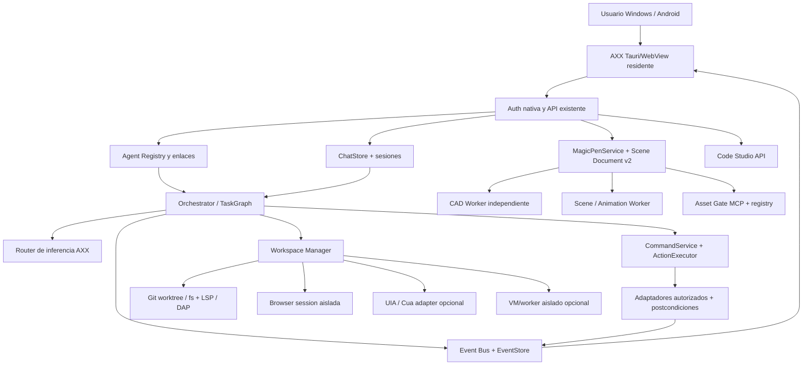

# 02 — Arquitectura objetivo y fronteras

## 2.1 Arquitectura C4 simplificada



**Frase de arquitectura:** «AXX orquesta y presenta; CommandService autoriza efectos; los trabajadores hacen trabajo especializado; SQLite registra estado; Magic Pen y Code Studio son vistas y capacidades, no ejecutores alternativos». El panel del usuario nunca monta shells o intérpretes desde texto producido por el modelo.

## 2.2 Límites de confianza

1. **WebView/UI:** no contiene claves de proveedores, comandos de host ni rutas privilegiadas no validadas. Solo interactúa con API autenticada del host.
2. **Backend AXX:** autoridad de identidades, sesiones, grants, scopes, journal de acciones, record/reconcile y datos de usuario.
3. **Worker local:** acceso explícito a carpetas, red y procesos; no se considera sandbox solo por ejecutar fuera de proceso.
4. **Worker remoto:** confianza diferenciada; cifrado, autenticación mutua, grants temporales, prohibido enviar capturas/archivos privados por defecto, retención declarada.
5. **Proveedor de modelos:** recibe únicamente el contexto necesario y autorizado por scope/proveedor; salida no confiable, nunca autoridad de permisos.
6. **Assets/plantillas/MCP:** datos externos no confiables; sanitizar HTML/SVG/glTF/archivos y verificar licencia, URL, hash.
7. **Identidad móvil/Telegram:** autorización propia; nunca usar el acceso del agente en PC como permiso móvil universal.

## 2.3 Subsistemas y contratos

| Subsistema | Entrada canónica | Salida canónica | Persistencia | Límite de permisos |
|---|---|---|---|---|
| Agent Registry | AgentProfileSpec | AgentProfile v# | tablas agente | perfil no ejecuta acciones |
| Conversation Binding | conversation_id + agent_id | membership | ChatStore + tabla aditiva | contexto explícito |
| TaskGraph | GoalSpec + scopes | tareas DAG con estados | SQLite | hereda permisos efectivos |
| Handoff Router | TaskContract | HandoffResult | SQLite + event log | atenuación de grants |
| Runtime Scheduler | ExecutionRequest | lease/deny/queue | SQLite + proceso | exclusividad por recurso |
| Workspace Manager | WorkspaceSpec | workspaceRef | DB+disco | root allowlist/sandbox |
| Code Studio | CodeChangeProposal | ChangeSet + tests | Git/worktree + DB | escritura limitada |
| Magic Pen Studio | SourceRevision/ScenePatch | SceneRevision | asset hash + DB | revisión/scope |
| Asset Registry | AssetDescriptor + license | AssetRef inmutable | content-addressed store | validación de origen |
| Event Hub | RuntimeEvent | SSE + snapshot | SQLite journal | ACL por conversación |

## 2.4 Estructura de código propuesta (no presente todavía)

```text
backend/
  agents/
    registry.py  bindings.py  profiles.py  policy.py
    orchestrator.py  task_graph.py  handoffs.py  events.py
    scheduler.py  recovery.py  routines.py
  workspaces/
    manager.py  leases.py  browser_sessions.py
    vm_provider.py  remote_protocol.py  focus_guard.py
  code_studio/
    projects.py  patch_engine.py  git_workspace.py
    file_versions.py  language_servers.py  debug_adapters.py
    test_runner.py  indexer.py  artifact_link.py
  spatial/
    scene_document.py  patches.py  asset_registry.py
    cad_contracts.py  render_jobs.py
1.AXX/scripts/
  agents/
    agent-designer.js  agent-roster.js
    agent-timeline.js  team-chat.js  work-approvals.js
  code-studio/
    code-workspace.js  code-editor.js  code-diff.js
    git-panel.js  problems-panel.js  terminal-panel.js
  magic-pen/
    diagram-editor.js  cad-editor.js
    scene-history.js  asset-browser.js  timeline-editor.js
workers/
  cad-worker/  scene-worker/  code-worker/  vm-gateway/
docs/evolution-3/  [copiar este paquete aquí]
```

Nombres modulares orientativos. Antes de abrir un PR, revisar estructura real y reutilizar servicios ya existentes (por ejemplo en `backend/actions`, `backend/inference`, `backend/memory`), sin duplicar semántica. Mantener adaptadores detrás de `CommandService`.

## 2.5 Contratos internos de referencia

- `AgentProfile` no incluye token de API ni conexión autenticada; solo referencias opacas a credenciales.
- `Task` tiene `task_id`, `run_id`, `graph_version`, `input_refs`, `agent_id`, `parent_id`, `lease`, `required_capabilities`, `state`, `attempt` y `idempotency_key`.
- `ExecutionRequest` incluye identidad de usuario, proyecto, conversación, scope de memoria vigente, operador, superficie, objeto destino, política de foco, presupuesto y postcondición.
- `SceneDocument v2` no transporta binarios en JSON; usa hashes y refs de STEP/GLB/SVG/PNG con metadata de fidelidad.
- `ChangeSet` incluye ref de worktree, archivo, sha256 antes/después, hunk, codificación, base revision, pruebas ejecutadas y estado de integración.
- `RuntimeEvent` identifica agente/ejecución/seq con payload limitado, sin secretos ni cadena de pensamiento.

## 2.6 Definiciones de ‘background’, ‘isolation’ y ‘mouse propio’

- **Background API/file:** no requiere foco Windows, puede continuar mientras usuario trabaja.
- **Background UIA:** acción semántica específica en una ventana con observación vigente y sin tomar foco; no implica compatibilidad universal.
- **Virtual pointer:** representación gráfica de interacción del agente; NO crea canal de entrada física separado.
- **Isolated desktop:** sesión de escritorio independiente (VM o runtime remoto) con mouse/teclado de dicha sesión; utiliza recursos reales y su disponibilidad debe probarse.
- **Same desktop multi-pointer:** experimental; no garantiza teclado/foco independiente. No base de aislamiento de agentes.

## 2.7 Descomposición operacional de un requerimiento

1. Normalizar texto/voz/pen a `GoalSpec` vinculado a conversación y contexto.
2. Seleccionar ruta rápida (respuesta sin herramientas) o TaskGraph complejo.
3. Resolver permisos y capacidad *antes* de asignar runtime.
4. Reservar workspaces/recursos, preparar artefactos de entrada por hash.
5. Ejecutar tareas permitidas; los efectos al host pasan por CommandService.
6. Verificar objetivos de salida mediante testers externos a la generación.
7. Consolidar resultados en chat original, con refs, estado y costes reales.
8. Si se cancela, liberar leases y conservar efectos confirmados; no fabricar rollback.

## 2.8 Decisiones anti-fragilidad

Agregar campos opcionales/versionados; no cambiar `chat_conversations` in place salvo migración explicada; evitar cadenas cíclicas de importaciones; separar adaptadores de presentación; proteger recursos del GPU; worker crash no tumba WebView; SSE con replay acotado; SQLite en transacciones cortas; operaciones con estado incierto recuperables por inspección, nunca inferidas completadas.
