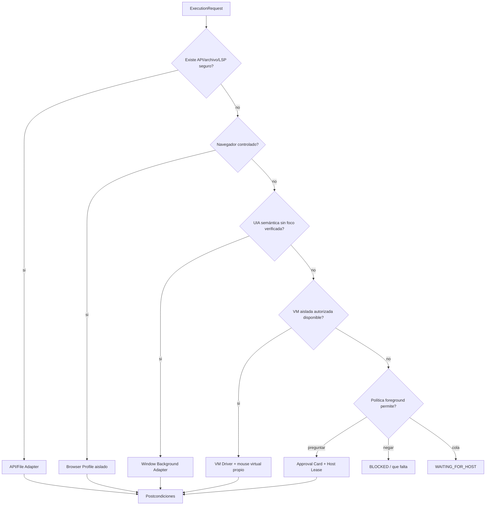

# 06 — Computer Use 2.0: mouse independiente, segundo plano y entornos gráficos

## 6.1 Objetivo realista

«Cada agente tiene su propio ratón» se traduce en **identidad visual y control lógico independiente**. En un escritorio físico Windows convencional, varios cursores virtuales no generan varios focos/teclados físicos independientes. AXX debe ofrecer una selección explícita entre: (a) APIs/archivos sin mouse, (b) navegador aislado con input propio de ese proceso, (c) acciones semánticas UIA/Win32 comprobadas que no roben foco, (d) escritorio VM/worker verdaderamente separado, (e) host foreground con consentimiento y lease exclusivo.

### Capacidades existentes en AXX

`docs/UNIFIED-EXECUTION.md` confirma `background` limitado a determinadas lecturas, `foreground` para acciones que afectan escritorio e `isolated` **NO disponible**. `backend/computer_use.py` contiene admisión efímera con ticket y `backend/actions/desktop_input.py` ata acciones a observación. Se prohíbe reclasificar una acción de `foreground` como `background` para satisfacer UX, o deshabilitar validación de observaciones.

### Referencias upstream

- `trycua/cua`: drivers y entornos de computer use; investigar por versión módulos de background control, cursor visual y compatibilidad con Windows. **No asumir que toda acción de toda app es background**.
- `alstonmendonca/openMouse`: multipuntero Windows experimental; su README confirma un solo foco Windows y restricciones teclado, validación inicial en un solo PC. Usarlo como referencia, NO como requisito de producción.
- `microsoft/winappCli`: descubrimiento de UI y automatización/sandbox Windows; estado public preview; investigar APIs antes de integrar.
- `OpenMausBot`: uso local/VM/nube según entorno y permisos; no importar infraestructura Electron al host Tauri.
- `Playwright` y browser-use: navegador aislado en CDP/perfil separado, evitar screenshots en todas las acciones si DOM/CDP resuelve.

## 6.2 Router de interacción

Router debe informar `selection_reason`, `requires_focus`, `isolation_level`, `app_capability_evidence` y si existe alternativa. Las capacidades se basan en tests versionados por app/OS, no en publicidad de un SDK.

## 6.3 Política de interferencia por agente

`foreground_policy` enum `ask`, `queue`, `isolated_only`, `deny`; si usa `ask`, la tarjeta debe especificar ventana/HWND/PID, tipo de acción y tiempo; en `queue` se espera una señal de disponibilidad del usuario, no solamente un cronómetro; en `isolated_only`, sin VM compatible la acción queda blocked. `deny` jamás hace fallback a host input. Existe opción separada `allow_observation_of_user_desktop` que no concede escritura.

`AttentionGuardian` usa únicamente actividad gruesa/ventana activa/estado de entrada, no keylogging ni contenido del documento. Respetar fullscreen, RDP, UAC y escritorio seguro. UAC/Secure Desktop nunca se automatiza eludiendo seguridad. Si el usuario toca el mouse durante un lease foreground, pausar nuevas acciones y preferir devolver control. No prometer cancelación retroactiva.

## 6.4 Mouse de agente

**Cursor visual:** overlay transparente con `agent_id`, color/paleta y tipología de acción. Fuente: telemetría `tool.dispatched` y `tool.progress` del runtime. No inventar pasos de «cursor trabajando» cuando realmente se está editando por API. Mantener hit testing/arrastre actual del avatar y la exclusión de input. Overlay se oculta cuando no hay mouse. «Ver su escritorio» abre stream de su VM/navegador solo con permiso de compartir captura; no colocar capture permanente del host.

**Cursor real independiente:** solo dentro de sesión gráfica distinta o interfaz multipuntero que supere pruebas y tenga garantía por app; multi-pointer en un solo desktop no resuelve foco de teclado. No utilizar hooks globales experimentales como requisito core.

## 6.5 Recursos: leases

- `host_input`: exclusividad global; proteger ventana enfocada y permisos, watchdog de liberación.
- `window(hWnd,pid,created)`: granularidad de ventana cuando UIA sin foco y no necesita exclusividad; distintos procesos pueden operar en paralelo tras certificar interacción.
- `browser_profile(agent_id)`: perfil segregado, CDP loopback no accesible desde red pública.
- `vm(session_id)`: identidad de sesión, CPU/RAM/storage/TTL, costo, snapshots; no reusar un guest con secretos de otro agente.
- `remote_computer`: autenticación de worker y scopes por tarea, confirmación explícita de transferencia de archivos.

Cualquier lease puede expirar, pero la acción física en vuelo no se deshace; al re-asignar verificar estado y obtener fencing token fresco. Windows inputs se tramitan mediante `CommandService`, no mensajes directos de modelos.

## 6.6 Diseño de VM/worker

`VMProvider` interfaz: `probe()`, `create(config)`, `start(id)`, `status(id)`, `observe(id,target)`, `act(id,action,proof)`, `upload_artifact`, `download_artifact`, `stop(id)`, `destroy(id)`. `probe` presenta requisitos reales; Windows Sandbox es efímero; Hyper-V o VM persistente es alternativa pero depende de edición Windows, soporte y memoria. Workers de Windows y Linux deben declarar capabilities, OS, driver y versión de herramientas. Nunca atribuir la capacidad de una VM Linux a una app específica de Windows.

**Aislamiento:** no heredar navegador principal del usuario, clipboard global ni directorios Home; usar staging y tokens temporales. Clips/montajes compartidos requieren autorización. Los logs/capturas tienen política de retención independiente.

## 6.7 Matriz por aplicaciones

| Categoría | Ruta preferente | Fallback | Estado esperado inicial |
|---|---|---|---|
| Edición código/archivos | FS patch/Git/LSP | editor visual y VM | Producción tras tests |
| Web app (formularios) | CDP/Playwright | VM browser | Ensayo con perfiles separados |
| Win32 UIA convencional | UIA semántica | foreground aprobado | Capacidad por control |
| Chromium canvas/SketchUp/AutoCAD | API/plugin nativo o bridge cuando exista | VM o foreground aprobado | No asumir background |
| Photoshop/Blender | CLI/API/plugins/adaptador acotado | VM o foreground aprobado | No asumir background |
| Diálogo privilegios/UAC | Ninguna automatizada | Usuario directo | Bloqueado |

No fingir que una ventana puede recibir escritura en segundo plano por `PostMessage(WM_CHAR)` cuando es WebView, canvas WPF, Chromium o UWP. Validar aplicación/versión/driver y postcondición.

## 6.8 Secuencia de verificación de no interferencia

1. Usuario mantiene foco en una ventana de edición con texto sin guardar; grabar ventana/estado inicial en test controlado.
2. Lanzar agente con `background` en otra app/VM; comprobar que GetForegroundWindow y cursor físico del usuario no cambian al ejecutar cada acción.
3. Inyectar acción que requiere foco; debe devolver `requires_foreground` o `blocked` sin efectuar movimiento.
4. En política `ask`, aceptar solo esa acción y observar foco y devolución; denegar debe dejar el escritorio intacto.
5. Crash del worker a mitad de tarea: liberar lease al detectar fallo; marcar operación `unknown` si hubo despacho.
6. Dos agentes apuntan a la misma ventana; garantizar exclusividad o rechazar. Usuario interactúa durante la prueba: nueva acción se detiene según AttentionGuardian.
7. Probar DPI 100/125/150%, múltiples monitores, ventana movida, PID reutilizado, pantalla bloqueada, RDP y UAC; no ampliar soporte no probado.

## 6.9 Antipatrones que se bloquean

- Intentar background y después usar `SendInput` silenciosamente.
- Crear cursores dibujados y afirmar que son dispositivos físicos.
- Compartir CDP del Chrome personal con todos los agentes.
- Levantar 4 VM Windows en laptop de 16 GB sin presupuesto/medición.
- Mantener secuencia de click después de perder target/proceso, observación o foco.
- Apagar sandbox con escritura pendiente y declarar rollback automático.
