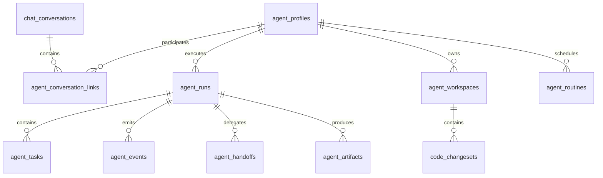

# 09 — Datos persistentes, SQL y migraciones sin pérdida

## 9.1 Principio de compatibilidad

AXX ya usa SQLite para chats, memorias y recibos. Se añaden **tablas versionadas**, no se reconstruye `chat_conversations` ni se modifica su TTL original. `sql/001_agent_foundation.sql` es un **diseño de migración**, compatible sintácticamente con SQLite moderno pero **no debe ejecutarse directamente en producción** hasta revisar versión SQLite, conexión `PRAGMA foreign_keys=ON`, rutas de almacenamiento, locking, constraints y migraciones concretas de repo. El agente de implementación debe adaptar el script al mecanismo transaccional y a la política de backups de AXX.

## 9.2 Entidades y relaciones

Nombres de tablas son **propuestos**. Nombres de campos `chat_conversations.id` están verificados en la fuente revisada. Mantener identidad de conversation en foreign key, `ON DELETE` debe ser revisado según TTL/forget y retención de recibos. Un borrado de contenido no puede dejar resúmenes privados en la memoria independiente.

## 9.3 Profile y permisos

`agent_profiles`: `agent_id UUID/text`, `revision`, `name`, `role`, `instructions`, `appearance JSON`, `intelligence JSON`, `voice JSON`, `status`, `created_at`, `updated_at`, `deleted_at` lógico. Credenciales **no** se guardan aquí. `agent_permissions` materializa `tool_id, resource_pattern, allowed_effects, approval_mode, expires_at, revision, granted_by_user` con esquema explícito; nunca copiar automáticamente permisos de otros agentes. `agent_team_memberships` representa equipos reutilizables separados de los miembros de cada conversación.

## 9.4 Run y eventos

`agent_runs`: ejecución vinculada a `agent_id + conversation_id`, objetivo, snapshot de permisos/configuration, estado y deadlines. `agent_tasks` representa nodos de DAG; `agent_handoffs` vínculo emisor/receptor; `agent_events` guarda secuencia incremental **por conversación** y payload limitado. Un ack SSE es de presentación, no de efecto. `agent_artifacts` referencia archivos por hash, tamaño, MIME, productor, visibility/ACL y vida útil. `agent_runtime_leases` registra recursos y fencing tokens, con corrección al reiniciar.

## 9.5 Workspaces/Code

`agent_workspaces`: tipo (`git_worktree`, `browser`, `vm_local`, `vm_remote`, `project_view`), root canonical validado, owner agent, project id, grant_ref, lifecycle, mount config opaca. `code_projects`: repo root, VCS info, approved roots. `code_changesets`: base ref, branch, worktree, estado, diff hash, tests, approval. `code_file_revisions`: cambios de hashes y conflictos. Copiar logs y archivos completos en SQLite puede crecer sin límite: mantener artefactos cifrados/almacén content-addressed y metadatos pequeños en DB.

## 9.6 Invariantes SQL y transacciones

- `PRAGMA foreign_keys=ON` en **cada conexión**, no solo script.
- `journal_mode=WAL` solo si backend actual y backup del usuario lo soportan; no forzar cambios globales de SQLite sin auditoría.
- Migration ledger (`schema_migrations`) with name/hash/transaction and `user_version` compatible con la estrategia actual; comprobar estado, no ejecutar 001 dos veces.
- `BEGIN IMMEDIATE` para operaciones críticas cortas; no mantener locks durante HTTP, LLM, compilación, copia grande o confirmación humana.
- `revision INTEGER > 0` y CAS `UPDATE ... WHERE revision=?`; `rowcount !=1` -> `stale_revision`.
- `event_id`/`operation_id` únicos e idempotentes; `seq` por conversación con `UNIQUE(conversation_id, seq)` y transacción para asignación.
- Límite del tamaño JSON, claves permitidas y version de schema validada antes de insertar.
- No usar `ON DELETE CASCADE` ciegamente sobre operación/journal hasta definir retención para auditoría y borrado del usuario.

## 9.7 Migración paso a paso

1. Tomar backup consistente (SQLite backup API, no copiar WAL en caliente de forma insegura) y manifestar SHA/row counts.
2. Registrar versión de esquema actual y abrir migración aditiva en branch de pruebas.
3. Crear tablas propuestas, índices y triggers *solo los comprobados*, sin tocar datos existentes.
4. Agregar perfil AXX principal como **vista/referencia read-through** al perfil global actual; no duplicarlo de forma que compita como autoridad.
5. Crear bindings opcionales para conversaciones convertidas. Conversaciones existentes sin binding se renderizan como chats normales.
6. Ejecutar compat tests legados con nuevo schema, luego tests nuevos de app/DB.
7. Prueba de restart con DB migrada, crash a mitad de migración, reintento y backup restore.
8. Activar flags de lectura primero, escritura después, ejecución más tarde.

## 9.8 Rollback del esquema

Rollback UI/feature puede hacerse deshabilitando flags, dejando tablas nuevas inertes. **No usar DROP TABLE como rollback de producción** si hay datos nuevos. Si es indispensable volver al instalador antiguo, comprobar que ignora tablas nuevas; si no, restaurar backup coherente después de exportar artefactos creados tras backup y obtener autorización. La migración de retorno requiere plan de conservación de datos, no comandos destructivos improvisados.

## 9.9 Retención y privacidad

Chats conservan TTL de 90 días de su documento canónico. Memoria de agente/proyecto tiene retención independiente **consentida y explícita**. Al olvidar un chat: cancelar tareas pendientes, revocar exports/refs/ACL y borrar derivados que contengan transcripciones expiradas, sin borrar evidencias mínimas que exige otra política hasta definirla. Informar qué proveedores externos conservaron datos fuera de AXX (no alegar borrado remoto sin confirmación).

## 9.10 Migración y pruebas

Validar migración sobre copia con 0, 1, 1000 y 100000 chats; referential integrity, índices, concurrencia, crash, agregados de uso y ficheros faltantes. Tests: **schema v1 legacy** debe seguir pudiendo abrir chats; `forgotten` no sale en index; dos clientes actualizar perfil con misma revisión -> uno conflict; agente desactivado no ejecuta; event replay ordenado y sin fuga; stale permissions blocked; artif hash mismatch. Todos los tests deben usar datos fabricados.
