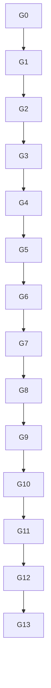

# 13 — Roadmap dependiente y puertas de aceptación

## Metodología

Trabajo incremental, una fase integrada a la vez. Una tarea se divide en cambios pequeños; se ejecuta plan, specs, tests, QA de compatibilidad, revisión, evidencia, rollback. CI de fuente primero; install Windows únicamente con source integrado/gates. Ninguna fase declara su funcionalidad implementada por tener mock, ruta o UI estática.

### Fase 0 — Baseline, dependencias y protección

**Input:** AXX `main` actual y cambios locales/otras ramas. **Output:** inventario de repo, ramas, tipos de pruebas, baseline de pantallas, datos/DB de prueba, licencia, budget de RAM/GPU, matriz de riesgos.

**Tareas:** crear branch/worktree aislado, capturar estado Git, leer AGENTS y docs actuales, ejecuta tests existentes, snapshot de formas/tentáculos/voz/pen/Android, crear manifest upstream fijado. **Gate G0:** baseline reproducible y políticas de release entendidas. **Rollback:** descartar worktree sin tocar cambios del usuario.

### Fase 1 — Superpowers / Agent Workflow Engine (sin multiagente chat aún)

Incorporar al `ActionLearning` existente workflows de plan/TDD/reviewer/verification, TaskGraph de tareas locales, tracing, cancellation/budget, roles de **ejecución interna limitada**, no perfiles persistentes nuevos todavía. **G1:** ninguna acción sin CommandService, crash safe/unknown, pruebas de workflow y superpowers.

### Fase 2 — Diagram Studio

AST diagramas, editor visual sobre Magic Pen, parches incrementales y export SVG/PNG/PDF; plantillas `diagram-design` selectivas. **G2:** nodos/edits realmente persistentes, sin regresión de pen.

### Fase 3 — CAD Studio

Worker CadQuery/OpenCascade, solids, STEP+GLB, cotas/unidades, cortes, explode y export; review licencia SOMA. **G3:** STEP físico probado, precisión/medidas según origen, worker aislado y kill/recovery.

### Fase 4 — Motion / Simulation

Storyboard/timeline reproducible, escenas interactivas, MP4 worker, steps de lecciones 3D, control de cámaras, narración opcional. **G4:** frames deterministas, export realmente reproducible y no bloquea voz.

### Fase 5 — Asset Gate + Diorama + Material Engine

Registry con assets por hash/licencias/size/LOD, MCP read-only, import, presets Diorama, QA por entidad, shaders selectivos Codevember y tentáculos conservados. **G5:** assets legales y render correcto, sin regresión hitmask/tentacles/escenas o GPU.

### Fase 6 — OpenVINO + estilos de splat opcionales

Provider worker con benchmark local y fallback controlado; splat renderer aislado cuando aporta valor. **G6:** proveedor detectado/comprobado, baseline sin degradación, dependencias opt-in.

### Fase 7 — Integración Magic Pen y aceptación nativa

Pruebas de fases 0–6 integradas, builds, screenshot parity, DPI/monitores, voz, Android, rollback. **G7:** baseline completa, suite Windows instalada, reporte de fuentes/versiones/licencias y `validate_companion.py` matching.

### Fase 8 — Agent Designer sobre chats

Tablas nuevas, perfiles, 24/9 forms canónicos, conversion de chats, bindings N:N, Agent Manifest, flags, grants. **G8:** conversion sin pérdida y sin desconfigurar AXX global o movilidad.

### Fase 9 — Code Studio Core

Monaco local, explorador, diff, patch/CAS, git worktrees, LSP básico, terminal de herramientas aprobadas, tests. **G9:** cambios reales en worktree, conflictos detectados y tests; usuario trabaja paralelo sin efectos host.

### Fase 10 — Background Workspaces / cursores

Router `api -> browser -> UIA -> isolated -> ask`, AttentionGuardian, leases y política por agente; adaptador Cua opcional verificado; VM/remote driver opcional; cursor visual correlacionado a acciones reales. **G10:** fondo sin robar foco, denial correcto, VM con mouse real de guest si configurada; **NO** anunciar host multi-pointer universal.

### Fase 11 — Orquestación multiagente de chat

Team UI en mismo chat, registry, handoffs, TaskGraph multiagent, verifier, SSE, scopes, recurso budget y recovery. **G11:** dos agentes con artefactos y third-party review real, sin fuga de contexto, sin doble ejecución.

### Fase 12 — Code Studio Pro y agentes avanzados

DAP, indexado estructural, proyectos múltiples, CI, preview, integración GitHub opcional, plugins de toolchain, sincronización de diffs y revisiones. **G12:** proyecto real de prueba end-to-end con PR solo mediante autorización, editor estable y rollback.

### Fase 13 — Routines, proactividad, móvil y remoto

Schedules, webhooks verificados, guardrails, reanudación con worker remoto, transferencias selectivas, resume/abort, equipo persistente. **G13:** acciones desatendidas autorizadas, interrupción/revocación, costes y recovery ensayados.

## Matriz de dependencias

Si una capacidad es independiente, se pueden desarrollar pruebas en branch paralelo **sin fusionar ni habilitar** antes de sus predecesores. La tabla representa orden de aceptación/publicación, no prohibición de prototipos aislados. Todo branch paralelo debe operar sobre archivos disjuntos o coordinar un integrador único; no sobrescribir trabajo de otras sesiones.

## Entrega por fase

1. `spec.md` y scope de archivos.
2. SQL/esquemas si cambia datos.
3. tests FAIL iniciales que demuestran ausencia de la capacidad (cuando aplicable).
4. implementación mínima que pasa tests.
5. revisión independiente y falsos positivos.
6. compat regresión local + Windows instalado donde corresponde.
7. evidencia, license inventory, rollback probados.
8. actualización docs y release solo si autorizada y completa.

**Regla antidegradación:** si falla un gate, corregir en la misma fase; no introducir un workaround que desactiva seguridad/permisos, reduce calidad del avatar o marca SKIPPED como PASS.
