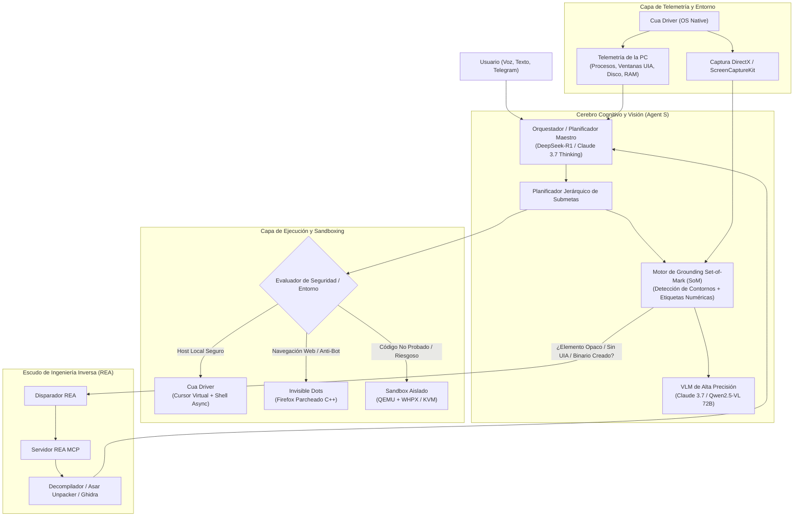
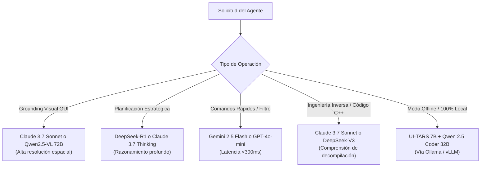

# Plan Maestro de Integración: Super-Agente Autónomo de Escritorio (Agent S + Cua + REA + Invisible Dots)

> Propuesta histórica, no inventario de capacidades. Las garantías de precisión
> absoluta, escritura universal sin foco, inmunidad antibot y modelos fijos que
> aparecen abajo no son criterios válidos de aceptación. La especificación
> revisada es `../AXX_ARQUITECTURA_UNIFICADA_REVISADA_2026-10-25.md` y el estado
> ejecutable está en [UNIFIED-EXECUTION.md](UNIFIED-EXECUTION.md). Los apartados
> originales se conservan para trazabilidad; no habilitan herramientas.

Este documento establece la arquitectura técnica, el diseño de subsistemas y la hoja de ruta de implementación para unificar las mejores tecnologías abiertas de agentes de computadora en un único sistema autónomo capaz de:
1. **Ver la PC con precisión absoluta** (eliminando errores de clics mediante Set-of-Mark de Agent S).
2. **Ejecutar comandos e interactuar en segundo plano** sin interrumpir al usuario físico (Cua Driver).
3. **Comprender y desensamblar software cerrado** cuando no existan APIs o accesibilidad (REA MCP).
4. **Ejecutar tareas riesgosas o de navegación protegida en entornos aislados indetectables** (Invisible Dots).
5. **Enrutar inteligentemente a los mejores modelos** según costo, latencia y precisión visual.

---

## 1. Diagrama de Arquitectura Unificada

---

## 2. Índice de Skills Creados en el Repositorio

Para dotar al sistema de modularidad y que cualquier subagente o proceso conozca su responsabilidad, se han generado los siguientes skills dentro de la carpeta `.agents/skills/`:

| Nombre del Skill | Enlace al Archivo | Propósito Principal |
| :--- | :--- | :--- |
| **`agent-s-vision-grounding`** | [SKILL.md](file:///c:/Users/luigi/Desktop/axx2/.agents/skills/agent-s-vision-grounding/SKILL.md) | Captura de pantalla, DPI scaling, generación de marcas visuales Set-of-Mark (SoM) y conversión de tags a coordenadas exactas $(x, y)$. |
| **`cua-os-driver`** | [SKILL.md](file:///c:/Users/luigi/Desktop/axx2/.agents/skills/cua-os-driver/SKILL.md) | Control de ratón y teclado en segundo plano con cursor virtual, inspección del árbol nativo Windows UIA y ejecución asíncrona de comandos de shell. |
| **`rea-reverse-engine`** | [SKILL.md](file:///c:/Users/luigi/Desktop/axx2/.agents/skills/rea-reverse-engine/SKILL.md) | Triaje de ejecutables opacos, extracción de bundles Electron (`app.asar`), decompilación .NET/C++ y análisis de tráfico local IPC cuando una ventana no expone accesibilidad. |
| **`stealth-vm-sandbox`** | [SKILL.md](file:///c:/Users/luigi/Desktop/axx2/.agents/skills/stealth-vm-sandbox/SKILL.md) | Despliegue de máquinas virtuales ligeras QEMU para aislar tareas y automatización de navegación web inmune a bloqueos de Cloudflare con Firefox C++. |
| **`model-router-matrix`** | [SKILL.md](file:///c:/Users/luigi/Desktop/axx2/.agents/skills/model-router-matrix/SKILL.md) | Matriz dinámica de selección de modelos: asigna el LLM/VLM óptimo según el costo, latencia y especialización técnica. |

---

## 3. Especificación Técnica de los Subsistemas

### A. Subsistema de Visión y Percepción Espacial (Agent S Core)
* **Desafío:** Evitar que el agente clique en falso o alucine sobre la pantalla de Windows.
* **Solución Técnica:**
  1. El driver captura la imagen cruda mediante APIs de hardware (Desktop Duplication API en Windows).
  2. Se extrae en paralelo el árbol nativo de `IUIAutomation`.
  3. Si la ventana expone elementos accesibles, se superponen recuadros con ID numérico en sus coordenadas.
  4. Si la ventana es gráfica/canvas sin accesibilidad, un modelo ligero de detección de objetos (YOLOv8-UI o PaddleOCR) detecta los contornos de los botones y genera los IDs numéricos.
  5. La imagen con las etiquetas Set-of-Mark se envía al VLM, el cual sólo devuelve el número de la marca a presionar.

### B. Subsistema de Ejecución y Conciencia Ambiental (Cua Driver)
* **Conciencia de Estado (Environment Awareness):**
  * El agente mantiene un mapa en memoria de:
    * Ventana activa y lista de ventanas visibles con sus PIDs.
    * Estado de CPU, RAM disponible y espacio en discos duros.
    * Rutas de proyectos detectadas en el equipo.
* **Control no invasivo:**
  * Uso de ventanas transparentes overlay para simular el clic y el movimiento del cursor virtual sin quitarle el ratón de las manos al usuario físico.
  * Ejecución de comandos mediante PowerShell 7 en subprocesos aislados con captura de streams `stdout`, `stderr` y códigos de retorno.

### C. Subsistema de Ingeniería Inversa Autónomo (REA Fallback)
* **Condición de activación:** Cuando una ventana objetivo arroja un árbol UIA nulo y la visión estándar falla, o cuando el usuario solicita interactuar con una aplicación no documentada.
* **Flujo REA:**
  1. Identificar el ejecutable asociado al PID de la ventana.
  2. Si es Electron: extraer `resources/app.asar` y analizar `package.json` y los endpoints del preload.
  3. Si es binario nativo: pasar la dirección de la ventana o binario a Ghidra Headless mediante el servidor REA MCP para extraer strings, nombres de clases o puertos de red abiertos (`netstat -ano | findstr <PID>`).
  4. Generar un informe técnico interno para que el agente planificador sepa exactamente cómo comunicarse con el software.

### D. Subsistema de Navegación Sigilosa y Sandboxing (Invisible Dots)
* **Condición de activación:** Tareas web con CAPTCHAs/Cloudflare agresivo o ejecución de scripts descargados de fuentes no verificadas.
* **Infraestructura:**
  * Host Windows: Aceleración vía Windows Hypervisor Platform (WHPX).
  * Host Linux: KVM nativo.
  * Navegador: Firefox con parches en C++ para neutralizar la detección de WebGL, Canvas y atributos `navigator.webdriver`.

---

## 4. Matriz de Recomendación y Selección de Modelos

---

## 5. Hoja de Ruta de Implementación por Fases

### Fase 1: Percepción Visual y Conexión del Driver Local (Actual)
- [x] Creación de skills modulares en `.agents/skills/`.
- [ ] Enlace del pipeline de captura de pantalla con el módulo de anotación Set-of-Mark.
- [ ] Implementación del bucle `Observe -> Set-of-Mark -> Decide -> Virtual Click`.
- [ ] Integración del comando de inspección ambiental (procesos, ventanas, discos).

### Fase 2: Integración de REA MCP (Ingeniería Inversa)
- [ ] Registro del servidor local REA MCP en la configuración del agente.
- [ ] Conexión del extractor de Electron `.asar` para desarmar interfaces de aplicaciones modernas.
- [ ] Manejador de excepciones: si un clic falla 3 veces en una ventana opaca, invocar `rea-reverse-engine`.

### Fase 3: Sandboxing Aislado y Navegación Sigilosa
- [ ] Configuración del backend de virtualización QEMU con aceleración WHPX.
- [ ] Despliegue de `invisible_playwright_mcp` con Firefox C++ para automatizaciones web críticas.

### Fase 4: Telemetría Remota y Control por Telegram (Futuro)
- [ ] Creación del demonio en segundo plano (Windows Service / Systemd).
- [ ] Puente bidireccional de Telegram con envío de capturas anotadas en tiempo real y confirmación remota de acciones críticas.

---

## 6. Protocolo de Verificación y Aceptación

Para dar por validada la integración, se deberán superar los siguientes tests de estrés:
1. **Prueba de Grounding:** El agente debe pulsar un botón específico en una ventana a escala 150% DPI sin fallar la coordenada por más de 2 píxeles.
2. **Prueba de Shell:** El agente debe listar los procesos de Windows, filtrar el PID de una app objetivo y obtener su ruta en disco sin intervención humana.
3. **Prueba REA:** El agente debe inspeccionar una aplicación Electron local empaquetada, extraer su `app.asar` e identificar sus canales IPC internos.
4. **Prueba de Inocuidad:** Ninguna acción del agente debe secuestrar el ratón físico del usuario mientras este escribe en otra ventana.
